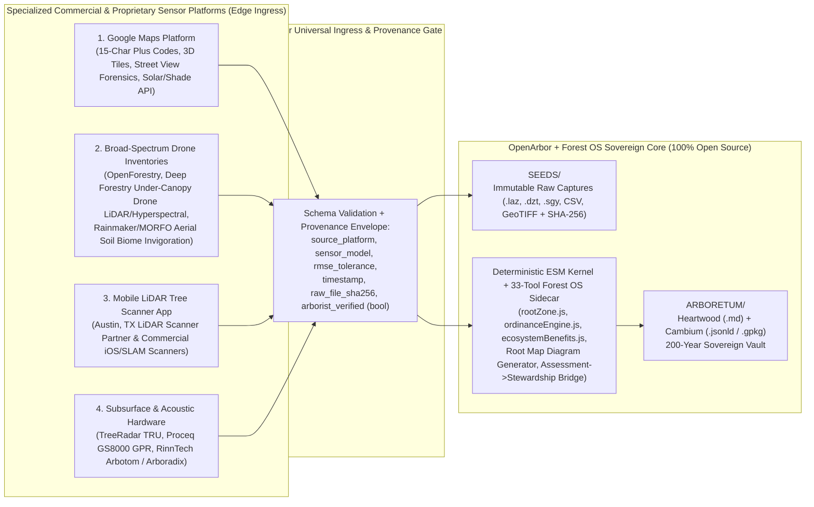
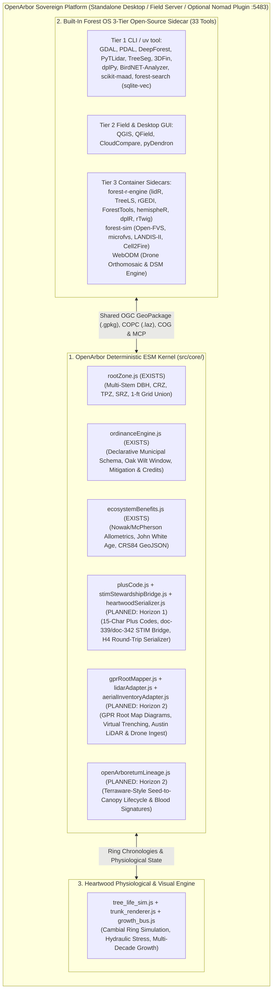

# OpenArbor & Bodhi: The Sovereign Architectural Blueprint (2026 to 2031, Designed for 2226)

> **Review note (Hermes, 2026-10-13).** Moved into the repo from the AG brain dir and
> verified against the live system. This file previously lived at
> `~/.gemini/antigravity/brain/63a3d87e-7afc-4989-990f-2970d60f331d/openarbor_2031_strategic_spec.md`
> and was not version-controlled. Six defects were corrected in place:
> 1. The Austin statutory example was wrong. It claimed protection begins at 24 inches.
>    Per Austin LDC 25-8 and Ordinance 20100204-038, **Protected Tree is 19" DBH+**
>    (residential) and **8"** (commercial/multifamily); Heritage Tree is 24"+ but only
>    for an eligible species list. Ashe juniper is not on that list, so the example
>    tree was a Protected Tree, not a Heritage Tree.
> 2. The Section 4 kernel diagram listed six modules as current. Three exist
>    (`rootZone.js`, `ordinanceEngine.js`, `ecosystemBenefits.js`); five are now
>    marked PLANNED (`stimStewardshipBridge.js`, `gprRootMapper.js`, `lidarAdapter.js`,
>    `openArboretumLineage.js`, `aerialInventoryAdapter.js`).
> 3. Section 5.1 used `FOREST/` as the fourth vault namespace while claiming to follow
>    finalized naming. Corrected to `HEARTWOOD/` per the 2026-10-08 seven-organ decision.
> 4. Added a disambiguation note for the "Heartwood" collision: the `HEARTWOOD/`
>    directory vs. a Heartwood `.md` file. Both senses remain in this document.
> 5. Fixed a broken citation: `Heartwood/tree_life_sim.js` resolves at `Heartwood/src/`.
> 6. Corrected the Caddy claim. The spec described the port 5483 workbench as deployed;
>    `caddy` is not installed on this machine. The 33-tool catalog is real.
>
> Verified as genuine and unchanged: `tests/verify_openarbor.mjs` passes 3/3 with zero
> proprietary dependencies; `forestry-tools.json` enumerates exactly 33 tools plus 4
> supporting apps; the Base44 purge is complete (3 remaining references are all
> historical narrative); brain docs `doc-339`, `doc-342`, `doc-343` exist in the Mycelial
> Brain (the local `Brain_Exports/` mirror is stale on these three).
>
> **One open decision for George, not changed here.** Horizon 1 lists MCP wrapping plus
> five assessment forms plus two sensor adapters plus the Nomad plugin package. That is
> four products in year one. Section 8's kill criteria are the strongest part of this
> document; scope is the biggest risk to it. Recommend cutting Horizon 1 to one
> deliverable before implementation starts.
>
> **Reconciliation note (Rocky, 2026-10-14).** Reconciled against the complete Horizon 1 engineering specification in [`docs/14_HORIZON1_IMPLEMENTATION_SPEC.md`](file:///home/george/Myceliate_Master/ARBORETUM/Active/OpenArbor/docs/14_HORIZON1_IMPLEMENTATION_SPEC.md) (`OA-SPEC-014`). The scope cut recommended above is now active: Horizon 1 executes **`openarbor-mcp` (14 deterministic tools) + the Hypothesis 4 Heartwood/Cambium Reconstructibility Engine** first, while GUI forms, hardware sensor adapters, and container packaging move to Horizon 2 behind falsifiable pull-forward triggers ([`14_HORIZON1_IMPLEMENTATION_SPEC.md` §1.2](file:///home/george/Myceliate_Master/ARBORETUM/Active/OpenArbor/docs/14_HORIZON1_IMPLEMENTATION_SPEC.md#L79-L91)). Section 9 at the bottom of this document records all seven reconciled disagreements and the rulings on the five Horizon 1 architectural additions.

**Scope:** [`ARBORETUM/Active/OpenArbor`](file:///home/george/Myceliate_Master/ARBORETUM/Active/OpenArbor) + [`ARBORETUM/Active/Forest_OS`](file:///home/george/Myceliate_Master/ARBORETUM/Active/Forest_OS) (Native 33-Tool Sidecar) + Optional [`Project Nomad`](file:///home/george/Myceliate_Master/ARBORETUM/Active/Neocambrian_Nomad_Customization.md) Stewardship Plugin  
**Horizon 1 Implementation Specification:** [`docs/14_HORIZON1_IMPLEMENTATION_SPEC.md`](file:///home/george/Myceliate_Master/ARBORETUM/Active/OpenArbor/docs/14_HORIZON1_IMPLEMENTATION_SPEC.md) (`OA-SPEC-014`)  
**Constitutional Foundation:** STIM Protocol v7.0011 (`DOI 10.5281/zenodo.21297458`, `doc-343`)  
**Architectural Horizon:** 5-Year Execution Roadmap (`2026` to `2031`) anchored in a **200-Year Minimum Data Sovereignty Horizon (`2026` to `2226`)**  
**Mode:** `Advise` (Master Architect Deep Specification; Reconciled with `OA-SPEC-014`)

---

## 1. The Human Truth of Arboriculture: Why Existing Software Fails the Field

Software built for urban forestry and arboriculture almost universally fails the people who touch trees because it is designed by SaaS product managers who view a tree as a static database row on a two-year subscription cycle. Existing software treats trees as inventory items to be depreciated and costs to be minimized. As established in `doc-343` (*STIM Protocol Reference Implementation*), that framing is thermodynamically dishonest: a 150-year-old Plateau Live Oak (*Quercus fusiformis*) or coastal Douglas-fir (*Pseudotsuga menziesii*) sequesters carbon, intercepts stormwater, cools roofs, stabilizes soil, and shelters biodiversity. It is not depreciating; it is compounding **Biological Equity**.

When we synthesize the nested project artifacts across [`OpenArbor/docs/`](file:///home/george/Myceliate_Master/ARBORETUM/Active/OpenArbor/docs), [`Soil_Grower_GPR_Service`](file:///home/george/Myceliate_Master/ARBORETUM/Active/Soil_Grower_GPR_Service/GPR_Technology_Research.md), [`Open_Arboretum`](file:///home/george/Myceliate_Master/ARBORETUM/Active/Open_Arboretum/Open_Arboretum_Manifest.md), and [`Heartwood`](file:///home/george/Myceliate_Master/ARBORETUM/Active/Heartwood/SPEC-13_implementation_plan.md), six distinct human archetypes emerge. OpenArbor and Bodhi are designed around what each human dreads and what they genuinely desire.

### 1.1 The Six Human Archetypes & Their Unmet Desires

| Archetype | The Daily Friction & Anxiety | What They Genuinely Desire from OpenArbor & Bodhi |
| :--- | :--- | :--- |
| **1. The Climbing & Field Arborist** | Standing in `98°F` heat with sweaty, pitch-stained gloves, chainsaws and woodchippers running at `105 dB`, trying to tap tiny dropdown menus on a sun-washed phone screen with zero cell signal. Existing apps turn skilled craftspeople into frustrated data-entry clerks. | **Hands-Free Respect for Craft & Field Voice:** Speak naturally while eyes stay on the canopy (`"Tag 104, 30-inch Ashe juniper, root compaction 2 out of 10"`). Receive clear **Field Voice** feedback (`"Tag 104 is a 30-inch Ashe juniper. That is a Protected Tree in Austin: 19 inches DBH and larger needs a permit, residential or commercial. It is not a Heritage Tree: Ashe juniper is not on the eligible species list, so the 24-inch Heritage tier does not apply."`, `doc-342`) with exact statutory citations attached underneath. |
| **2. The Consulting Arborist (`ISA` / `ASCA` / `RCA`)** | Spending 4 hours in the field doing meaningful diagnostic work, then losing 10 hours on Sunday night wrestling with Excel formulas, Word tables, CAD exports, and poorly indexed municipal PDFs (`eCode360`, `Municode`). Carrying the constant legal anxiety of missing an obscure clause (such as Liberty Hill's ascending whole-tree cap vs. retained-tree credit consumption in [`central_texas_ordinances.json`](file:///home/george/Myceliate_Master/ARBORETUM/Active/OpenArbor/data/ordinances/central_texas_ordinances.json)) that gets a client's permit rejected. | **Ironclad Statutory & Subsurface Authority:** Walk off the site with the Tree Preservation Plan (`TPP`), TRAQ risk matrix ([`09_FEATURE_BRIEF_ASSESSMENT_FORMS.md`](file:///home/george/Myceliate_Master/ARBORETUM/Active/OpenArbor/docs/09_FEATURE_BRIEF_ASSESSMENT_FORMS.md)), LiDAR stem scans, and Ground Penetrating Radar (`GPR`) root map diagrams already 95% complete. Every number traces to a cited statute or peer-reviewed equation defensible in court. |
| **3. The Civil Engineer, Architect & Developer** | Discovering a protected Heritage Tree conflict *after* grading and utility plans are 90% drawn, triggering a `\$40,000` mitigation fee, a 60-day municipal variance delay, or an adversarial standoff with neighborhood preservationists. | **Pre-Design Counterfactual Clarity:** Before drawing a single trench line, overlay the **GPR Root Map Diagram** onto the CAD/Google Map and ask Bodhi: *"If I shift this storm sewer 4 feet north and use air-spade root bridging on Tree #12, how much mitigation fee do I save and do I stay out of a Planning Commission variance?"* |
| **4. The Municipal Urban Forester & Plan Reviewer** | Buried under inconsistent, hand-calculated PDF submittals where developers miscalculate multi-stem DBH, ignore overlapping Critical Root Zones, or pay into a tree fund because nobody verified whether replacement stock could fit on site. Watching 40% of newly planted `2.5-inch` caliper mitigation trees die within 24 months from root-bound nursery stock and compacted soil. | **Verifiable Machine-Readable Submittals & Survival Proof:** Receive an `OGC CRS84` GeoJSON + `GeoPackage` submittal that passes [`verify_openarbor.mjs`](file:///home/george/Myceliate_Master/ARBORETUM/Active/OpenArbor/tests/verify_openarbor.mjs) in 50 milliseconds with exact statutory trace strings, paired with a verifiable genetic and survival record (`Blood Signature`) for every replacement tree planted. |
| **5. The Native Nursery Grower (`Open Arboretum`)** | Growing native trees takes 3 to 7 years of capital, water, and labor before a single sale. Growers guess what species municipalities and developers will need 36 months from now, while superior wild genetics are paved over before acorns or cuttings can be collected. | **Forward Demand Contracts & Terraware-Grade Seed-to-Canopy Tracking:** Bodhi aggregates upcoming municipal mitigation deficits across the watershed and connects growers to pre-funded propagation orders, tracking every batch from wild mother tree in `SEEDS/` to out-planting via the [`Open Arboretum Blood Signature`](file:///home/george/Myceliate_Master/ARBORETUM/Active/Open_Arboretum/Open_Arboretum_Manifest.md). |
| **6. The Private Land Steward & Multi-Generational Owner** | Hiring a tree service or consultant, receiving a static PDF on an email account that disappears in 8 years, and losing all institutional memory of when an ancient oak was treated for Oak Wilt, where root flares were excavated, or which seedlings came from the family's 300-year-old mother tree. | **A Living 200-Year Land Chronicle:** A self-contained, plain-text and spatial archive (`Heartwood/Cambium`) that lives on their own hardware and physical media, readable in `2226` by their great-grandchildren without any software subscription. |

---

## 2. Constitutional Foundation: The Seven STIM Protocol Axioms as Architecture

In OpenArbor, ethics and engineering are the same thing (`doc-343`, `STIM Protocol v7.0011`, `DOI 10.5281/zenodo.21297458`). The seven nature-derived axioms are not a post-hoc compliance checklist; they are compile-time and inference-time constraints that govern every data structure, deterministic calculation, and agent action, serving as our primary **test oracle**:

| STIM Axiom | Architectural Implementation in OpenArbor | Live Verification & Bug-Catching Oracle (`doc-339`, `doc-342`, `doc-343`) |
| :--- | :--- | :--- |
| **1. Thermodynamic Honesty** | Zero greenwashing and zero fabricated metrics. Every ecological claim links to a cited equation in [`ecosystemBenefits.js`](file:///home/george/Myceliate_Master/ARBORETUM/Active/OpenArbor/src/core/ecosystemBenefits.js) or [`rootZone.js`](file:///home/george/Myceliate_Master/ARBORETUM/Active/OpenArbor/src/core/rootZone.js). | If `overall_health_score` or `carbon_sequestration_lbs_per_year` is null, the engine stays silent and prompts the user to run the calculator rather than inventing a fallback estimate. |
| **2. Mycelial Connectivity** | No entity is isolated. The **Ordinance Intelligence Bridge** chains `Tree -> Property -> Municipality -> OrdinanceProvision -> StewardTask`. The **Guild Economy** chains `MotherTree (SEEDS) -> NurseryBatch -> Job -> PlantedTree -> StewardTask -> EcologicalOutcome`. | Prevents "orphan records" and catches false-negative ordinance lookups by walking best-first across municipal records (`validated -> complete -> processed -> raw`) rather than trusting a single unindexed scrape. |
| **3. Carrying Capacity Respect** | The **Assessment-to-Stewardship Engine** (`doc-339`) evaluates biological limits via 6 deterministic rules (Zero LLM cost):<br/>1. Hazard (`Emergency` or `health <= 3/10`) -> Urgent (3-day due)<br/>2. Structural defects -> High (14-day due)<br/>3. Pest/disease present -> High (7-day due)<br/>4. Root/soil compaction (`<= 4/10`) -> Medium (30-day due)<br/>5. Canopy/trunk decline (`<= 4/10`) -> Medium (30-day due)<br/>6. Assessor recommendations -> Medium (21-day due) | Turns biological decline indicators (`root condition <= 4/10`, `soil condition <= 4/10`) into immediate, scheduled restorative action (`Biochar / Air-Spade / Mycorrhizal Inoculation`) before irreversible mortality occurs. |
| **4. Memory Stasis** | Append-only history (`Archive-Never-Delete`). Auto-generated tasks carry idempotent provenance markers (`[assessment:ID][rule:KEY]` and `[assessment:ID][ordinance:provisionID]`). Longitudinal measurements append to `EcologicalTimeSeries`. | Re-running an evaluation on an updated assessment never duplicates tasks or overwrites prior historical observations. |
| **5. Human Primacy at the Boundary** | The system recommends; the human decides. Auto-generated tasks display an emerald `"From assessment"` badge; protected-tree cutting tasks display an amber `"Permit required"` badge (`Acknowledge this before the crew is dispatched`). Outputs use **Field Voice** first, with formal statutory citations attached below. | Guarantees that neither Bodhi nor an automated workflow ever dispatches a crew or files an external municipal submittal without explicit human sign-off. |
| **6. Citation Integrity** | Every calculation and permit verdict reads from stored, hash-verified records and cites the exact statutory section, source URL/PDF hash in `SEEDS/`, last-verified date, and explicit confidence level (`HIGH / MEDIUM / LOW / UNVERIFIED`). | If a municipality (e.g., an unextracted code) lacks verified thresholds, the engine explicitly states `"Confidence: UNVERIFIED"` rather than guessing. Measurement source (`manual_tape`, `lidar_scanner`, `drone_segmentation`, `gpr_radargram`) is permanently bound to every number. |
| **7. Intrinsic Value (Biological Equity)** | Trees are compounding biological assets. Whenever a removal or encroachment permit task is generated, OpenArbor automatically attaches the tree's quantified annual stormwater, carbon, cooling (`kWh`), and pollinator value at risk. | Section-header context parsing ensures invasive/prohibited species lists (such as Oakland's eucalyptus removal encouragement list in `doc-342`) are never falsely flagged as protected heritage trees. |

---

## 3. Open-Source Sovereignty & The Universal Sensor/Platform Ingress Architecture

### 3.1 Purging Legacy Cloud Lock-In (100% Open-Source Core)
Earlier planning documents in [`docs/00_MASTER_BLUEPRINT.md`](file:///home/george/Myceliate_Master/ARBORETUM/Active/OpenArbor/docs/00_MASTER_BLUEPRINT.md), [`docs/06_FOUNDER_PROVISIONING_CHECKLIST.md`](file:///home/george/Myceliate_Master/ARBORETUM/Active/OpenArbor/docs/06_FOUNDER_PROVISIONING_CHECKLIST.md), and [`docs/12_POCKET_HARDWARE_INTEGRATION_STRATEGY.md`](file:///home/george/Myceliate_Master/ARBORETUM/Active/OpenArbor/docs/12_POCKET_HARDWARE_INTEGRATION_STRATEGY.md) referenced proprietary cloud infrastructure (`Firebase Auth`, `Firestore`, `Neo4j Enterprise`, `AWS S3`, `@base44/sdk`, `Fulcrum`, and closed `HeyPocket` cloud APIs).

OpenArbor replaces every one of those core infrastructure dependencies with **100% open-source, sovereign software**:
* **Core Compute & Sidecars:** Pure **Node.js ESM** (`OpenArbor` kernel) + native **[`Forest_OS`](file:///home/george/Myceliate_Master/ARBORETUM/Active/Forest_OS/AGENTS.md) 33-Tool Forestry Sidecar** (planned `Caddy 2` workbench on port `5483` / `LIVE`; **not yet installed on this machine** (`which caddy` returns nothing as of 2026-10-13). The 33-tool catalog itself is real: [`forestry-tools.json`](file:///home/george/Myceliate_Master/ARBORETUM/Active/Forest_OS/04_Configuration/forestry-tools.json) enumerates exactly 33 tools plus 4 supporting applications.) Plus open-source nursery/seed-bank patterns inspired by **Terraware** (`terraware.io` Apache 2.0 seed-to-canopy lifecycle). Also planned: `GDAL`, `PDAL`, `QGIS`, `QField`, `CloudCompare`, `lidR`, `TreeLS`, `3DFin`, `DeepForest`, `dplPy`, `Open-FVS`, `LANDIS-II`, `WebODM`, `BirdNET-Analyzer`.
* **Spatial & Relational Persistence:** **SQLite 3 + SpatiaLite + `OGC GeoPackage (.gpkg)`** for single-file, 200-year portable field and desktop vaults, scaling to containerized **PostgreSQL + PostGIS** for multi-crew concurrency.
* **Semantic & Graph Memory (`STIM`):** **Heartwood/Cambium Markdown + JSON-LD** + **Resolver Protocol v1 (`PTR` edges)** + **`forest-search` (`sqlite-vec` + local `Ollama nomic-embed-text`)** + embedded **KùzuDB**.
* **Peer-to-Peer Sync & Voice I/O:** **Any-Sync CRDTs** ([`07_ARBORACLE_ANYTYPE_INTEGRATION_PROPOSAL.md`](file:///home/george/Myceliate_Master/ARBORETUM/Active/OpenArbor/docs/07_ARBORACLE_ANYTYPE_INTEGRATION_PROPOSAL.md)) + **QFieldSync** + **Syncthing** + open Bluetooth bone-conduction hardware running local **`Whisper.cpp` / `Moonshine`** and local grammar-constrained LLMs (`Ollama` / `vLLM`).

### 3.2 How OpenArbor Relates to Project Nomad (Standalone OS + Modular Nomad Plugin)
To state the architectural boundary with complete clarity:
1. **OpenArbor + Forest OS is a standalone, primary operating platform.** It runs natively on any Linux, macOS, or Windows workstation, field tablet, or ruggedized truck server without requiring Project Nomad. The 33 open-source tools of [`Forest_OS`](file:///home/george/Myceliate_Master/ARBORETUM/Active/Forest_OS/04_Configuration/forestry-tools.json) ship as OpenArbor's own built-in sidecar (`openarbor-forestry-sidecar`).
2. **OpenArbor Plugs Into Project Nomad as a Land Stewardship Cartridge (`openarbor-nomad-plugin`):**
   * For users running **Project Nomad** ([`crosstalk-solutions/project-nomad`](file:///home/george/Myceliate_Master/ARBORETUM/Active/Forest_OS/01_Docs/NOMAD_INTEGRATION.md)), OpenArbor installs cleanly as a single plugin on **Port `5483` (`LIVE`)**.
   * **Maximum Creativity for the Global Project Nomad Community:** Beyond serving professional arborists, how can OpenArbor enrich the broader Project Nomad ecosystem of off-grid homesteaders, rural land stewards, disaster-response teams, and community sanctuaries?
     * **The Nomad Offline Land Steward ZIM (`openarbor-stewardship.zim`):** OpenArbor compiles an offline Kiwix ZIM archive containing illustrated North American & global tree identification keys, `ANSI A300` / `ISA` emergency storm-damage hazard triage guides, structural root protection rules, agroforestry/biochar kiln blueprints, and soil mycorrhizal inoculation manuals.
     * **The Nomad AI Land Advisor (`openarbor-mcp` for Nomad Chat):** Plugs into Nomad's built-in Ollama/Qdrant chat so any off-grid landowner can ask: *"A 32-inch oak is leaning 15 degrees toward my barn after a storm and has a fungal conk at the base; how do I evaluate its windthrow risk and where is the drop zone?"*
     * **Decentralized Seed & Mother-Tree Ark:** Every Nomad box running the OpenArbor plugin can act as a local node in the `Open Arboretum` seed registry, cataloging drought- and blight-resistant wild mother trees in its bioregion.

### 3.3 Strategic Proprietary Sensor & Platform Ingress Bridges ("Sovereign Core, Universal Adapters")
While the core engine, database, and long-term archive remain 100% open-source and sovereign, **OpenArbor is designed to be the universal system of record where best-in-class commercial sensors and specialized proprietary platforms converge.**

OpenArbor achieves this without compromising data sovereignty through **Standardized Ingress Adapters**. Every external proprietary tool connects at the edge via an open adapter that extracts the measurements, wraps them in a strict `measurement_provenance` metadata envelope, and writes them into OpenArbor's sovereign `SEEDS/` and `ARBORETUM/` formats (`OGC GeoPackage`, `CRS84 GeoJSON`, and `Heartwood/Cambium` Markdown):



#### Adapter 1: Google Maps Platform (The Visual, Solar & Plus Code Exception)
1. **15-Character Open Location Codes (`plus_code_global`):** Trees do not have street addresses. As deployed on `soilgrower.com` and specified in [`09_FEATURE_BRIEF_ASSESSMENT_FORMS.md`](file:///home/george/Myceliate_Master/ARBORETUM/Active/OpenArbor/docs/09_FEATURE_BRIEF_ASSESSMENT_FORMS.md#L69-L74), every tree receives a 15-character Plus Code (`~1.4m x 1.4m` to `~0.3m` sub-meter precision). Because the Open Location Code algorithm is Apache 2.0 open source, OpenArbor encodes/decodes Plus Codes **100% offline in pure JavaScript**, while giving field crews, utility locators, and municipal inspectors one-tap navigation in Google Maps.
2. **Interactive Field Pinning, 3D Tiles & Street View Forensics:** High-resolution leaf-on/leaf-off satellite imagery, 3D Photorealistic Tiles, and multi-decade historical Street View time-sliders provide court-admissible visual evidence of pre-construction canopy condition and unpermitted encroachments.
3. **Google Solar, Shade & Air Quality APIs:** Combines roof-plane irradiance flux maps with [`ecosystemBenefits.js`](file:///home/george/Myceliate_Master/ARBORETUM/Active/OpenArbor/src/core/ecosystemBenefits.js) to prove the exact kilowatt-hour thermal cooling value of specific shade trees over buildings and parking lots.

#### Adapter 2: Broad-Spectrum Drone Inventory Platforms (`OpenForestry`, `Deep Forestry` & Aerial Soil Invigoration)
1. **Commercial Drone Inventory Ingestion (`OpenForestry` & `Deep Forestry`):**
   * Platforms like **OpenForestry** (broad-spectrum aerial/drone individual-tree inventory and multispectral analysis) and **Deep Forestry** (autonomous under-canopy drone LiDAR, RGB, and hyperspectral tree-level mapping, reviewed in `bodhi/post-session-sync-2026-09-19-deep-forestry-review`) excel at rapid, large-tract tree digitization (capturing tree coordinates, height, crown area, stem diameter with `~1.6 cm` reported MAE, species classification, and spectral vigor across hundreds of acres).
   * **The Missing Link That OpenArbor Provides:** As identified in `bodhi/post-session-sync-2026-09-19-deep-forestry-review`, commercial drone inventory platforms stop at *measurement* (often used for timber extraction or generic ESG carbon reporting). They do not know municipal tree ordinances, they cannot compute statutory mitigation or `AS 4970` root protection zones, and they do not generate actionable arboricultural stewardship tasks.
   * **The OpenForestry / Drone Ingress Bridge (`ingest_aerial_inventory`):** OpenArbor ingests batch GeoJSON/CSV/LAS outputs from `OpenForestry`, `Deep Forestry`, or local `WebODM`/`DeepForest` flights, tags every measurement with `measurement_provenance: { source: "openforestry_drone", confidence: "MEDIUM", arborist_verified: false }`, and immediately runs:
     * **Ordinance & Heritage Screening:** Flags which drone-detected trees exceed municipal protection thresholds (`ordinanceEngine.js`).
     * **Canopy Decline & Pest Triage:** Routes spectral stress anomalies into the **Assessment-to-Stewardship Engine** (`doc-339`) to dispatch a ground arborist to high-priority targets rather than walking 500 healthy trees blind.
     * **Aerial Soil Biome Invigoration Targeting (`ENSC 511 / Rainmaker / MORFO` workflow):** Uses drone canopy gap and root-zone stress maps to generate precision drop-zone coordinates (`within 15 to 18 meters of mature oak overstory`) for hydrogel + biochar + ectomycorrhizal (`ECM`) fungal spore bio-balls timed with precipitation windows (`doc-arboretum-OSU-ENSC_511-Rainmaker_Partnership_Strategy`).

#### Adapter 3: Mobile LiDAR Tree Scanner Applications (Austin, TX LiDAR Scanner Partner & SLAM Scanners)
1. **The Field LiDAR Bottleneck:** Measuring complex multi-stem live oaks (`quadratic`, `largest_plus_half`, or `sum` formulas in [`rootZone.js`](file:///home/george/Myceliate_Master/ARBORETUM/Active/OpenArbor/src/core/rootZone.js#L144-L161)) and root buttress flares (`D_flare` for [`calculateSRZ`](file:///home/george/Myceliate_Master/ARBORETUM/Active/OpenArbor/src/core/rootZone.js#L118-L136)) with a physical D-tape in thorny brush is slow and prone to height-placement errors.
2. **The Austin LiDAR Tree Scanner Ingress API (`openarbor-lidar-adapter`, Deferred to Horizon 2 per [`14_HORIZON1_IMPLEMENTATION_SPEC.md` §1.2](file:///home/george/Myceliate_Master/ARBORETUM/Active/OpenArbor/docs/14_HORIZON1_IMPLEMENTATION_SPEC.md#L85)):**
   * Designed specifically to integrate with the **Austin, Texas LiDAR tree scanner application** (as well as iOS LiDAR / handheld SLAM scanners), OpenArbor exposes a zero-friction local/webhook JSON + `.laz`/`.ply` ingress contract:
     ```json
     {
       "tree_tag": "104",
       "plus_code_global": "8644J9M7+8R4X9",
       "scanner_source": "austin_lidar_scanner_v1",
       "stems_at_4_5_ft_inches": [19.4, 15.1, 11.8],
       "root_flare_diameter_inches": 38.2,
       "crown_radius_cardinal_ft": { "N": 22.0, "E": 26.5, "S": 24.0, "W": 19.5 },
       "lean_degrees": 8.5,
       "lean_azimuth": 140,
       "point_cloud_sha256": "e3b0c44298fc1c149afbf4c8996fb92427ae41e4649b934ca495991b7852b855"
     }
     ```
   * The moment the arborist scans a tree trunk with their phone/tablet, the scanner app passes the extracted stem cylinders and root flare diameter directly into OpenArbor:
     * OpenArbor computes the exact jurisdiction-specific `effectiveDBH` (`largest_plus_half` in Austin, Georgetown, and Liberty Hill vs. `quadratic` default), `CRZ`, `TPZ`, and `SRZ` (`AS 4970-2009`).
     * Instead of forcing the CRZ to be a crude circle when the canopy is asymmetric, OpenArbor also renders the **Asymmetric Drip-Line + Root Flare Polygon** from the LiDAR cardinal radii.
     * The raw point cloud snippet is archived immutably in `SEEDS/LiDAR_And_Drone/` so the measurement is 100% auditable by a municipal forester.

#### Adapter 4: Ground Penetrating Radar (`GPR`) & Sonic Tomography Root Map Diagram Engine
1. **Turning Radargrams into Actionable Root Map Diagrams ([`Soil_Grower_GPR_Service`](file:///home/george/Myceliate_Master/ARBORETUM/Active/Soil_Grower_GPR_Service/GPR_Technology_Research.md)):**
   * Proprietary GPR hardware (`TreeRadar TRU`, `Proceq GS8000` stepped-frequency continuous-wave radar with RTK-GNSS) and acoustic tomographs (`RinnTech Arbotom` + `Arboradix`) output specialized files (`.dzt`, `.sgy`, CSV root hit tables, and 2D velocity tomograms) that are difficult to overlay onto municipal Tree Preservation Plans.
   * **OpenArbor's `gprRootMapper.js` Module (Planned Horizon 2 Core Extension per [`14_HORIZON1_IMPLEMENTATION_SPEC.md` §1.2](file:///home/george/Myceliate_Master/ARBORETUM/Active/OpenArbor/docs/14_HORIZON1_IMPLEMENTATION_SPEC.md#L86)):**
     * Ingests concentric-transect or grid GPR root hits (`azimuth`, `distance_from_trunk_ft`, `depth_inches`, `estimated_root_diameter_cm`, `dielectric_moisture_class` distinguishing live moisture-conducting roots from dead wood or PVC pipes).
     * Automatically generates **Three Standardized Visual & Spatial Outputs**:
       1. **Top-Down Polar & GIS Root Map Diagram (`CRS84 GeoJSON` + SVG/PDF):** Plots actual detected structural and absorbing root pathways overlaid directly on top of the theoretical [`calculateCRZ`](file:///home/george/Myceliate_Master/ARBORETUM/Active/OpenArbor/src/core/rootZone.js#L17-L52) and [`calculateSRZ`](file:///home/george/Myceliate_Master/ARBORETUM/Active/OpenArbor/src/core/rootZone.js#L118-L136) circles, immediately showing civil engineers where the "Root-Free Construction Corridor" lies (e.g., where shallow limestone bedrock blocked root growth).
       2. **Virtual Trenching Cross-Section Diagram (`Depth Profile`):** For any proposed utility line, sidewalk, or pier foundation line drawn on the map, renders a vertical depth profile (`0 to 48 inches` deep along the trench length) highlighting exact root crossing locations and diameters so the arborist can specify targeted air-spade root bridging or directional boring depth (`e.g., bore at 42 inches below grade to clear 96% of structural roots`).
       3. **Empirical Encroachment Override Calculator:** Computes both the **Statutory Geometric Encroachment %** (required by municipal code) and the **Empirical GPR Root-Mass Encroachment %** (actual percentage of live root cross-sectional area impacted), giving the consulting arborist hard scientific evidence for administrative variance approval under `ANSI A300 Part 5`.

---

## 4. The Unified Engine: OpenArbor + Forest OS 33-Tool Sidecar

Inside OpenArbor, the deterministic JavaScript core and the [`Forest_OS`](file:///home/george/Myceliate_Master/ARBORETUM/Active/Forest_OS/04_Configuration/forestry-tools.json) 33-tool open-source sidecar operate as a single cohesive machine on **Port `5483` (`LIVE`)**:



---

## 5. The 200-Year Data Sovereignty Architecture ("Tree Time": `2026` to `2226`)

A Live Oak or Pecan planted or preserved today will stand in `2226`. Over those 200 years, every cloud SaaS company, proprietary binary database, and web UI framework alive today will vanish. OpenArbor enforces **200-Year Data Sovereignty** (`doc-136`) through four structural laws:

### 5.1 The Canonical Four-Namespace Botanical Directory Contract (`SEEDS` Update)
Reflecting the finalized naming evolution across the ecosystem, every OpenArbor vault is structured around four botanical directories. Names follow the Layer 2 seven-organ map (George, 2026-10-08): SEEDS (was SEED_BANK), ARBORETUM, UNDERSTORY, and HEARTWOOD (was FOREST).

```text
OpenArbor_Vault/
├── SEEDS/                        # 1. IMMUTABLE PRIMARY EVIDENCE & GERMPLASM (Write-Once, Never Edited in Place)
│   ├── Ordinances_PDF/           # Official municipal code PDFs + .sha256 sidecars (e.g., Liberty Hill UDC §6.07)
│   ├── GPR_Radargrams/           # Raw TreeRadar (.dzt/.sgy) & Proceq GS8000 scans + Arbotom tomograms
│   ├── LiDAR_And_Drone/          # Raw Austin LiDAR Scanner clouds (.copc.laz), OpenForestry/WebODM COGs
│   ├── Increment_Cores/          # High-res dendrochronology core scans (.tiff + .rwl ring widths)
│   └── Blood_Signatures/         # Wild Mother-Tree germplasm manifests & seed-lot provenance records
├── ARBORETUM/                    # 2. ACTIVE CULTIVATED PROJECTS, LIVING TREE DOSSIERS & NURSERY LOTS
│   ├── Properties/               # Site-specific Tree Preservation Plans & EcologicalTimeSeries
│   ├── Trees/                    # Heartwood (<ID>-<slug>.md) + Cambium (<ID>-<slug>.jsonld) pairs
│   ├── Spatial/                  # OGC GeoPackage (.gpkg) & CRS84 GeoJSON layers (Root Maps, CRZ/SRZ)
│   └── Nursery_Batches/          # Terraware-inspired seed-to-sapling batch tracking linked to SEEDS/
├── UNDERSTORY/                   # 3. DETERMINISTIC ENGINES, SCHEMAS, SIDECARS & AGENT PROTOCOLS
│   ├── OpenArbor_Core/           # Pure ESM calculation kernel (< 1,500 LOC, zero external runtime dependencies)
│   ├── Schemas/                  # municipal-ordinance.schema.json, lidar-ingest.schema.json, gpr-root.schema.json
│   ├── Forest_OS_Sidecar/        # forestry-tools.json & container definitions (Port 5483 LIVE)
│   └── Protocols/                # RESOLVER_PROTOCOL_v1, HEARTWOOD_CAMBIUM_PATTERN, STIM v7.0011 validator
└── HEARTWOOD/                    # 4. BIOREGIONAL LAW, WATERSHED SYNTHESES & SEASONAL CADENCE
    ├── Watershed_Models/         # Multi-decade Open-FVS / LANDIS-II / Cell2Fire stand projections
    ├── Epidemiology/             # Bioregional Oak Wilt & invasive pest fronts
    └── Seasonal_Chronicles/      # Equinox & Solstice archival digests (doc-210)
```

> **Naming collision, read before implementing.** Two different things are called "Heartwood" in this document, and they are not the same thing:
> * **`HEARTWOOD/`** is the **fourth vault namespace** (canonical truth: bioregional law, watershed syntheses, seasonal cadence). It is a directory. It was formerly `FOREST/` until the 2026-10-08 seven-organ decision.
> * **A Heartwood file** (`<ID>-<slug>.md`) is the **human-readable half of a dual-file dossier** under `ARBORETUM/Trees/`, paired with a Cambium `.jsonld`. It is a file type, defined in `HEARTWOOD_CAMBIUM_PATTERN.md`, and predates the directory rename.
> They collide only because the Oct 8 rename reused a word the file-pattern protocol already owned. A file named `ARBORETUM/Trees/TX-WIL-0042.md` is a Heartwood file; a directory named `HEARTWOOD/` is not. If a future decision renames one of the two to end the ambiguity, this document should be updated with it.

### 5.2 The Heartwood / Cambium Dual-File Pattern ([`HEARTWOOD_CAMBIUM_PATTERN.md`](file:///home/george/Myceliate_Master/ARBORETUM/Active/Forest_OS/00_Core_Protocols/HEARTWOOD_CAMBIUM_PATTERN.md))
Every tree dossier and site plan is stored as a dual representation (specified field-by-field in [`docs/14_HORIZON1_IMPLEMENTATION_SPEC.md` Section 6](file:///home/george/Myceliate_Master/ARBORETUM/Active/OpenArbor/docs/14_HORIZON1_IMPLEMENTATION_SPEC.md#L829-L1100)):
* **The Heartwood (`<ID>-<slug>.md`):** Plain UTF-8 Markdown beginning with the **36-Field Deterministic Input Envelope** in YAML frontmatter (partitioned into Identity & Location, Dendrometry & Provenance, Health & Risk Observations, Construction & Ordinance Context, and the `RFC 8785` canonical `cambium_sha256` receipt per [`14_HORIZON1_IMPLEMENTATION_SPEC.md` §6.1](file:///home/george/Myceliate_Master/ARBORETUM/Active/OpenArbor/docs/14_HORIZON1_IMPLEMENTATION_SPEC.md#L837-L879)). It writes out the exact measurements, statutory citations, and mathematical formulas in human-readable text and tables. An arborist or descendant in `2226` with nothing but a basic text reader can read the entire file with zero data loss.
* **The Cambium (`<ID>-<slug>.jsonld`, `<ID>.geojson`, and `<ID>.svg` in Horizon 1; optional `.gpkg` in Horizon 2):** The machine-executable companion (`JSON-LD` graph, `OGC:1.3:CRS84` GeoJSON vectors, and to-scale SVG site map; binary `OGC GeoPackage` and `sqlite-vec` indexes are deferred to Horizon 2 per [`14_HORIZON1_IMPLEMENTATION_SPEC.md` §1.2 Item 7](file:///home/george/Myceliate_Master/ARBORETUM/Active/OpenArbor/docs/14_HORIZON1_IMPLEMENTATION_SPEC.md#L90)). **Fundamental Invariant:** $\text{Cambium} \equiv \text{compile}(\text{Heartwood}, \text{SEEDS})$. The Cambium is 100% regenerable from the `Heartwood` `.md` file and `SEEDS/` raw evidence at any time.

### 5.3 Resolver Protocol v1 & The Seventh-Generation Hop Rule ([`RESOLVER_PROTOCOL_v1_20261008.md`](file:///home/george/Myceliate_Master/UNDERSTORY/Agent_Protocols/RESOLVER_PROTOCOL_v1_20261008.md))
Relationships between trees, properties, ordinances, GPR scans, and offspring saplings are stored in plain text inside each Heartwood file's `## Links (Pointers)` section using `@ORGAN` alias prefixes and `< >` target delimiters ([`14_HORIZON1_IMPLEMENTATION_SPEC.md` §6.2 & §6.3](file:///home/george/Myceliate_Master/ARBORETUM/Active/OpenArbor/docs/14_HORIZON1_IMPLEMENTATION_SPEC.md#L980-L1018)):

```markdown
## Links (Pointers)
PTR [topic:mother-tree-lineage | scope:open-arboretum | updated:2026-10] -> <@SEEDS/Blood_Signatures/TX-WIL-0042-quercus-fusiformis.md>
PTR [topic:statutory-authority | scope:liberty-hill-udc-6.07 | updated:2026-10] -> <@UNDERSTORY/data/ordinances/central_texas_ordinances.json#tx-liberty-hill>
PTR [topic:subsurface-gpr-diagram | scope:root-plate-north | updated:2026-10] -> <@SEEDS/GPR_Radargrams/2026-10-13_Tag104_TRU.md>
PTR [topic:lidar-stem-scan | scope:austin-scanner-v1 | updated:2026-10] -> <@SEEDS/LiDAR_And_Drone/2026-10-13_Tag104_scan.copc.laz>
```

* **Hop Ceilings:** Live field queries by Bodhi enforce a hard limit of **3 hops (`MAX_HOPS_LIVE = 3`)**. Deep asynchronous lineage or watershed syntheses run under the **Seventh-Generation Rule (`MAX_HOPS_ASYNC = 7`)**.
* **Archive-Never-Delete Law:** Removed or deceased trees transition to `status: historical` in `Archive/YYYY/` with a permanent `REDIRECT` pointer so no link ever rots across two centuries.

### 5.4 Three-Layer Physical Longevity (`doc-136`)
1. **Layer 1 (Live Local NVMe Vaults):** Field tablets, workstations, and truck Sanctuary Nodes synced peer-to-peer via `Any-Sync` / `Syncthing`.
2. **Layer 2 (Bioregional Cold Mirrors):** Weekly `ZSTD` + `SHA-256` encrypted archives mirrored across separate climate zones (Texas Hill Country + Oregon Pacific Northwest).
3. **Layer 3 (1,000-Year Optical & Archival Paper):** Yearly Winter Solstice burns of `SEEDS/`, `ARBORETUM/` Heartwood files, and `UNDERSTORY/OpenArbor_Core/` onto **M-DISC Blu-ray media**, paired with **ISO 9706 acid-free paper** prints of Veteran Tree Chronicles and GPR Root Map Diagrams.

---

## 6. Bodhi as Local Sovereign Agent & "Boardy.ai for Arboriculture" Across Three Horizons

### 6.1 The Core Identity of Bodhi
In the venture ecosystem, **Boardy.ai** proved that a voice-first AI super-connector that calls you, remembers your exact context, and makes double-opt-in introductions beats another dashboard login.

In arboriculture, **Bodhi** is two things unified in one voice:
1. **In Private Sovereign Mode (Inside the Arborist's Headset):** A 100% local, offline-capable field co-pilot running on the arborist's hardware (`Port 5483 LIVE`). Bodhi listens to field observations over a noise-canceling bone-conduction headset, triggers OpenArbor MCP tools, speaks in clear **Field Voice** (`doc-342`), auto-generates `StewardTask` and `OrdinanceBridge` records (`doc-339`, `doc-343`), and drafts the complete Tree Preservation Plan before the arborist leaves the driveway.
2. **In Opt-In Mycelial Broker Mode ("Boardy for the Guild Economy"):** When arborists, native nursery growers (`Open Arboretum`), civil engineers, GPR specialists (`Soil Grower`), aerial drone operators (`OpenForestry` / `Rainmaker`), and urban sawyers opt in to share specific supply/demand intents, Bodhi connects them by voice and message to turn ecological liabilities into local economic transactions.

---

### 6.2 Horizon 1: TODAY (`2026` to `2027`, Months 0 to 12)
**Theme:** *The Hypothesis 4 Heartwood/Cambium Reconstructibility Engine & Zero-Dependency `openarbor-mcp` Server*  
**Complete Engineering Specification:** [`docs/14_HORIZON1_IMPLEMENTATION_SPEC.md`](file:///home/george/Myceliate_Master/ARBORETUM/Active/OpenArbor/docs/14_HORIZON1_IMPLEMENTATION_SPEC.md) (`OA-SPEC-014`)

1. **OpenArbor Capabilities in Horizon 1 ([`14_HORIZON1_IMPLEMENTATION_SPEC.md` §1.1 & §3](file:///home/george/Myceliate_Master/ARBORETUM/Active/OpenArbor/docs/14_HORIZON1_IMPLEMENTATION_SPEC.md#L47-L315)):**
   * **Verified ESM Kernel + Statutory & Temporal Purity (`Step 1` & `Step 2`):** Preserves [`rootZone.js`](file:///home/george/Myceliate_Master/ARBORETUM/Active/OpenArbor/src/core/rootZone.js), [`ordinanceEngine.js`](file:///home/george/Myceliate_Master/ARBORETUM/Active/OpenArbor/src/core/ordinanceEngine.js) (patched for species-gated Austin Heritage exclusivity and deterministic `evaluation_date` anchoring), and [`ecosystemBenefits.js`](file:///home/george/Myceliate_Master/ARBORETUM/Active/OpenArbor/src/core/ecosystemBenefits.js), plus offline **15-character Plus Code** encoding and decoding in `src/core/plusCode.js`.
   * **Deterministic STIM Stewardship & Ordinance Intelligence Bridge (`Step 3`, `src/core/stimStewardshipBridge.js`):** Implements the 6 deterministic Assessment-to-Stewardship rules (`doc-339`) and the 5-entity Ordinance Intelligence Bridge (`doc-342`, `doc-343`), including the 3 production bug defenses (`complete` status ranking, 8-record best-first walk, negative section-header skipping), Field Voice synthesis, and Intrinsic Value ecological blocks.
   * **Heartwood / Cambium Round-Trip Serializer, `PTR` Resolver & Air-Gapped Reconstructor (`Step 4` to `Step 6`):** Implements `src/core/heartwoodSerializer.js`, `src/cli/reconstruct_cambium.mjs`, and the destructive CI gate `tests/verify_hypothesis4_ci.mjs` (`StimWriteTransaction` + `RFC 8785` `cambium_sha256` verification).
   * **Zero-Dependency Dual-Transport `openarbor-mcp` Server (`Step 7` & `Step 8`, `src/mcp/openarbor_mcp_server.mjs`):** Exposes 14 deterministic MCP tools over `stdio` and native `node:http` loopback (`127.0.0.1:5483`), verified mechanically by `tests/verify_stim_axioms.mjs`.
   * **Explicit Horizon 1 Scope Cut ([`14_HORIZON1_IMPLEMENTATION_SPEC.md` §1.2](file:///home/george/Myceliate_Master/ARBORETUM/Active/OpenArbor/docs/14_HORIZON1_IMPLEMENTATION_SPEC.md#L79-L91)):** To falsify Hypothesis 4 first with zero scope drift, the 5 GUI field assessment forms, Austin LiDAR scanner adapter, GPR Root Map v1 adapter, drone inventory adapter, `openArboretumLineage.js`, Project Nomad / `Caddy 2` container packaging, and binary databases (`SQLite`/`GeoPackage`/`PostGIS`) are deferred to Horizon 2 with explicit, falsifiable pull-forward triggers.
2. **How Bodhi Operates Today:**
   * **Zero-UI Voice-to-MCP Field Workflow:** The arborist speaks tag numbers, species, stem diameters, and condition scores into their headset. Local `Whisper.cpp` + Bodhi invokes the 14 `openarbor-mcp` tools, writes verified Heartwood/Cambium pairs (`write_heartwood_cambium_pair`), generates idempotent `StewardTask` and `Permit Required` records (`doc-342`), and reads back immediate Field Voice alerts (`"Tag 104 is a 30-inch Ashe juniper. That is a Protected Tree in Austin: 19 inches DBH and larger needs a permit, residential or commercial. It is not a Heritage Tree: Ashe juniper is not on the eligible species list"`).
   * **Truck Debrief ("Boardy v0.1"):** Summarizes the site visit by voice on the drive back, highlights where a `Soil Grower GPR` scan can save a heritage tree from removal, and exports the client Heartwood dossier, SVG protection map, and `QGIS`-ready `CRS84` GeoJSON.

---

### 6.3 Horizon 2: TOMORROW (`2027` to `2028`, Years 1 to 2)
**Theme:** *Five Assessment Forms UI, Austin LiDAR & 3D Subsurface GPR Virtual Trenching, Broad-Spectrum Drone Ingestion (`OpenForestry`), and Regional Guild Brokerage*

1. **OpenArbor Capabilities Tomorrow (Promoted via [`14_HORIZON1_IMPLEMENTATION_SPEC.md` §1.2 Pull-Forward Triggers](file:///home/george/Myceliate_Master/ARBORETUM/Active/OpenArbor/docs/14_HORIZON1_IMPLEMENTATION_SPEC.md#L79-L91)):**
   * **The Five Core Field Assessment Forms UI ([`09_FEATURE_BRIEF_ASSESSMENT_FORMS.md`](file:///home/george/Myceliate_Master/ARBORETUM/Active/OpenArbor/docs/09_FEATURE_BRIEF_ASSESSMENT_FORMS.md)):** Once the Heartwood v1.0 frontmatter schema is frozen across 10+ field trees (`Pull-Forward Trigger #1`), ships the interactive UI for *Form 1 (`ISA TRAQ`)*, *Form 2 (`CTLA Trunk Formula`)*, *Form 3 (`Rapid Multi-Tree Inventory`)*, *Form 4 (`PHC & Soil Biome Prescription Log`)*, and *Form 5 (`Post-Care & Oak Wilt Compliance Verification`*, enforcing the seasonal Oak Wilt window at [`ordinanceEngine.js#L230-L237`](file:///home/george/Myceliate_Master/ARBORETUM/Active/OpenArbor/src/core/ordinanceEngine.js#L230-L237)).
   * **Austin Mobile LiDAR Scanner Adapter (`lidarAdapter.js`) & Full 2D/3D GPR Root Map Diagrams (`gprRootMapper.js`):**
     * Once 3 real Austin LiDAR scan payloads (`Pull-Forward Trigger #2`) and 1 raw GPR transect dataset (`Pull-Forward Trigger #3`) are staged in `SEEDS/`, ships `lidar-ingest.schema.json` and `gpr-root.schema.json`.
     * Live overlay of `TreeRadar TRU` / `Proceq GS8000` subsurface radar slices and `Arbotom` acoustic tomograms onto civil CAD drawings and Google Maps 3D Tiles, computing real-time deltas between **Statutory Circular CRZ Encroachment** and **Empirical GPR Root-Mass Encroachment** for `ANSI A300 Part 5` variance exhibits.
   * **Broad-Spectrum Drone & Under-Canopy Inventory Bridge (`aerialInventoryAdapter.js` for `OpenForestry` / `Deep Forestry` / `WebODM`):**
     * One-click ingestion of multi-acre individual-tree inventories (`Pull-Forward Trigger #4`) from commercial drone partners (`OpenForestry`, `Deep Forestry`) and local `Forest_OS` Tier 1/3 pipelines (`DeepForest`, `3DFin`, `TreeLS`).
   * **Terraware-Style `Open Arboretum` Nursery & Seed-Lot Engine (`openArboretumLineage.js`) + `openarbor-nomad-plugin` Container Packaging:**
     * Full lifecycle tracking from wild Mother-Tree harvest in `SEEDS/Blood_Signatures/` (`Pull-Forward Trigger #5`) and containerized `Caddy 2` / Nomad plugin deployment after post-swap Phase 1 consolidation (`Pull-Forward Trigger #6`).
2. **How Bodhi Operates Tomorrow ("Boardy v1.0 for the Regional Guild Economy"):**
   * **Double-Opt-In Voice Broker Across the 6 Archetypes:**
     * *Arborist <-> GPR Specialist:* When a field arborist logs a protected tree with `>30%` theoretical CRZ encroachment or suspected basal decay, Bodhi offers to book a `Soil Grower GPR / Sonic Tomography` scan before the developer files for removal.
     * *Developer/Engineer <-> Open Arboretum Nursery:* When `ordinanceEngine.js` calculates a 150-caliper-inch native replacement deficit, Bodhi checks regional `Open Arboretum` nursery inventories and introduces the project manager to a local grower holding verified `Blood Signature` stock.
     * *Tree Crew <-> Urban Sawyer / Biochar Kiln:* Matches clean storm-damage or permitted removal logs with local woodworkers and biochar producers prior to felling.

---

### 6.4 Horizon 3: IN 5 YEARS (`2029` to `2031`, Years 3 to 5)
**Theme:** *The Global Open Standard for Arboriculture & The Autonomous Bioregional Canopy Nervous System*

1. **OpenArbor Capabilities in 2031:**
   * **The Universal Operating System of Record for Trees:**
     * Whether a tree is first detected by an **OpenForestry** overstory drone, scanned at breast height by an **Austin mobile LiDAR app**, probed underground by a **Soil Grower GPR** array, or climbed by an **ISA Certified Arborist**, all data converges into OpenArbor's open schemas (`municipal-ordinance.schema.json`, `OGC GeoPackage`, `Heartwood/Cambium`).
     * Cities publish official machine-readable ordinance updates directly to the open schema repository, eliminating statutory ambiguity across hundreds of jurisdictions.
   * **Watershed-Scale Digital Twins & Predictive Epidemiology:**
     * Across federated local nodes, `Forest_OS` Tier 3 simulators (`Open-FVS`, `LANDIS-II`, `Cell2Fire`), `BirdNET` acoustic monitors, and [`Heartwood`](file:///home/george/Myceliate_Master/ARBORETUM/Active/Heartwood/src/tree_life_sim.js) physiological models forecast urban heat-island shifts, drought mortality, Oak Wilt vector spread, and post-burn aerial soil biome invigoration windows (`Rainmaker / MORFO` bio-ball staging).
2. **How Bodhi Operates in 2031 ("Boardy for the Living Earth"):**
   * **36-Month Forward Genetic Market Maker:** Bodhi aggregates anonymized regional development pipelines and climate-mortality projections to issue 3-year forward propagation contracts to `Open Arboretum` seed collectors and nurseries, ending native nursery stock shortages permanently.
   * **Bioregional Rapid-Response Coordinator:** Coordinates multi-property Oak Wilt trenching, mycorrhizal soil restoration, and wildfire fuel-load thinning across neighboring private landowners, municipalities, and utility corridors while preserving 100% local data privacy.
   * **The 200-Year Steward Voice:** Guides second- and third-generation landowners across their land by voice using 15-character Plus Codes and the immutable `SEEDS/` and `ARBORETUM/` chronicles.

---

## 7. Complete Neuro-Symbolic MCP Tool Contract for Bodhi

Under the STIM Protocol axioms of **Thermodynamic Honesty** and **Citation Integrity**, Bodhi's LLM never performs mental math on DBH, root zones, ordinance thresholds, or ecosystem dollars. Every number is computed by calling these deterministic MCP tools over `stdio` or `127.0.0.1:5483`.

The first three namespaces (**14 tools total**) constitute the **Horizon 1 `openarbor-mcp` Deliverable** specified with complete input/output schemas in [`docs/14_HORIZON1_IMPLEMENTATION_SPEC.md` Section 4](file:///home/george/Myceliate_Master/ARBORETUM/Active/OpenArbor/docs/14_HORIZON1_IMPLEMENTATION_SPEC.md#L318-L622); the remaining three namespaces are **Horizon 2/3 Planned Expansions**:

| MCP Tool Namespace & Horizon | Deterministic Tool Signatures | Backing Engine & Data Contract |
| :--- | :--- | :--- |
| **`openarbor-core` (Horizon 1: Tools 1 to 9)** | `calculate_multi_stem_dbh`, `calculate_crz_tpz_srz`, `calculate_overlapping_crz_union`, `evaluate_tree_inventory`, `compute_mitigation_plan`, `evaluate_site_context_and_map`, `calculate_ecosystem_benefits`, `export_crs84_geojson`, `encode_decode_plus_code` | [`rootZone.js`](file:///home/george/Myceliate_Master/ARBORETUM/Active/OpenArbor/src/core/rootZone.js) (`calculateMultiStemDBH`, `calculateCRZ`, `calculateTPZ`, `calculateSRZ`, `unionRootZoneArea`), [`ordinanceEngine.js`](file:///home/george/Myceliate_Master/ARBORETUM/Active/OpenArbor/src/core/ordinanceEngine.js) (`evaluateTreeInventory`, `permitDetermination`, `computeMitigationPlan`, `estimateRootZoneRemediation`, `evaluateSiteContext`, `renderSiteMapSVG`), [`ecosystemBenefits.js`](file:///home/george/Myceliate_Master/ARBORETUM/Active/OpenArbor/src/core/ecosystemBenefits.js) (`calculateTreeEcosystemBenefits`, `estimateTreeAge`, `toGeoJSONFeatureCollection`), `plusCode.js` |
| **`openarbor-stim-bridge` (Horizon 1: Tools 10 to 11)** | `generate_steward_tasks_from_assessment`, `evaluate_ordinance_intelligence_bridge` | `stimStewardshipBridge.js`: `doc-339` (6 deterministic stewardship rules), `doc-342` (5-entity ordinance bridge + Field Voice + Intrinsic Value), `doc-343` (`tests/verify_stim_axioms.mjs` CI suite) |
| **`heartwood-vault` (Horizon 1: Tools 12 to 14; Horizon 2 Extensions)** | **Horizon 1:** `write_heartwood_cambium_pair`, `resolve_ptr_chain` (3 live hops / 7 async hops), `verify_hypothesis4_reconstruction`<br/>**Horizon 2 Planned:** `forest_search`, `register_blood_signature`, `track_nursery_batch`, `export_geopackage_bundle` | `heartwoodSerializer.js`, `reconstruct_cambium.mjs`, `SEEDS/` + `ARBORETUM/` vault, [`RESOLVER_PROTOCOL_v1`](file:///home/george/Myceliate_Master/UNDERSTORY/Agent_Protocols/RESOLVER_PROTOCOL_v1_20261008.md), [`Open_Arboretum`](file:///home/george/Myceliate_Master/ARBORETUM/Active/Open_Arboretum/Open_Arboretum_Manifest.md) |
| **`openarbor-sensors` (Horizon 2 Planned)** | `ingest_austin_lidar_scan`, `ingest_gpr_root_scan`, `generate_gpr_root_map_diagram`, `simulate_virtual_trench_profile`, `ingest_sonic_tomogram`, `ingest_aerial_drone_inventory` (`OpenForestry` / `Deep Forestry`) | `lidarAdapter.js`, `gprRootMapper.js` ([`Soil_Grower_GPR_Service`](file:///home/george/Myceliate_Master/ARBORETUM/Active/Soil_Grower_GPR_Service/GPR_Technology_Research.md)), `aerialInventoryAdapter.js` |
| **`forest-os-sidecar` (Horizon 2 Planned)** | `extract_pointcloud_stems` (`3DFin`/`TreeLS`), `segment_orthomosaic_crowns` (`DeepForest`/`WebODM`), `crossdate_increment_core` (`dplPy`/`dplR`), `analyze_canopy_hemisphere` (`hemispheR`), `run_stand_simulation` (`Open-FVS`/`LANDIS-II`/`Cell2Fire`), `analyze_bioacoustics` (`BirdNET`) | [`Forest_OS/04_Configuration/forestry-tools.json`](file:///home/george/Myceliate_Master/ARBORETUM/Active/Forest_OS/04_Configuration/forestry-tools.json) (33 Open-Source Tools) |
| **`bodhi-broker` (Horizon 2/3 Planned)** | `publish_opt_in_guild_intent`, `match_bioregional_guild_intents`, `dispatch_double_opt_in_intro` | `Any-Sync` P2P Guild Economy intent feed (`doc-339` Pillar 2) |

---

## 8. Testable Hypotheses & Kill Criteria (Pre-Implementation Gates)

Per `GEMINI.md` Section II, every product and scientific claim in this blueprint is governed by explicit falsification criteria.

> **Falsification Execution Order ([`14_HORIZON1_IMPLEMENTATION_SPEC.md` §1.1 & §7](file:///home/george/Myceliate_Master/ARBORETUM/Active/OpenArbor/docs/14_HORIZON1_IMPLEMENTATION_SPEC.md#L1103-L1185)):** Because **Hypothesis 4** requires zero external hardware, zero partner sit-downs, and zero municipal review cycles, it is falsified **first** in Horizon 1 (`Step 1` through `Step 6`, enforced on every `npm test` run by `tests/verify_hypothesis4_ci.mjs` in `< 250 ms`). **Hypotheses 1, 2, and 3** are falsified in Horizon 2 as soon as their respective hardware pull-forward triggers in [`14_HORIZON1_IMPLEMENTATION_SPEC.md` §1.2](file:///home/george/Myceliate_Master/ARBORETUM/Active/OpenArbor/docs/14_HORIZON1_IMPLEMENTATION_SPEC.md#L79-L91) are satisfied.

1. **Hypothesis 1 (Zero-UI Field Voice + Austin LiDAR Scanner Velocity, Horizon 2 Field Gate):**
   * *Claim:* Combining hands-free local voice capture (`Whisper.cpp` + Bodhi Field Voice) with the **Austin mobile LiDAR tree scanner ingress** and offline 15-character Plus Codes will reduce single-tree full assessment time (stem measurements, root flare, `CRZ/SRZ`, `ISA TRAQ` risk, and municipal ordinance check) from `~12 minutes` (manual tape + clipboard/phone typing) to `< 3 minutes` with `< 2 cm` DBH RMSE.
   * *Kill Criterion:* If side-by-side field tests across 50 Central Texas trees (including multi-stem Live Oaks and Ashe Junipers) show LiDAR multi-stem DBH error `> 5%` against physical D-tape or voice transcription word-error rate `> 5%` in `85+ dB` equipment noise, restrict automated LiDAR/voice ingestion to single-trunk trees and require manual D-tape confirmation on multi-stem forks.
2. **Hypothesis 2 (GPR Root Map Diagrams & Virtual Trenching Variance Approval, Horizon 2 Field Gate):**
   * *Claim:* Generating standardized **GPR Root Map Diagrams** and **Virtual Trenching Cross-Sections** (`TreeRadar TRU` / `Proceq GS8000`) overlaid on `calculateCRZ`/`calculateSRZ` will enable consulting arborists to secure administrative variances or reroute utilities on `>= 70%` of contested Heritage Tree encroachments, saving clients an average of `> \$5,000` per tree in avoided removal/mitigation fees while maintaining `> 95%` 3-year survival.
   * *Kill Criterion:* If municipal reviewers reject GPR empirical root-zone exhibits in `> 30%` of submittals across the first 10 commercial projects, or if high-clay soil conductivity obscures root reflections on `> 40%` of Central Texas sites, flag soil electrical conductivity (`EC`) pre-screening as mandatory before dispatching a GPR unit.
3. **Hypothesis 3 (Broad-Spectrum Drone Ingress to Ground-Truth Conversion, Horizon 2 Field Gate):**
   * *Claim:* Ingesting broad-spectrum drone inventories (`OpenForestry` / `Deep Forestry` / `WebODM`) into OpenArbor's **Ordinance Intelligence Bridge** and **Assessment-to-Stewardship Engine** will reduce ground arborist scouting time on large tracts (`> 10 acres`) by `>= 50%` while catching `100%` of potential Heritage Tree candidates for physical arborist verification.
   * *Kill Criterion:* If drone crown segmentation misses `> 10%` of understory or codominant protected trees under closed Live Oak/Juniper canopies, enforce an automatic `"Under-Canopy Blind Spot"` warning badge on all aerial imports requiring a ground walkthrough before permit sign-off.
4. **Hypothesis 4 (200-Year Zero-Dependency Reconstructibility, Falsified First in Horizon 1 CI via [`14_HORIZON1_IMPLEMENTATION_SPEC.md` §7](file:///home/george/Myceliate_Master/ARBORETUM/Active/OpenArbor/docs/14_HORIZON1_IMPLEMENTATION_SPEC.md#L1103-L1185)):**
   * *Claim:* Any OpenArbor vault containing `SEEDS/` and `ARBORETUM/` `Heartwood` (`.md` + `PTR` links) can be placed on an air-gapped machine in `2226` with zero databases installed, and a single dependency-free script (`src/cli/reconstruct_cambium.mjs`) can regenerate 100% of the `Cambium` (`.jsonld`, `.geojson`, `.svg`, statutory mitigation calculations, and `StewardTask` records, plus optional Horizon 2 `.gpkg` / GPR derivatives) passing all assertions in [`verify_openarbor.mjs`](file:///home/george/Myceliate_Master/ARBORETUM/Active/OpenArbor/tests/verify_openarbor.mjs) and `tests/verify_hypothesis4_ci.mjs`.
   * *Kill Criterion:* Any code commit that writes primary state solely into a binary store (`SQLite`, `PostGIS`, `Any-Sync`) or derived Cambium file without a lossless plain-text `Heartwood` or `SEEDS/` serialization fails continuous integration (`HYPOTHESIS_4_PARITY_VIOLATION`) and is reverted immediately.

---

## 9. Horizon 1 Reconciliation & Architectural Rulings (`OA-SPEC-013` <-> `OA-SPEC-014`)

This section records the formal architectural reconciliation between this 2031 strategic blueprint (`docs/13_STRATEGIC_SPEC_2031_SOVEREIGN_ARCHITECTURE.md`) and the Horizon 1 implementation specification ([`docs/14_HORIZON1_IMPLEMENTATION_SPEC.md`](file:///home/george/Myceliate_Master/ARBORETUM/Active/OpenArbor/docs/14_HORIZON1_IMPLEMENTATION_SPEC.md), `OA-SPEC-014`).

### 9.1 Resolution of Disagreements Between `docs/13` and `docs/14`

| # | Topic | `docs/13` Section(s) | `docs/14` Section(s) | Ruling & Evidence |
| :--- | :--- | :--- | :--- | :--- |
| **1** | **Horizon 1 Scope & `gprRootMapper.js` Placement** | Review Note (`L30-L34`), §3.3 (`L172`), §6.2 (`L290-L307`) | §1.1 (`L47-L78`), §1.2 (`L79-L91`), §10.1 (`L1222-L1229`) | **`docs/14` governs.** `docs/13` previously called `gprRootMapper.js` "Planned Phase 2" in §3.3 while also listing `GPR Root Map v1`, the Austin LiDAR adapter, 5 GUI forms, and the Nomad plugin in §6.2 (Horizon 1). Cutting Horizon 1 to `openarbor-mcp` + the Hypothesis 4 Reconstructibility Engine and gating the deferred items on the 7 falsifiable pull-forward triggers in `docs/14` §1.2 prevents scope drift. |
| **2** | **Hypothesis Falsification Order** | §8 (`L361-L377`) | §1.1 (`L54-L58`), §3 (`L160-L315`), §7 (`L1103-L1185`) | **`docs/14` governs.** Hypothesis 4 is falsified first in Horizon 1 (`< 250 ms` in CI, zero hardware or partner dependencies); Hypotheses 1, 2, and 3 are falsified in Horizon 2 upon hardware scan ingestion. All four kill criteria in §8 remain unchanged. |
| **3** | **Exact Source Symbol Names & Line Ranges on Disk** | §3.3 (`L150`, `L177`), §6.2, §7 | §4.1 (`L324-L340`), §4.2 (`L345-L559`) | **`docs/14` governs.** Verified against live files on disk: in `src/core/rootZone.js` (208 lines), `calculateCRZ` is `L17-L52`, `calculateTPZ` is `L61-L111`, `calculateSRZ` is `L118-L136`, `calculateMultiStemDBH` is `L144-L161` (with method enum `'quadratic' \| 'largest_plus_half' \| 'sum'`), and overlapping union is `unionRootZoneArea` at `L167-L203`. In `src/core/ecosystemBenefits.js` (196 lines), veteran age is `estimateTreeAge` at `L26-L54`. In `src/core/ordinanceEngine.js` (647 lines), Oak Wilt pruning check is at `L230-L237`. |
| **4** | **MCP Tool Count & Signatures** | §7 (`L346-L358`) | §4.1 (`L322-L340`), §4.2 (`L343-L622`) | **`docs/14` governs for Horizon 1.** `docs/14` defines 14 concrete tools across `openarbor-core`, `openarbor-stim-bridge`, and `heartwood-vault`, adding `evaluate_site_context_and_map` (`evaluateSiteContext` + `renderSiteMapSVG`), `export_crs84_geojson` (`toGeoJSONFeatureCollection`), and `verify_hypothesis4_reconstruction` (which `docs/13` §7 originally omitted), and merging single/multi-tree evaluation into `evaluate_tree_inventory`. |
| **5** | **Heartwood `.md` Frontmatter Completeness** | §5.2 (`L253-L256`) | §2.2 (`L109-L122`), §6.1 (`L837-L879`) | **`docs/14` governs.** The 8 frontmatter keys originally listed in `docs/13` §5.2 cannot reconstruct `evaluateTreeInventory`, `calculateTreeEcosystemBenefits`, or `doc-339` tasks without raw `stems_inches`, `drf_inches`, `condition_class`, health/component scores, `observations`, `construction_impacts`, and `assessment_date`. `docs/14` §6.1's 36-field input envelope is required for Hypothesis 4 parity. |
| **6** | **Resolver Protocol v1 `PTR` Target Delimiters, `@ORGAN` Prefixes & Liberty Hill ID** | §5.3 (`L258-L267`) | §6.2 (`L980-L984`), §6.3 (`L988-L1018`) | **`docs/14` governs (with 1 regex refinement below).** `docs/13` §5.3 originally omitted `< >` delimiters, omitted `@ORGAN` prefixes, and used `#liberty_hill_tx` instead of the actual ID `#tx-liberty-hill` in `data/ordinances/central_texas_ordinances.json` line 139. Reconciled in §5.3 above. |
| **7** | **Horizon 1 Cambium File Formats (`.gpkg` Binary vs. Plain-Text UTF-8)** | §3.1 (`L85`), §5.1 (`L235`), §5.2 (`L256`) | §1.2 Item 7 (`L90`), §6.4 (`L1021-L1097`), §10.1 Item 3 (`L1225`) | **`docs/14` governs for Horizon 1.** Horizon 1 Cambium artifacts are strictly plain-text `.jsonld`, `.geojson` (`OGC:1.3:CRS84`), and `.svg` so `package.json` retains zero native binary dependencies. Binary `.gpkg` (`OGC GeoPackage`) compilation is deferred to Horizon 2 (`> 5,000` tree stand trigger). |

### 9.2 Rulings on the Five `[ROCKY ARCHITECTURAL ADDITION #1..#5]` Inventions in `docs/14`

1. **`[ROCKY ARCHITECTURAL ADDITION #1]` (Zero-Dependency Dual-Transport MCP Router: `stdio` + Native `node:http` Port 5483 Loopback, `docs/14` §2.1):** **ACCEPTED.** Preserves zero `npm` dependencies in `package.json`, works immediately without `caddy` installed, and serves both `stdio` agent clients and local HTTP callers on `127.0.0.1:5483`.
2. **`[ROCKY ARCHITECTURAL ADDITION #2]` (36-Field Deterministic Input Envelope & `RFC 8785` Canonical `cambium_sha256` Receipt, `docs/14` §2.2 & §6.1):** **ACCEPTED.** Required so `compileCambiumFromHeartwood` has every input parameter demanded by `rootZone.js`, `ordinanceEngine.js`, `ecosystemBenefits.js`, and `stimStewardshipBridge.js`, with tamper-evident SHA-256 verification and zero circular hash dependency.
3. **`[ROCKY ARCHITECTURAL ADDITION #3]` (Two-Tier Austin Statutory Context Resolver & Species-Gated Heritage Bug Fix in `ordinanceEngine.js`, `docs/14` §2.3 & §3 Step 1):** **ACCEPTED WITH REFINEMENT #1 BELOW.** Verified against `src/core/ordinanceEngine.js` lines 90 to 110 and `data/ordinances/central_texas_ordinances.json` lines 13 to 23: because `tx-austin` defines both `heritage_species_thresholds` and `"heritage_threshold_inches": 24`, line 108 of `ordinanceEngine.js` currently falls through and falsely classifies a 30-inch Ashe juniper (`Juniperus ashei`) as `heritage: true`. Fixing `qualifiesAsHeritage` to return `false` when `heritage_species_thresholds` is non-empty and the species does not match closes a live statutory defect while keeping `verify_openarbor.mjs` 3/3 green.
4. **`[ROCKY ARCHITECTURAL ADDITION #4]` (Deterministic Temporal Anchor Law: `evaluation_date` / `assessment_date` Purity, `docs/14` §2.4):** **ACCEPTED WITH REFINEMENT #2 BELOW.** Eliminates wall-clock drift from `Date.now()` in `ordinanceEngine.js` line 508 and `new Date().toISOString()` in `ecosystemBenefits.js` line 165 so Cambium hashes remain identical in `2026` and `2226`.
5. **`[ROCKY ARCHITECTURAL ADDITION #5]` (Write-Ahead Reconstructibility Transaction / `StimWriteTransaction`, `docs/14` §2.5):** **ACCEPTED.** Writing the Heartwood `.md` first, purging memory, re-parsing the `.md` from disk, and compiling the Cambium exclusively from the parsed `.md` makes Hypothesis 4 violations impossible through the standard write API.

### 9.3 Three Technical Refinements Flagged on `docs/14` for Horizon 1 Implementation

While `docs/14_HORIZON1_IMPLEMENTATION_SPEC.md` is complete and approved without file modification, the implementer executing `Step 1` and `Step 4` of `docs/14` must apply three technical refinements verified against the live codebase and protocols:

1. **Refinement #1 (Gate Commercial 8" Threshold on `hardwood === true` in `ordinanceEngine.js` Step 1, `docs/14` §3 `L188`):**
   * *Observation:* In `docs/14` §3 Step 1 (`L188`), the proposed commercial threshold expression is `const effectiveThreshold = (options.site_use === 'commercial' && Number(rules?.survey?.hardwood_min_dbh) > 0) ? Number(rules.survey.hardwood_min_dbh) : threshold;`. In `central_texas_ordinances.json` line 52 (`tx-austin`), `hardwood_min_dbh` is `8` inches (Austin ECM § 3.3.2), and `Juniperus ashei` (Ashe juniper) is a softwood (`hardwood === false` in `ordinanceEngine.js` line 62) that is *not* in `tx-austin.excepted_species` (lines 24 to 30). Without checking `hardwood`, a 12-inch Ashe juniper on an Austin commercial site would be evaluated against `hardwood_min_dbh` (`8"`) and falsely marked `protected: true`.
   * *Required Implementation Rule:* Include `&& hardwood` in the commercial threshold check:
     ```js
     const effectiveThreshold =
       options.site_use === 'commercial' && hardwood && Number(rules?.survey?.hardwood_min_dbh) > 0
         ? Number(rules.survey.hardwood_min_dbh)
         : threshold;
     ```
2. **Refinement #2 (Use `setUTCDate` in `ordinanceEngine.js` `evaluateSiteContext` Deadlines, `docs/14` §2.4 & §3 Step 1):**
   * *Observation:* In `src/core/ordinanceEngine.js` lines 549 to 553, `addDays` inside `evaluateSiteContext` uses local-timezone `x.setDate(x.getDate() + n)` on an ISO date string before calling `x.toISOString().slice(0, 10)`. Across DST transitions or non-UTC timezones, local `setDate` can shift the UTC date string by 1 day, whereas `docs/14` §5.1.1 (`L638-L642`) properly specifies `setUTCDate`.
   * *Required Implementation Rule:* When patching `evaluateSiteContext` in Step 1, update line 551 of `src/core/ordinanceEngine.js` from `x.setDate(x.getDate() + n)` to `x.setUTCDate(x.getUTCDate() + n)`.
3. **Refinement #3 (Support Both Post-`>` and In-Bracket `#anchor` Splitting in `PTR_LINE_REGEX`, `docs/14` §6.3 `L996`):**
   * *Observation:* In `UNDERSTORY/Agent_Protocols/RESOLVER_PROTOCOL_v1_20261008.md`, line 12 shows an example with the anchor inside `< >` (`<@HEARTWOOD/STIM_Axioms.md#Axiom 1>`), while lines 20 to 21 state: *"Target always wrapped in `< >` (319 vault files carry spaces, 4 carry hash). Anchor split only after the closing `>`; the part after `#` is a heading that must be verified by normalized exact match at resolve time."* In `docs/14` §6.3 (`L996`), `PTR_LINE_REGEX = /^PTR \[([^\]]+)\] -> <([^>#]+)(?:#([^>]+))?>\s*$/;` only accepts anchors inside `< >` and rejects both `<path.md>#Anchor` (anchor after closing `>`) and the 4 vault filenames that contain a literal `#`.
   * *Required Implementation Rule:* In `src/core/heartwoodSerializer.js :: parsePtrLine`, match `^PTR \[([^\]]+)\] -> <([^>]+)>(?:#(.+?))?\s*$` first: if a post-`>` `#anchor` (`group 3`) is present, `group 2` is the full target path (even if it contains `#`); if `group 3` is absent and `group 2` contains `#` where the full `group 2` path does not exist on disk as a literal filename, split `group 2` at the last `#` into `target` and `anchor`. This satisfies both line 12 and lines 20 to 21 of `RESOLVER_PROTOCOL_v1_20261008.md`.

