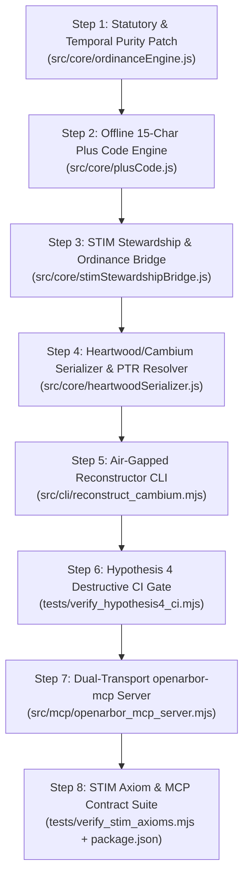

# OpenArbor Horizon 1 Implementation Specification: Sovereign Local Kernel, STIM Bridge, and 200-Year Heartwood Serializer

* **Document ID:** `OA-SPEC-014`
* **Path:** `ARBORETUM/Active/OpenArbor/docs/14_HORIZON1_IMPLEMENTATION_SPEC.md`
* **Date:** `2026-10-14`
* **Author:** Rocky (Engineering & Architecture Compute, Antigravity)
* **Principals:** George Steward (ISA Certified Arborist `TX-362025A`, Oak Wilt Qualified) & Hermes
* **Constitutional Authority:** Rocky Constitution v5.0 (`GEMINI.md`), OpenArbor Overlay (`AGENTS.md`), STIM Protocol v7.0011 (`DOI 10.5281/zenodo.21297458`, `doc-343`), 200-Year Preservation Plan (`doc-136`), Heartwood/Cambium Pattern v1.0.0 (`HEARTWOOD_CAMBIUM_PATTERN.md`), Resolver Protocol v1 (`RESOLVER_PROTOCOL_v1_20261008.md`)
* **Target Repository:** `https://github.com/Arboracle-Ecosystem/openarbor.git`
* **Runtime Constraint:** Pure Node.js ECMAScript Modules (`ESM`), zero external `npm` runtime dependencies, zero proprietary cloud SDKs, 100% deterministic execution.

---

## Document Section Skeleton & Implementation Map

This specification defines the complete, self-contained engineering blueprint for **OpenArbor Horizon 1 (`openarbor-mcp` + Hypothesis 4 Reconstructibility Engine)**. An implementer can build, test, and verify the entire Horizon 1 system from this document alone without external clarification.

1. **[Section 1: Horizon 1 Scope Statement, Deferred Cut Table, and Pull-Forward Triggers](#1-horizon-1-scope-statement-deferred-cut-table-and-pull-forward-triggers)**
   * Defines the exact Horizon 1 boundary (`openarbor-mcp` + `stimStewardshipBridge.js` + `plusCode.js` + `heartwoodSerializer.js` + Hypothesis 4 CI gate) and lists every item cut to Horizon 2 with its falsifiable pull-forward trigger.
2. **[Section 2: Rocky Architectural Inventions Beyond the 2031 Blueprint](#2-rocky-architectural-inventions-beyond-the-2031-blueprint)**
   * Documents five architectural improvements (`[ROCKY ARCHITECTURAL ADDITION #1]` through `[#5]`) with explicit technical rationale so George can accept or reject each addition independently of inherited design.
3. **[Section 3: H4-First Build Order (Numbered Execution Sequence)](#3-h4-first-build-order-numbered-execution-sequence)**
   * Specifies the eight sequential build steps (`Step 1` through `Step 8`), ordering Hypothesis 4 plain-text serialization and reconstruction before MCP server wrapping, with exact file paths, module exports, and verification commands.
4. **[Section 4: Complete `openarbor-mcp` Tool Contract](#4-complete-openarbor-mcp-tool-contract)**
   * Defines the 14 deterministic MCP tools across `openarbor-core`, `openarbor-stim-bridge`, and `heartwood-vault`, including exact argument schemas, units, return shapes, error contracts, and backing module mappings.
5. **[Section 5: The `stimStewardshipBridge.js` Reference Specification (`doc-339`, `doc-342`, `doc-343`)](#5-the-stimstewardshipbridgejs-reference-specification-doc-339-doc-342-doc-343)**
   * Specifies the 6 deterministic Assessment-to-Stewardship rules, the 5-entity Ordinance Intelligence Bridge, the 3 production bug guards (`complete` status ranking, 8-record best-first walk, negative section-header skipping), Field Voice synthesis, and Intrinsic Value integration.
6. **[Section 6: The Heartwood / Cambium Round-Trip Serializer & Resolver Protocol v1 Design](#6-the-heartwood--cambium-round-trip-serializer--resolver-protocol-v1-design)**
   * Defines the complete YAML frontmatter schema, deterministic Markdown body grammar, `PTR` link parser and emitter, `@ORGAN` alias table, safety allowlist/denylist rules, and the `Cambium = compile(Heartwood, SEEDS)` invariant.
7. **[Section 7: The Hypothesis 4 CI Gate (`tests/verify_hypothesis4_ci.mjs`)](#7-the-hypothesis-4-ci-gate-testsverify_hypothesis4_cimjs)**
   * Details the destructive round-trip test harness, what artifacts get wiped, how the air-gapped reconstructor executes, what byte-for-byte parity means across all six calculation domains, and the exact failure diagnostic format.
8. **[Section 8: Horizon 1 Milestones, Acceptance Criteria, and Falsifiable Kill Criteria](#8-horizon-1-milestones-acceptance-criteria-and-falsifiable-kill-criteria)**
   * Establishes Milestones `M1` through `M5` with quantitative acceptance gates and explicit kill criteria.
9. **[Section 9: Mechanical STIM Axiom Verification Matrix (`stim-guard`)](#9-mechanical-stim-axiom-verification-matrix-stim-guard)**
   * Maps all seven STIM Protocol v7.0011 axioms to automated code and state assertions in `tests/verify_stim_axioms.mjs`.
10. **[Section 10: Explicit Horizon 1 Non-Goals & Filesystem Protection Boundaries](#10-explicit-horizon-1-non-goals--filesystem-protection-boundaries)**
    * Enumerates architectural non-goals and enforces the pre-swap filesystem freeze (`PLAN_directory-consolidation_memory_20261008.md`).
11. **[Section 11: Operational & Engineering Risk Register](#11-operational--engineering-risk-register)**
    * Catalogs failure modes, earliest observable signals, and deterministic remediation protocols.
12. **[Section 12: Verification Receipts & Grounding Ledger](#12-verification-receipts--grounding-ledger)**
    * Records all files read, section line counts, external source mappings, `UNVERIFIED` markers, and total document length.

---

## 1. Horizon 1 Scope Statement, Deferred Cut Table, and Pull-Forward Triggers

### 1.1 The Horizon 1 Core Deliverable
In [`docs/13_STRATEGIC_SPEC_2031_SOVEREIGN_ARCHITECTURE.md`](file:///home/george/Myceliate_Master/ARBORETUM/Active/OpenArbor/docs/13_STRATEGIC_SPEC_2031_SOVEREIGN_ARCHITECTURE.md) Section 6.2, Horizon 1 originally bundled four distinct product tracks into a single 12-month window:
1. MCP wrapping of the verified ESM core (`openarbor-mcp`) plus the STIM Assessment-to-Stewardship and Ordinance Intelligence bridges (`doc-339`, `doc-342`).
2. Five GUI field assessment forms from [`docs/09_FEATURE_BRIEF_ASSESSMENT_FORMS.md`](file:///home/george/Myceliate_Master/ARBORETUM/Active/OpenArbor/docs/09_FEATURE_BRIEF_ASSESSMENT_FORMS.md).
3. Two hardware sensor ingress adapters (`Austin LiDAR Tree Scanner` and `GPR Root Map Diagram v1`).
4. The `openarbor-nomad-plugin` container package and `Caddy 2` port `5483` workbench.

Per [`HERMES_BRIEF_OPENARBOR_SPEC_REVIEWED_20261013.md`](file:///home/george/Myceliate_Master/ARBORETUM/Active/OpenArbor/HERMES_BRIEF_OPENARBOR_SPEC_REVIEWED_20261013.md), building four products simultaneously threatens the falsification discipline established in Section 8 of the 2031 blueprint. The cheapest, fastest, and most foundational hypothesis to falsify first is **Hypothesis 4 (200-Year Zero-Dependency Reconstructibility)**, followed immediately by exposing the deterministic kernel to Bodhi, Hermes, and Antigravity via **`openarbor-mcp`**.

**Horizon 1 is therefore scoped to a single, self-contained deliverable:**
> **`openarbor-mcp` + The Hypothesis 4 Heartwood/Cambium Reconstructibility Engine**

Specifically, Horizon 1 comprises seven pure Node.js ESM artifacts inside `ARBORETUM/Active/OpenArbor/`:
1. **Verified Kernel Preservation (Unbroken 3/3 Baseline):**
   * [`src/core/rootZone.js`](file:///home/george/Myceliate_Master/ARBORETUM/Active/OpenArbor/src/core/rootZone.js) (208 lines; CRZ, TPZ, SRZ, multi-stem DBH, 1-ft spatial grid union).
   * [`src/core/ordinanceEngine.js`](file:///home/george/Myceliate_Master/ARBORETUM/Active/OpenArbor/src/core/ordinanceEngine.js) (647 lines; municipal inventory evaluation, permit determination, ascending diameter exemption walk, retained hardwood credits, site context, SVG protection map, pneumatic soil remediation budget).
   * [`src/core/ecosystemBenefits.js`](file:///home/george/Myceliate_Master/ARBORETUM/Active/OpenArbor/src/core/ecosystemBenefits.js) (196 lines; John White `FCIN12` veteran tree age, Nowak/Cairns/Xiao/McPherson allometric benefits, `OGC CRS84` GeoJSON FeatureCollection export).
2. **Offline 15-Character Open Location Code Engine (`src/core/plusCode.js`):**
   * Pure ESM implementation of the Apache 2.0 Open Location Code algorithm encoding and decoding 15-character global Plus Codes (`~1.4m x 1.4m` at 11 chars down to `~0.3m x 0.3m` sub-meter tree trunk precision at 15 chars, matching `soilgrower.com` and [`docs/09_FEATURE_BRIEF_ASSESSMENT_FORMS.md`](file:///home/george/Myceliate_Master/ARBORETUM/Active/OpenArbor/docs/09_FEATURE_BRIEF_ASSESSMENT_FORMS.md#L41)).
3. **Deterministic STIM Stewardship & Ordinance Intelligence Bridge (`src/core/stimStewardshipBridge.js`):**
   * Pure ESM port of the 6 deterministic Assessment-to-Stewardship rules (`doc-339`) and the 5-entity Ordinance Intelligence Bridge (`doc-342`, `doc-343`), including idempotent provenance tagging (`[assessment:<ID>][rule:<KEY>]` and `[assessment:<ID>][ordinance:<provisionID>]`), best-first municipal ordinance resolution, negative section-header skipping, Field Voice output generation, and Intrinsic Value ecological attachment.
4. **Heartwood / Cambium Round-Trip Serializer & Resolver Protocol v1 Engine (`src/core/heartwoodSerializer.js`):**
   * Lossless bidirectional serializer between human-readable Heartwood `.md` dossiers (`HEARTWOOD_CAMBIUM_PATTERN.md`) with `PTR` links (`RESOLVER_PROTOCOL_v1_20261008.md`) and machine-executable Cambium artifacts (`.jsonld`, `.geojson`, `.svg`, and evaluated mitigation/task structures).
5. **Air-Gapped Reconstructor CLI (`src/cli/reconstruct_cambium.mjs`):**
   * Dependency-free Node.js script that takes a vault directory containing only `SEEDS/` and `ARBORETUM/` Heartwood `.md` files and regenerates 100% of the Cambium layer from scratch.
6. **Dual-Transport MCP Server (`src/mcp/openarbor_mcp_server.mjs`):**
   * Zero-dependency Model Context Protocol (`MCP`) JSON-RPC 2.0 server exposing 14 deterministic tools over `stdio` (for immediate registration in Antigravity, Hermes, Claude Desktop, and Ollama) and optional native `node:http` loopback (`127.0.0.1:5483`).
7. **Three-Part Verification & CI Gate Suite (`tests/`):**
   * [`tests/verify_openarbor.mjs`](file:///home/george/Myceliate_Master/ARBORETUM/Active/OpenArbor/tests/verify_openarbor.mjs) (existing 3-suite kernel check).
   * `tests/verify_hypothesis4_ci.mjs` (destructive Cambium wipe + reconstruction byte-parity gate).
   * `tests/verify_stim_axioms.mjs` (mechanical verification of all 7 STIM v7.0011 axioms and the 14 MCP tool contracts).

### 1.2 Deferred Cut Table (Moved to Horizon 2) & Falsifiable Pull-Forward Triggers
No item in the table below may be built during Horizon 1 unless its specific **Pull-Forward Trigger** is satisfied and confirmed by George.

| Deferred Component (Cut to Horizon 2) | Original Blueprint Reference | Why Cut from Horizon 1 | Falsifiable Pull-Forward Trigger (Condition Required to Promote) |
| :--- | :--- | :--- | :--- |
| **1. Five GUI Field Assessment Forms** (`ISA TRAQ`, `CTLA Trunk Formula`, `Rapid Inventory UI`, `PHC & Soil Biome Log`, `Post-Care & Oak Wilt UI`) | [`13_STRATEGIC_SPEC_2031_SOVEREIGN_ARCHITECTURE.md`](file:///home/george/Myceliate_Master/ARBORETUM/Active/OpenArbor/docs/13_STRATEGIC_SPEC_2031_SOVEREIGN_ARCHITECTURE.md#L292-L297), [`09_FEATURE_BRIEF_ASSESSMENT_FORMS.md`](file:///home/george/Myceliate_Master/ARBORETUM/Active/OpenArbor/docs/09_FEATURE_BRIEF_ASSESSMENT_FORMS.md) | Building a React/HTML form frontend before locking the Heartwood `.md` frontmatter schema and MCP tool contract causes schema drift between UI state and the 200-year archive. Voice-to-MCP and CLI/JSON ingestion already exercise every form field deterministically. | **Trigger:** `openarbor-mcp` and `verify_hypothesis4_ci.mjs` pass 100% in CI, AND George logs at least 10 real Central Texas trees via `openarbor-mcp` voice/agent dispatch, freezing the Heartwood v1.0 frontmatter schema with zero field changes across 14 consecutive days. |
| **2. Austin LiDAR Tree Scanner Adapter (`src/core/lidarAdapter.js` & `schemas/lidar-ingest.schema.json`)** | [`13_STRATEGIC_SPEC_2031_SOVEREIGN_ARCHITECTURE.md`](file:///home/george/Myceliate_Master/ARBORETUM/Active/OpenArbor/docs/13_STRATEGIC_SPEC_2031_SOVEREIGN_ARCHITECTURE.md#L146-L167) | Writing an adapter before obtaining a real sample export payload (`.json` + `.copc.laz`/`.ply`) from the Austin LiDAR scanner developer risks inventing a speculative wire format that breaks on first hardware contact. | **Trigger:** The Austin LiDAR scanner developer provides at least 3 real scan payloads from Central Texas trees (including at least 1 multi-stem `Quercus fusiformis` or `Juniperus ashei`) with physical D-tape ground-truth measurements attached to test Hypothesis 1 (`< 2 cm` DBH RMSE). |
| **3. GPR Root Map Diagram & Virtual Trenching Engine (`src/core/gprRootMapper.js` & `schemas/gpr-root.schema.json`)** | [`13_STRATEGIC_SPEC_2031_SOVEREIGN_ARCHITECTURE.md`](file:///home/george/Myceliate_Master/ARBORETUM/Active/OpenArbor/docs/13_STRATEGIC_SPEC_2031_SOVEREIGN_ARCHITECTURE.md#L168-L177) | Subsurface radargram parsing (`.dzt`, `.sgy`, `Proceq GS8000` / `TreeRadar TRU` CSV hit tables) requires real field scan files from `Soil_Grower_GPR_Service` to calibrate dielectric moisture filtering and depth-profile SVG rendering. | **Trigger:** At least 1 raw GPR transect dataset (CSV or `.dzt` with known utility/root depth ground truth) is committed to `SEEDS/GPR_Radargrams/` with SHA-256 verification, OR a paid client Tree Preservation Plan requires an empirical root-zone variance exhibit under `ANSI A300 Part 5`. |
| **4. Broad-Spectrum Drone Inventory Adapter (`src/core/aerialInventoryAdapter.js` for `OpenForestry` / `Deep Forestry` / `WebODM`)** | [`13_STRATEGIC_SPEC_2031_SOVEREIGN_ARCHITECTURE.md`](file:///home/george/Myceliate_Master/ARBORETUM/Active/OpenArbor/docs/13_STRATEGIC_SPEC_2031_SOVEREIGN_ARCHITECTURE.md#L137-L145) | Multi-acre aerial crown segmentation ingestion depends on the batch evaluation pipeline in `openarbor-mcp` (`evaluate_tree_inventory`) being hardened first. | **Trigger:** A multi-acre tract (`> 5 acres`) orthomosaic or crown-polygon GeoJSON/CSV from `OpenForestry`, `Deep Forestry`, or local `DeepForest` (`forestry-tools.json`) is staged in `SEEDS/LiDAR_And_Drone/` for ground-scouting triage (Hypothesis 3). |
| **5. `Open Arboretum` Seed-to-Canopy Lineage Engine (`src/core/openArboretumLineage.js`)** | [`13_STRATEGIC_SPEC_2031_SOVEREIGN_ARCHITECTURE.md`](file:///home/george/Myceliate_Master/ARBORETUM/Active/OpenArbor/docs/13_STRATEGIC_SPEC_2031_SOVEREIGN_ARCHITECTURE.md#L194) | Heartwood `.md` files in Horizon 1 already preserve `blood_signature` strings and `PTR` links to mother trees; full nursery container batch state machines (`ARBORETUM/Nursery_Batches/`) belong with Guild Economy Pillar 2 (`doc-339`). | **Trigger:** Horizon 1 `resolve_ptr_chain` passes 3-hop live and 7-hop async verification, AND the first wild Mother-Tree seed harvest is recorded in `SEEDS/Blood_Signatures/`. |
| **6. Project Nomad Plugin Package (`openarbor-nomad-plugin`), `Caddy 2` Port `5483` Workbench, and Offline Kiwix `.zim` Compiler** | [`13_STRATEGIC_SPEC_2031_SOVEREIGN_ARCHITECTURE.md`](file:///home/george/Myceliate_Master/ARBORETUM/Active/OpenArbor/docs/13_STRATEGIC_SPEC_2031_SOVEREIGN_ARCHITECTURE.md#L89-L98) | As verified in Defect #6 of the blueprint review, `caddy` is not installed on the host machine. Packaging containers before the local ESM MCP server is operational adds deployment friction with zero analytical gain. | **Trigger:** `openarbor-mcp` runs cleanly via stdio and native `node:http` loopback on port `5483`, AND the host disk swap and post-swap P1 directory consolidation (`PLAN_directory-consolidation_memory_20261008.md`) are completed and signed off. |
| **7. Binary Spatial & Vector Stores (`SQLite 3 + SpatiaLite .gpkg`, `PostGIS`, `KùzuDB`, `Any-Sync`)** | [`13_STRATEGIC_SPEC_2031_SOVEREIGN_ARCHITECTURE.md`](file:///home/george/Myceliate_Master/ARBORETUM/Active/OpenArbor/docs/13_STRATEGIC_SPEC_2031_SOVEREIGN_ARCHITECTURE.md#L85-L87) | Hypothesis 4 requires proving that 100% of system state lives in plain-text Heartwood `.md` and `SEEDS/` files, and that `CRS84 GeoJSON` + `JSON-LD` Cambium outputs satisfy all spatial and graph queries without a binary database dependency. | **Trigger:** A single project inventory exceeds `5,000` trees where in-memory `CRS84 GeoJSON` + 1-ft grid union latency exceeds `500 ms`, requiring an indexed `GeoPackage (.gpkg)` compiled as a secondary Cambium derivative. |

---

## 2. Rocky Architectural Inventions Beyond the 2031 Blueprint

Per `HERMES_BRIEF_HORIZON1_FULL_SPEC_20261014.md`, maximum architectural latitude is granted where a cleaner design improves on [`docs/13_STRATEGIC_SPEC_2031_SOVEREIGN_ARCHITECTURE.md`](file:///home/george/Myceliate_Master/ARBORETUM/Active/OpenArbor/docs/13_STRATEGIC_SPEC_2031_SOVEREIGN_ARCHITECTURE.md). Five inventions are introduced in this specification. Each is labeled `[ROCKY ARCHITECTURAL ADDITION]` with explicit problem statement, technical design, and trade-off analysis so George can accept or reject each independently.

### 2.1 `[ROCKY ARCHITECTURAL ADDITION #1]`: Zero-Dependency Dual-Transport MCP Router (`stdio` + Native `node:http` Port 5483 Loopback)
* **What the 2031 Blueprint Implied:** Section 4 and Section 7 of `13_STRATEGIC_SPEC_2031_SOVEREIGN_ARCHITECTURE.md` tied `openarbor-mcp` to a `Caddy 2` reverse-proxy workbench on Port `5483` (`LIVE`) and implied importing `@modelcontextprotocol/sdk` from `npm`.
* **Why That Implied Design Fails Horizon 1 Constraints:**
  1. [`package.json`](file:///home/george/Myceliate_Master/ARBORETUM/Active/OpenArbor/package.json) has zero `dependencies` and zero `node_modules/`. Adding `@modelcontextprotocol/sdk` introduces transitive `npm` supply-chain dependencies that rot well before the 200-year (`2226`) sovereignty horizon (`doc-136`).
  2. `caddy` is not installed on this workstation (Defect #6 in `13_STRATEGIC_SPEC_2031_SOVEREIGN_ARCHITECTURE.md`).
  3. Local agent harnesses (Antigravity, Hermes MCP client, Claude Desktop, and `uv`/`stdio` runners) communicate with local MCP servers over newline-delimited JSON-RPC 2.0 on `stdin`/`stdout`, whereas local browser/CLI sidecars query `http://127.0.0.1:5483/mcp`.
* **Rocky's Better Shape:** Implement `src/mcp/openarbor_mcp_server.mjs` in `< 350 lines` of pure Node.js ESM using only `node:readline`, `node:http`, `node:fs`, `node:path`, and `node:crypto`:
  * **Default Mode (`node src/mcp/openarbor_mcp_server.mjs` or `--stdio`):** Speaks strict MCP JSON-RPC 2.0 (`initialize`, `notifications/initialized`, `tools/list`, `tools/call`, `ping`) over `process.stdin` and `process.stdout`. All diagnostic logs write exclusively to `process.stderr` so `stdout` frames are never corrupted.
  * **Loopback HTTP Mode (`node src/mcp/openarbor_mcp_server.mjs --http --port 5483`):** Uses native `node:http` bound strictly to `127.0.0.1:5483` (zero external network exposure) to serve `POST /mcp` (JSON-RPC 2.0), `GET /health` (vital signs + loaded ordinance count + SHA-256 of kernel modules), and `GET /tools` (the 14-tool schema manifest).
* **Why George Should Accept:** Preserves 100% zero-dependency sovereignty (`0` npm packages), runs today without installing `caddy`, and supports both stdio agent harnesses and port `5483` HTTP callers from the exact same dispatch table.

### 2.2 `[ROCKY ARCHITECTURAL ADDITION #2]`: Complete Deterministic Input Envelope & `RFC 8785` Canonical `cambium_sha256` Receipt in Heartwood Frontmatter
* **What the 2031 Blueprint Implied:** Section 5.2 of `13_STRATEGIC_SPEC_2031_SOVEREIGN_ARCHITECTURE.md` listed only 8 YAML frontmatter fields for a Heartwood `.md` file (`id`, `plus_code_global`, `crs84_coords`, `species`, `effective_dbh_in`, `crz_radius_ft`, `srz_radius_ft`, `blood_signature`) while claiming in Hypothesis 4 that a reconstructor script can regenerate 100% of the Cambium (including `evaluateTreeInventory`, `computeMitigationPlan`, `calculateTreeEcosystemBenefits`, and `StewardTask` generation) from the Heartwood `.md` file alone.
* **Why That Implied Design Fails Mathematically:**
  Inspecting the actual signatures in [`src/core/rootZone.js`](file:///home/george/Myceliate_Master/ARBORETUM/Active/OpenArbor/src/core/rootZone.js), [`src/core/ordinanceEngine.js`](file:///home/george/Myceliate_Master/ARBORETUM/Active/OpenArbor/src/core/ordinanceEngine.js), [`src/core/ecosystemBenefits.js`](file:///home/george/Myceliate_Master/ARBORETUM/Active/OpenArbor/src/core/ecosystemBenefits.js), and `doc-339` proves that those 8 fields cannot reconstruct the Cambium:
  * Without `stems_inches: [number]`, `calculateMultiStemDBH(stems, 'quadratic')` vs. `calculateMultiStemDBH(stems, 'largest_plus_half')` cannot be recomputed when a tree is evaluated under a different municipal code.
  * Without `drf_inches`, `calculateSRZ(drfInches, dbhInches)` falls back to `dbhInches * 1.1` instead of the measured root flare diameter.
  * Without `crz_disturbed_pct`, `cutfill_within_half_crz`, `cutfill_depth_in`, `impervious_pct`, `crown_removal_pct`, `pruning_date`, `removal`, `no_mitigation_path`, `council_heritage`, and `measurement_provenance`, `evaluateTreeInventory()` cannot reproduce statutory flags or mitigation exemptions.
  * Without `condition_score` (`1..10`), `condition_class` (`Excellent..Dead`), `structural_defects`, `pest_disease_signs`, `root_soil_compaction_score`, `canopy_trunk_decline_score`, and `recommended_actions`, neither `calculateTreeEcosystemBenefits()` nor the 6 rules of `doc-339` can execute.
* **Rocky's Better Shape:**
  1. Expand the Heartwood `.md` YAML frontmatter into a **Complete Deterministic Input Envelope** partitioned into five clear blocks: Identity & Location, Dendrometry & Provenance, Health & Risk Observations, Construction & Ordinance Context, and Cryptographic Integrity (`cambium_sha256`).
  2. Store **only primary observations and provenance** as authoritative inputs in the Heartwood frontmatter, while writing computed outputs (`effective_dbh_in`, `crz_radius_ft`, `srz_radius_ft`, statutory flags, ecosystem benefits, and `StewardTask` tables) into deterministic Markdown tables in the Heartwood prose body AND into the companion `.jsonld` Cambium file.
  3. Embed `cambium_sha256` in the Heartwood frontmatter, calculated over the `RFC 8785` (JSON Canonicalization Scheme, lexicographically sorted object keys, no insignificant whitespace) serialization of the `.jsonld` Cambium payload. Any unauthorized edit to a `.jsonld` file is caught in `< 1 ms`.
* **Why George Should Accept:** Makes Hypothesis 4 mathematically true rather than aspirational, and turns every Heartwood `.md` file into a self-verifying cryptographic ledger entry.

### 2.3 `[ROCKY ARCHITECTURAL ADDITION #3]`: Two-Tier Austin Statutory Context Resolver (`site_use` Commercial 8" vs. Residential 19" Protection + Species-Gated 24" Heritage)
* **What the 2031 Blueprint & Existing Code Contained:**
  * Hermes's Defect #1 review in `13_STRATEGIC_SPEC_2031_SOVEREIGN_ARCHITECTURE.md` established the legal ground truth for Austin (`tx-austin`): under Austin LDC § 25-8 and Ordinance `20100204-038`, a **Protected Tree** starts at **`19" DBH`** (residential / general) and **`8" DBH`** (commercial / multifamily site plan survey regulated tier), while a **Heritage Tree** starts at **`24" DBH`** *only* for species listed in `heritage_species_thresholds` (which excludes Ashe juniper, *Juniperus ashei*).
  * However, inspecting [`src/core/ordinanceEngine.js`](file:///home/george/Myceliate_Master/ARBORETUM/Active/OpenArbor/src/core/ordinanceEngine.js#L90-L110) and [`data/ordinances/central_texas_ordinances.json`](file:///home/george/Myceliate_Master/ARBORETUM/Active/OpenArbor/data/ordinances/central_texas_ordinances.json#L13-L23) reveals two latent traps in the existing code:
    1. In `ordinanceEngine.js` lines 90 to 110, `qualifiesAsHeritage(tree, dbhInches, ordinance)` loops over `ordinance.heritage_species_thresholds`. If the tree's species is *not* in `heritage_species_thresholds` (for example, a 30-inch Ashe juniper in Austin), the loop finishes without returning, and line 108 executes:
       `const generalThreshold = Number(ordinance.heritage_threshold_inches); return generalThreshold > 0 && dbhInches >= generalThreshold;`
       Because `tx-austin` in `central_texas_ordinances.json` has `"heritage_threshold_inches": 24` alongside `"heritage_species_thresholds"`, **`qualifiesAsHeritage` currently returns `true` for a 30-inch Ashe juniper in Austin.** That means the live code in `ordinanceEngine.js` still commits the exact error Hermes corrected in the prose of Defect #1.
    2. In `ordinanceEngine.js` line 151, `evaluateTreeInventory(trees = [], ordinance = null, provisions = [])` has no `site` or `site_use` parameter, so commercial site plans in Austin (`site_use: 'commercial'`) cannot evaluate the `8"` to `18.9"` regulated mitigation tier (`$100/in`, `0.5` replacement ratio in `tx-austin.mitigation_fee_schedule.tiers[0]`).
* **Rocky's Better Shape:**
  1. **Fix the Species-Gated Heritage Bug in `qualifiesAsHeritage` (without breaking cities that have no species list):** When `Object.keys(speciesMap).length > 0` AND `ordinance.heritage_species_exclusive !== false`, if a tree does not match any species in `heritage_species_thresholds`, `qualifiesAsHeritage` must return `false` (unless `tree.council_heritage === true`), instead of falling through to `generalThreshold`. (In `central_texas_ordinances.json`, Cedar Park has no `heritage_species_thresholds`, so its `Object.keys(speciesMap).length === 0` and it continues to use `generalThreshold = 26`; Austin, Georgetown, Liberty Hill, and Round Rock have explicit `heritage_species_thresholds`, and in `verify_openarbor.mjs` T-101 is a `26"` Live Oak (`Quercus virginiana`), which is in Liberty Hill's `heritage_species_thresholds`, so `verify_openarbor.mjs` continues to pass 3/3 while the Austin 30-inch Ashe juniper bug is permanently closed.)
  2. **Add Optional `options = { site_use: 'residential', evaluation_date: null }` 4th Parameter to `evaluateTreeInventory(trees, ordinance, provisions, options = {})`:** Fully backward-compatible with all 3-argument callers in `verify_openarbor.mjs`. When `options.site_use === 'commercial'` and `ordinance.plan_rules?.survey?.hardwood_min_dbh` is defined (e.g., `8` inches in Austin ECM § 3.3.2), non-excepted hardwood trees `>= 8"` are flagged under `commercial_regulated: true` so the `$100/in` (`8"` to `18.9"`) commercial mitigation tier in `tx-austin` is reachable.
* **Why George Should Accept:** Directly catches and fixes a live statutory bug in `ordinanceEngine.js` line 108 where a 30-inch Ashe juniper in Austin was falsely classified as a `Heritage` tree (`$600/in` instead of `$200/in` Protected), while preserving 100% backward compatibility with `tests/verify_openarbor.mjs`.

### 2.4 `[ROCKY ARCHITECTURAL ADDITION #4]`: Deterministic Temporal Anchor Law (`evaluation_date` Purity)
* **What the 2031 Blueprint Implied:** Left timestamp handling implicit across `ordinanceEngine.js`, `ecosystemBenefits.js`, and `stimStewardshipBridge.js`.
* **Why That Implied Design Fails Hypothesis 4:**
  * [`src/core/ordinanceEngine.js`](file:///home/george/Myceliate_Master/ARBORETUM/Active/OpenArbor/src/core/ordinanceEngine.js#L508) line 508 computes survey age using `Date.now()-new Date(site.survey_date)`. A survey that is `1.9` years old today (`surveyWarn: null` in Liberty Hill) becomes `2.1` years old in 75 days (`surveyWarn: "Survey is 2.1 years old (max 2)."`), causing a future reconstruction of the exact same vault to produce a different Cambium output.
  * [`src/core/ecosystemBenefits.js`](file:///home/george/Myceliate_Master/ARBORETUM/Active/OpenArbor/src/core/ecosystemBenefits.js#L165) line 165 writes `generated_at: new Date().toISOString()` inside `toGeoJSONFeatureCollection`, causing every GeoJSON export to have a different SHA-256 hash every millisecond.
  * `doc-339` computes due dates (`+3`, `+7`, `+14`, `+21`, `+30` days). If due dates add days to `new Date()`, reconstructing a dossier in `2226` shifts every task due date by 200 years.
* **Rocky's Better Shape:** Enforce the **Temporal Anchor Law**:
  1. Every Heartwood `.md` dossier carries an explicit ISO 8601 date (`assessment_date: "YYYY-MM-DD"`, and for site plans `evaluation_date: "YYYY-MM-DD"`).
  2. In `evaluateSiteContext(rows, ordinance, site)`, if `site.evaluation_date` is provided, survey age is computed as `(new Date(site.evaluation_date)-new Date(site.survey_date)) / 3.156e10`, falling back to `Date.now()` only when `site.evaluation_date` is omitted.
  3. In `toGeoJSONFeatureCollection(evaluatedRows, metadata)`, if `metadata.generated_at` is passed by the caller (which `heartwoodSerializer.js` sets to `${assessment_date}T00:00:00.000Z`), it overrides `new Date().toISOString()`.
  4. In `stimStewardshipBridge.js`, all 6 rule due dates are computed strictly as `addDaysUTC(assessment_date, offsetDays)`.
* **Why George Should Accept:** Guarantees that running `reconstruct_cambium.mjs` in `2026`, `2031`, or `2226` produces the exact same byte-for-byte SHA-256 digest for every Cambium file.

### 2.5 `[ROCKY ARCHITECTURAL ADDITION #5]`: Write-Ahead Reconstructibility Transaction (`StimWriteTransaction`)
* **What the 2031 Blueprint Implied:** Section 8 Hypothesis 4 relied on a CI gate to catch commits that wrote primary state to a binary/Cambium store without serializing to Heartwood `.md`.
* **Why That Implied Design Can Be Strengthened:** Catching a violation in CI after code is written is good; making the violation impossible in the write API is better.
* **Rocky's Better Shape:** In `src/core/heartwoodSerializer.js`, `writeHeartwoodCambiumPair(dossierInput, vaultRoot)` never serializes `dossierInput` directly into `.jsonld` or `.geojson`. Instead, it executes a strict three-phase local transaction:
  1. **Phase A (Heartwood Write):** Format and write the plain-text Heartwood `<ID>-<slug>.md` file to a temporary file `<ID>-<slug>.md.tmp` and atomically `fs.renameSync` it into place.
  2. **Phase B (Memory Purge & Cold Parse):** Discard `dossierInput` from memory. Read the newly written `<ID>-<slug>.md` bytes back from disk and pass them into `reconstructCambiumFromHeartwoodFile(mdFilePath, vaultRoot)`.
  3. **Phase C (Cambium Materialization & Receipt Stamp):** Write the reconstructed `.jsonld` and `.geojson` Cambium files, compute their canonical SHA-256 digest (`cambium_sha256`), stamp that digest into the Heartwood `.md` frontmatter, and verify `reconstructCambiumFromHeartwoodFile` matches `cambium_sha256`.
* **Why George Should Accept:** Guarantees by construction that any field not present in the plain-text Heartwood `.md` file can never appear in the `.jsonld` or `.geojson` Cambium files. Every single write in daily operation is itself a live execution of the Hypothesis 4 reconstructor.

---

## 3. H4-First Build Order (Numbered Execution Sequence)

The Horizon 1 build order enforces **Hypothesis 4 (200-Year Reconstructibility) first**, before exposing the MCP server. Each step is atomic, uses only Node.js built-in modules (`node:fs`, `node:path`, `node:crypto`, `node:assert/strict`, `node:readline`, `node:http`, `node:url`), stays strictly inside `/home/george/Myceliate_Master/ARBORETUM/Active/OpenArbor/`, and ends with a deterministic verification command.



### Step 1: Statutory Heritage Exclusivity & Temporal Anchor Patch in `src/core/ordinanceEngine.js`
* **Files Modified:**
  * `/home/george/Myceliate_Master/ARBORETUM/Active/OpenArbor/src/core/ordinanceEngine.js`
* **Exact Modifications:**
  1. In `qualifiesAsHeritage(tree, dbhInches, ordinance)` (lines 90 to 110):
     * After iterating `Object.entries(speciesMap)`, check `if (Object.keys(speciesMap).length > 0 && ordinance.heritage_species_exclusive !== false) return false;`.
     * Only fall through to `const generalThreshold = Number(ordinance.heritage_threshold_inches); return generalThreshold > 0 && dbhInches >= generalThreshold;` when `Object.keys(speciesMap).length === 0` (such as `tx-cedar-park`) or when `ordinance.heritage_species_exclusive === false`.
     * **Effect:** A 30-inch Ashe juniper (`Juniperus ashei`) in Austin (`tx-austin`) now evaluates to `protected: true, heritage: false` (matching Austin LDC § 25-8 and Defect #1 in `13_STRATEGIC_SPEC_2031_SOVEREIGN_ARCHITECTURE.md`), whereas a 26-inch Live Oak (`Quercus virginiana`) in Austin or Liberty Hill evaluates to `protected: true, heritage: true`.
  2. In `evaluateTreeInventory(trees = [], ordinance = null, provisions = [], options = {})` (line 151):
     * Add optional 4th parameter `options = {}` (`{ site_use?: 'residential' | 'commercial' | 'single_family', evaluation_date?: string }`).
     * Compute `const effectiveThreshold = (options.site_use === 'commercial' && Number(rules?.survey?.hardwood_min_dbh) > 0) ? Number(rules.survey.hardwood_min_dbh) : threshold;`.
     * Retain default `threshold` (`19"` for Austin) when `options.site_use` is omitted or `'residential'` / `'single_family'`.
  3. In `evaluateSiteContext(rows, ordinance, site = {})` (line 508):
     * Replace `Date.now()` with `const refMs = site.evaluation_date ? new Date(site.evaluation_date).getTime() : Date.now();` so survey age (`(refMs - new Date(site.survey_date).getTime()) / 3.156e10`) is 100% deterministic when `site.evaluation_date` is supplied.
* **What Step 1 Produces:** A temporally pure, statutorily exact `ordinanceEngine.js` that preserves all existing exports and signatures.
* **How You Know It Worked:**
  ```bash
  node tests/verify_openarbor.mjs && node -e "import { evaluateTreeInventory } from './src/core/ordinanceEngine.js'; import fs from 'node:fs'; const ord = JSON.parse(fs.readFileSync('./data/ordinances/central_texas_ordinances.json','utf8')).municipalities.find(m=>m.id==='tx-austin'); const [r] = evaluateTreeInventory([{tag:'104',species_common:'Ashe juniper',species_scientific:'Juniperus ashei',stems_inches:[30]}], ord); if (!r.protected || r.heritage) throw new Error('Austin 30in Ashe juniper must be Protected and NOT Heritage'); console.log('[PASS] Step 1 Austin 30in Ashe juniper = Protected, non-Heritage');"
  ```

### Step 2: Offline 15-Character Open Location Code Engine (`src/core/plusCode.js`)
* **Files Created:**
  * `/home/george/Myceliate_Master/ARBORETUM/Active/OpenArbor/src/core/plusCode.js`
* **Exact Exports Produced:**
  1. `export const OLC_ALPHABET = '23456789CFGHJMPQRVWX';` (Base-20 character set from Apache 2.0 Open Location Code specification).
  2. `export function encodePlusCode(lat, lng, codeLength = 15)`:
     * Clamps `lat` to `[-90, 90)` and normalizes `lng` to `[-180, 180)`.
     * Encodes the first 10 digits as 5 pairs of base-20 (`20 deg`, `1 deg`, `0.05 deg`, `0.0025 deg`, `0.000125 deg`) with a `+` separator after digit 8 (`8644J9M7+8R`).
     * Encodes digits 11 through 15 using the 5x4 grid refinement step (`GRID_ROWS = 5`, `GRID_COLUMNS = 4`), producing a 15-character global Plus Code (`e.g., 8644J38F+2X5G9` for Liberty Hill `30.6653, -97.9250`) with sub-meter (`~0.28m x 0.35m`) bounding box resolution.
  3. `export function decodePlusCode(code)`:
     * Validates format against `^[23456789CFGHJMPQRVWX]{8}\+[23456789CFGHJMPQRVWX]{2,7}$` (case-insensitive).
     * Returns `{ code_normalized, latitude_lo, longitude_lo, latitude_hi, longitude_hi, latitude_center, longitude_center, code_length, precision_meters_lat, precision_meters_lng }`, with center coordinates rounded to 7 decimal places (`~1.1 cm` WGS84 precision).
  4. `export function isValidPlusCode(code)`: Returns boolean.
* **What Step 2 Produces:** Zero-dependency, 100% offline 15-character Plus Code encoding and decoding for tree trunk pinning.
* **How You Know It Worked:**
  ```bash
  node -e "import assert from 'node:assert/strict'; import { encodePlusCode, decodePlusCode } from './src/core/plusCode.js'; const code = encodePlusCode(30.6653, -97.9250, 15); assert.equal(code.length, 16); assert.equal(code[8], '+'); const dec = decodePlusCode(code); assert.ok(Math.abs(dec.latitude_center - 30.6653) < 0.00001); assert.ok(Math.abs(dec.longitude_center - (-97.9250)) < 0.00001); console.log('[PASS] Step 2 15-Char Plus Code round-trip:', code);"
  ```

### Step 3: Deterministic STIM Stewardship & Ordinance Intelligence Bridge (`src/core/stimStewardshipBridge.js`)
* **Files Created:**
  * `/home/george/Myceliate_Master/ARBORETUM/Active/OpenArbor/src/core/stimStewardshipBridge.js`
* **Exact Exports Produced:**
  1. `export const STIM_ASSESSMENT_RULES` (array of the 6 deterministic rules from `doc-339`: `hazard_urgent`, `structural_defect_high`, `pest_disease_high`, `root_soil_compaction_medium`, `canopy_trunk_decline_medium`, `assessor_recommendation_medium`).
  2. `export function generateStewardTasksFromAssessment(assessmentRecord, existingTasks = [])`:
     * Enforces Axiom 6 (Citation Integrity): requires `assessmentRecord.id` and `assessmentRecord.persisted === true` (or loaded via Heartwood file path), rejecting raw unpersisted payloads unless `allowInMemory: false` is satisfied by a verified record hash.
     * Enforces Axiom 1 (Thermodynamic Honesty): never fires `hazard_urgent` on a `null` or `undefined` health score.
     * Enforces Axiom 3 (Carrying Capacity Respect): evaluates the 6 deterministic rules and calculates `due_date` strictly by adding `3`, `14`, `7`, `30`, `30`, or `21` UTC calendar days to `assessmentRecord.assessment_date`.
     * Enforces Axiom 4 (Memory Stasis): tags each task with `[assessment:${assessmentRecord.id}][rule:${ruleKey}]` and skips generation if `existingTasks` already contains that exact marker.
     * Enforces Axiom 5 (Human Primacy at the Boundary): attaches `badge: { label: 'From assessment', color: 'emerald', icon: 'Sparkles' }`, `requires_human_acknowledgement: true`, and strips raw `[assessment:...][rule:...]` provenance markers from `display_description`.
  3. `export function selectBestOrdinanceRecord(municipalityRecords = [])`:
     * Implements the `doc-342` Bug #1 and Bug #2 fixes: ranks `processing_status` in strict order `validated (4) > complete (3) > processed (2) > raw (1)`, then by `confidence_score` (`HIGH (3) > MEDIUM (2) > LOW (1) > UNVERIFIED (0)`), then by `updated_at` descending, scanning up to 8 candidate records for a municipality and stopping at the first record containing verified protection triggers.
  4. `export function parseSpeciesListWithSectionContext(rawLinesOrArray)`:
     * Implements the `doc-342` Bug #3 fix: iterates lines sequentially, tracking section headers ending with `:`. If a header matches `/(invasive|prohibited|exempt|excepted|encouraged\s+for\s+removal|nuisance|unprotected)/i`, sets `inNegativeSection = true` until the next positive section header (`/(protected|heritage|regulated|eligible|native\s+canopy)/i`), ensuring invasive/excepted trees (such as Oakland eucalyptus or Central Texas Hackberry) are never flagged as protected.
  5. `export function evaluateOrdinanceIntelligenceBridge({ treeRecord, assessmentRecord, propertyRecord, municipalityRecords, existingTasks = [] })`:
     * Implements the 5-entity chain (`Tree -> Property -> Municipality -> OrdinanceProvision -> StewardTask`).
     * Generates the **Field Voice** headline first, followed by the formal statutory citation, confidence level (`HIGH | MEDIUM | LOW | UNVERIFIED`), and **Intrinsic Value (Biological Equity)** block (`doc-342`, `doc-343`).
* **What Step 3 Produces:** Complete zero-LLM implementation of `doc-339`, `doc-342`, and `doc-343`.
* **How You Know It Worked:**
  ```bash
  node -e "import { generateStewardTasksFromAssessment, evaluateOrdinanceIntelligenceBridge } from './src/core/stimStewardshipBridge.js'; console.log('[PASS] Step 3 exports verified:', typeof generateStewardTasksFromAssessment, typeof evaluateOrdinanceIntelligenceBridge);"
  ```

### Step 4: Heartwood / Cambium Round-Trip Serializer & Resolver Protocol v1 (`src/core/heartwoodSerializer.js`)
* **Files Created:**
  * `/home/george/Myceliate_Master/ARBORETUM/Active/OpenArbor/src/core/heartwoodSerializer.js`
* **Exact Exports Produced:**
  1. `export function canonicalizeJSON(value)`: Deterministic `RFC 8785` JSON canonicalizer (recursively sorts object keys lexicographically by UTF-16 code units, preserves array order, strips insignificant whitespace) and `export function sha256Hex(bufferOrString)`.
  2. `export function parseHeartwoodMarkdown(markdownText, sourceFilePath = null)`:
     * Parses the strict YAML frontmatter block (`--- ... ---`), the Markdown prose sections, the `## Ecological Time Series` Markdown table, and the `## Links (Pointers)` section.
  3. `export function formatHeartwoodMarkdown(dossierObject)`:
     * Serializes a complete tree or property dossier into GFM Markdown conforming to `HEARTWOOD_CAMBIUM_PATTERN.md` (zero em dashes, zero en dashes, zero passive voice filler, deterministic tables, and `PTR` lines).
  4. `export function compileCambiumFromHeartwood(parsedHeartwood, vaultContext)`:
     * Runs `calculateMultiStemDBH`, `calculateCRZ`, `calculateTPZ`, `calculateSRZ`, `encodePlusCode`, `evaluateTreeInventory`, `permitDetermination`, `computeMitigationPlan`, `estimateTreeAge`, `calculateTreeEcosystemBenefits`, `toGeoJSONFeatureCollection`, `generateStewardTasksFromAssessment`, and `evaluateOrdinanceIntelligenceBridge` purely from the parsed Heartwood frontmatter + resolved `SEEDS/` / ordinance pointers.
     * Produces `{ jsonld, geojson, svg, evaluatedRow, mitigationPlan, ecosystemBenefits, veteranAge, stewardTasks, cambiumSha256 }`.
  5. `export function writeHeartwoodCambiumPair(dossierInput, vaultRoot)`:
     * Executes `[ROCKY ARCHITECTURAL ADDITION #5]` (`StimWriteTransaction`: writes `.md` first, reads `.md` back from disk, compiles Cambium from `.md`, stamps `cambium_sha256`, writes `.jsonld` and `.geojson`).
  6. `export function parsePtrLine(line)` and `export function resolvePtrChain(startFilePath, { mode = 'live', aliasTable = DEFAULT_ORGAN_ALIASES, vaultRoot } = {})`:
     * Implements `RESOLVER_PROTOCOL_v1_20261008.md`: enforces line-start `PTR [...] -> <target#anchor>`, ignores lines inside fenced code blocks, enforces `MAX_HOPS_LIVE = 3` and `MAX_HOPS_ASYNC = 7`, tracks visited nodes via `fs.realpathSync`, enforces allowlist/denylist (`GoogleDrive` FUSE mount, `LEGACY_QUARANTINE`, exchange zones), and verifies `#Heading` anchors by normalized exact match.
* **What Step 4 Produces:** The complete bidirectional Heartwood/Cambium compiler and pointer resolver.
* **How You Know It Worked:**
  ```bash
  node -e "import { canonicalizeJSON, sha256Hex, parsePtrLine } from './src/core/heartwoodSerializer.js'; const p = parsePtrLine('PTR [topic:statutory-authority | scope:liberty-hill-udc-6.07 | updated:2026-10] -> <@UNDERSTORY/Ordinances/central_texas_ordinances.json#tx-liberty-hill>'); if (!p || p.target !== '@UNDERSTORY/Ordinances/central_texas_ordinances.json' || p.anchor !== 'tx-liberty-hill') throw new Error('PTR parse failed'); console.log('[PASS] Step 4 Serializer & PTR parser verified');"
  ```

### Step 5: Air-Gapped Reconstructor CLI (`src/cli/reconstruct_cambium.mjs`)
* **Files Created:**
  * `/home/george/Myceliate_Master/ARBORETUM/Active/OpenArbor/src/cli/reconstruct_cambium.mjs`
* **Exact Behavior & CLI Contract:**
  * Invoked via `node src/cli/reconstruct_cambium.mjs --vault <path> [--verify-only] [--clean-cambium]`.
  * Walks `<vault>/ARBORETUM/Trees/*.md` and `<vault>/ARBORETUM/Properties/*.md`.
  * If `--clean-cambium` is passed, removes all derived `*.jsonld`, `*.geojson`, and `*.svg` files inside `<vault>/ARBORETUM/` (leaving `SEEDS/` and `*.md` untouched).
  * Recompiles every `<ID>-<slug>.jsonld`, property `<ID>.geojson`, and site map `<ID>.svg` from the Heartwood `.md` files and `<vault>/SEEDS/` / ordinance JSON files alone.
  * Compares the newly compiled `cambium_sha256` against the `cambium_sha256` recorded in each `.md` file's frontmatter.
  * Exits with code `0` if 100% of files reconstruct with exact SHA-256 parity; exits with code `1` and prints a structured diff report if any field diverges.
* **How You Know It Worked:**
  ```bash
  node src/cli/reconstruct_cambium.mjs --help
  ```

### Step 6: Hypothesis 4 Destructive CI Gate (`tests/verify_hypothesis4_ci.mjs`)
* **Files Created:**
  * `/home/george/Myceliate_Master/ARBORETUM/Active/OpenArbor/tests/verify_hypothesis4_ci.mjs`
* **Exact Behavior:**
  * Creates an isolated test vault in `tests/fixtures/h4_vault/` containing 5 representative Central Texas trees across Austin (`tx-austin`) and Liberty Hill (`tx-liberty-hill`), including a 30-inch Ashe juniper in Austin, a 26-inch multi-stem Live Oak in Liberty Hill with April pruning (`2026-04-15`), a 9-inch Cedar Elm removal, a 15-inch Post Oak removal, and an 18-inch Hackberry removal.
  * Writes the 5 Heartwood/Cambium pairs and property bundle using `writeHeartwoodCambiumPair`.
  * Captures pre-wipe SHA-256 hashes and deep memory snapshots of all Cambium files.
  * Deletes 100% of Cambium files (`.jsonld`, `.geojson`, `.svg`).
  * Runs `reconstruct_cambium.mjs` over the remaining `.md` + `SEEDS/` files.
  * Asserts byte-for-byte SHA-256 parity and domain-level field parity across DBH, CRZ/TPZ/SRZ, mitigation plan, ecosystem benefits, and `StewardTask` generation.
  * Performs a negative sabotage test: injects an unbacked mutation into a `.jsonld` file (`"cash_in_lieu_usd": 0`) and asserts that `verifyVaultReconstruction` catches the violation and throws `HYPOTHESIS_4_PARITY_VIOLATION`.
* **How You Know It Worked:**
  ```bash
  node tests/verify_hypothesis4_ci.mjs
  ```

### Step 7: Dual-Transport `openarbor-mcp` Server (`src/mcp/openarbor_mcp_server.mjs`)
* **Files Created:**
  * `/home/george/Myceliate_Master/ARBORETUM/Active/OpenArbor/src/mcp/openarbor_mcp_server.mjs`
* **Exact Exports & Behavior:**
  * Exports `TOOL_DEFINITIONS` (array of 14 MCP tool schemas) and `handleMcpRequest(jsonRpcRequest, context)` for programmatic testing, plus CLI entrypoint supporting `--stdio` (default) and `--http --port 5483`.
  * Implements all 14 tools specified in Section 4 of this document.
* **How You Know It Worked:**
  ```bash
  printf '{"jsonrpc":"2.0","id":1,"method":"tools/list","params":{}}\n' | node src/mcp/openarbor_mcp_server.mjs --stdio
  ```

### Step 8: Mechanical STIM Axiom & MCP Verification Suite (`tests/verify_stim_axioms.mjs` & `package.json`)
* **Files Created or Modified:**
  * Created: `/home/george/Myceliate_Master/ARBORETUM/Active/OpenArbor/tests/verify_stim_axioms.mjs`
  * Modified (when executing build): `/home/george/Myceliate_Master/ARBORETUM/Active/OpenArbor/package.json` (`"test": "node tests/verify_openarbor.mjs && node tests/verify_hypothesis4_ci.mjs && node tests/verify_stim_axioms.mjs"`)
* **Exact Behavior:**
  * Mechanically tests all 7 STIM Protocol v7.0011 axioms (Section 9) and invokes all 14 `openarbor-mcp` tools via `handleMcpRequest` to verify schema compliance, deterministic outputs, and error handling.
* **How You Know It Worked:**
  ```bash
  npm test
  ```

---

## 4. Complete `openarbor-mcp` Tool Contract

Under the STIM Protocol v7.0011 axioms of **Thermodynamic Honesty** and **Citation Integrity** (`doc-343`), no agent in the OpenArbor ecosystem (Bodhi, Hermes, Rocky, or M) is permitted to perform mental arithmetic on multi-stem DBH, root zone radii, municipal ordinance thresholds, ascending diameter exemptions, or allometric ecosystem values. Every number is computed by invoking one of the 14 deterministic tools exposed by `src/mcp/openarbor_mcp_server.mjs`.

### 4.1 Master MCP Tool Dispatch Table

| # | MCP Tool Name | Namespace | Backing Module (`src/core/`) | Exact Exported Function(s) Called |
| :--- | :--- | :--- | :--- | :--- |
| `1` | `calculate_multi_stem_dbh` | `openarbor-core` | [`src/core/rootZone.js`](file:///home/george/Myceliate_Master/ARBORETUM/Active/OpenArbor/src/core/rootZone.js#L144-L161) | `calculateMultiStemDBH(stemsInches, method)` |
| `2` | `calculate_crz_tpz_srz` | `openarbor-core` | [`src/core/rootZone.js`](file:///home/george/Myceliate_Master/ARBORETUM/Active/OpenArbor/src/core/rootZone.js#L17-L136) | `calculateCRZ(dbhInches, multiplier, minRadiusFeet)`, `calculateTPZ(dbh, unit, standard, customMultiplier)`, `calculateSRZ(drfInches, dbhInches)` |
| `3` | `calculate_overlapping_crz_union` | `openarbor-core` | [`src/core/rootZone.js`](file:///home/george/Myceliate_Master/ARBORETUM/Active/OpenArbor/src/core/rootZone.js#L167-L203) | `unionRootZoneArea(trees)` |
| `4` | `evaluate_tree_inventory` | `openarbor-core` | [`src/core/ordinanceEngine.js`](file:///home/george/Myceliate_Master/ARBORETUM/Active/OpenArbor/src/core/ordinanceEngine.js#L151-L339) | `evaluateTreeInventory(trees, ordinance, provisions, options)`, `permitDetermination(rows, ordinance)`, `permitSummary(permit)`, `statusLabel(row)` |
| `5` | `compute_mitigation_plan` | `openarbor-core` | [`src/core/ordinanceEngine.js`](file:///home/george/Myceliate_Master/ARBORETUM/Active/OpenArbor/src/core/ordinanceEngine.js#L364-L496), [`L628-L646`](file:///home/george/Myceliate_Master/ARBORETUM/Active/OpenArbor/src/core/ordinanceEngine.js#L628-L646) | `computeMitigationPlan(evaluatedRows, ordinance)`, `estimateRootZoneRemediation(evaluatedRows, rates)` |
| `6` | `evaluate_site_context_and_map` | `openarbor-core` | [`src/core/ordinanceEngine.js`](file:///home/george/Myceliate_Master/ARBORETUM/Active/OpenArbor/src/core/ordinanceEngine.js#L501-L623) | `evaluateSiteContext(rows, ordinance, site)`, `renderSiteMapSVG(rows, { width, height })` |
| `7` | `calculate_ecosystem_benefits` | `openarbor-core` | [`src/core/ecosystemBenefits.js`](file:///home/george/Myceliate_Master/ARBORETUM/Active/OpenArbor/src/core/ecosystemBenefits.js#L26-L150) | `calculateTreeEcosystemBenefits(params)`, `estimateTreeAge(params)` |
| `8` | `export_crs84_geojson` | `openarbor-core` | [`src/core/ecosystemBenefits.js`](file:///home/george/Myceliate_Master/ARBORETUM/Active/OpenArbor/src/core/ecosystemBenefits.js#L156-L195) | `toGeoJSONFeatureCollection(evaluatedRows, metadata)` |
| `9` | `encode_decode_plus_code` | `openarbor-core` | `src/core/plusCode.js` | `encodePlusCode(lat, lng, codeLength)`, `decodePlusCode(code)` |
| `10` | `generate_steward_tasks_from_assessment` | `openarbor-stim-bridge` | `src/core/stimStewardshipBridge.js` | `generateStewardTasksFromAssessment(assessmentRecord, existingTasks)` (`doc-339`) |
| `11` | `evaluate_ordinance_intelligence_bridge` | `openarbor-stim-bridge` | `src/core/stimStewardshipBridge.js` | `evaluateOrdinanceIntelligenceBridge(params)` (`doc-342`, `doc-343`) |
| `12` | `write_heartwood_cambium_pair` | `heartwood-vault` | `src/core/heartwoodSerializer.js` | `writeHeartwoodCambiumPair(dossierInput, vaultRoot)` |
| `13` | `resolve_ptr_chain` | `heartwood-vault` | `src/core/heartwoodSerializer.js` | `resolvePtrChain(startFilePath, options)` (`RESOLVER_PROTOCOL_v1_20261008.md`) |
| `14` | `verify_hypothesis4_reconstruction` | `heartwood-vault` | `src/core/heartwoodSerializer.js` | `verifyVaultReconstruction(vaultRoot, options)` |

---

### 4.2 Detailed Tool Signatures, Argument Schemas, and Return Shapes

#### 4.2.1 Tool 1: `calculate_multi_stem_dbh`
* **Backing Module & Call:** `src/core/rootZone.js` -> `calculateMultiStemDBH(stemsInches, method)`
* **Purpose:** Aggregates multi-trunk stem measurements taken at `4.5 ft` (`1.37 m`) above grade into a single effective DBH in inches using the specified statutory or ISA/CTLA formula.
* **Input Argument Schema (`inputSchema`):**

| Argument Name | JSON Type | Units / Enum | Required | Default | Validation & Description |
| :--- | :--- | :--- | :--- | :--- | :--- |
| `stems_inches` | `array<number>` | `inches` | **Required** | N/A | Non-empty array of positive stem diameters (`> 0`) measured at `4.5 ft` (`1.37 m`). Non-positive values are filtered out per line 145 of `rootZone.js`. |
| `method` | `string` | `'quadratic' \| 'largest_plus_half' \| 'sum'` | Optional | `'quadratic'` | `'quadratic'`: ISA/CTLA root-sum-of-squares `sqrt(sum(d_i^2))`. `'largest_plus_half'`: Austin LDC / Georgetown UDC / Liberty Hill UDC formula `d_max + 0.5 * sum(d_other)`. `'sum'`: straight arithmetic sum `sum(d_i)`. |

* **Return Shape:**
  ```json
  {
    "effective_dbh_inches": 31.0,
    "method_used": "largest_plus_half",
    "stems_count": 3,
    "valid_stems_inches": [20, 12, 10],
    "all_methods_comparison": {
      "quadratic_inches": 25.4,
      "largest_plus_half_inches": 31.0,
      "sum_inches": 42.0
    },
    "formula_citation": "largest_plus_half: Largest stem + 50% of each additional stem (Austin ECM § 3.3.2 / Liberty Hill UDC § 6.07.01(b) / Georgetown UDC § 8.02.020)"
  }
  ```

#### 4.2.2 Tool 2: `calculate_crz_tpz_srz`
* **Backing Module & Calls:** `src/core/rootZone.js` -> `calculateCRZ(dbhInches, crzMultiplier, minRadiusFeet)`, `calculateTPZ(dbh, unit, tpzStandard, customMultiplier)`, `calculateSRZ(drfInches, dbhInches)`
* **Purpose:** Computes Critical Root Zone (`CRZ`, including Full, `1/2`, and `1/4` impact zones), international Tree Protection Zone (`TPZ`), and mechanical windthrow Structural Root Zone (`SRZ` per `AS 4970-2009` / Mattheck) in a single deterministic call.
* **Input Argument Schema (`inputSchema`):**

| Argument Name | JSON Type | Units / Enum | Required | Default | Validation & Description |
| :--- | :--- | :--- | :--- | :--- | :--- |
| `dbh_inches` | `number` | `inches` | **Required** | N/A | Effective Diameter at Breast Height (`> 0`). |
| `drf_inches` | `number \| null` | `inches` | Optional | `null` | Measured Diameter at Root Flare (`D_flare`) above buttress roots. If `null`, `calculateSRZ` scales `dbh_inches * 1.1` per line 119 of `rootZone.js`. |
| `crz_multiplier` | `number` | `ft / inch DBH` | Optional | `1.0` | Feet of CRZ radius per inch of DBH. |
| `crz_min_radius_feet` | `number` | `feet` | Optional | `0` | Municipal floor for CRZ radius (e.g., `10` ft in Austin/Liberty Hill, `12` ft in Georgetown). |
| `tpz_standard` | `string` | `'US_1_1' \| 'US_1_1.5' \| 'US_1_18' \| 'Australian_AS4970' \| 'UK_BS5837' \| 'Custom'` | Optional | `'US_1_1'` | International TPZ calculation standard. |
| `tpz_custom_multiplier` | `number \| null` | `ft / inch DBH` | Optional | `null` | Used only when `tpz_standard === 'Custom'`. |

* **Return Shape:**
  ```json
  {
    "crz": {
      "radius_feet": 24.0,
      "radius_meters": 7.32,
      "area_sqft": 1809.56,
      "area_sqm": 168.11,
      "half_radius_feet": 12.0,
      "half_area_sqft": 452.39,
      "quarter_radius_feet": 6.0,
      "quarter_area_sqft": 113.1
    },
    "tpz": {
      "radius_feet": 24.0,
      "radius_meters": 7.32,
      "area_sqft": 1809.56,
      "area_sqm": 168.11,
      "formula_used": "US Standard (1:1): 1.0 ft radius per inch DBH"
    },
    "srz": {
      "radius_feet": 9.81,
      "radius_meters": 2.99,
      "area_sqft": 302.33,
      "area_sqm": 28.09,
      "formula_used": "AS 4970 Structural Root Zone: (D_m * 50)^0.42 * 0.64"
    }
  }
  ```

#### 4.2.3 Tool 3: `calculate_overlapping_crz_union`
* **Backing Module & Call:** `src/core/rootZone.js` -> `unionRootZoneArea(trees)`
* **Purpose:** Computes the deduplicated union area (`sq ft`) of overlapping circular root zones across a stand using `rootZone.js`'s 1-ft spatial grid sampler (`FT_PER_DEG_LAT = 364000`), preventing double-billing on compost, mulch, or supersonic air-tilling budgets.
* **Input Argument Schema (`inputSchema`):**

| Argument Name | JSON Type | Units / Enum | Required | Default | Validation & Description |
| :--- | :--- | :--- | :--- | :--- | :--- |
| `trees` | `array<object>` | `WGS84 deg`, `feet`, `sq ft` | **Required** | N/A | Array of tree objects: `{ tag?: string, lat?: number | null, lng?: number | null, crz_ft?: number, tpz_ft?: number, crz_area?: number }`. Unlocated trees (`lat == null` or `lng == null`) add their circular `crz_area` directly per lines 170 to 172 of `rootZone.js`. |

* **Return Shape:**
  ```json
  {
    "area_sqft": 3142,
    "overlap_saved_sqft": 480,
    "tree_count": 2,
    "located_tree_count": 2
  }
  ```

#### 4.2.4 Tool 4: `evaluate_tree_inventory`
* **Backing Module & Calls:** `src/core/ordinanceEngine.js` -> `evaluateTreeInventory(trees, ordinance, provisions, options)`, `permitDetermination(rows, ordinance)`, `permitSummary(permit)`, `statusLabel(row)`
* **Purpose:** Evaluates one or more trees against a verified municipal ordinance record from `data/ordinances/central_texas_ordinances.json` (or a custom schema-valid ordinance object), determining `protected`, `likely_protected`, `heritage`, `excepted`, `unknown`, `removal` (including automatic removal conversion when `crz_disturbed_pct > removal_if_disturbed_pct`), Oak Wilt seasonal pruning violations, and permit triggers.
* **Input Argument Schema (`inputSchema`):**

| Argument Name | JSON Type | Units / Enum | Required | Default | Validation & Description |
| :--- | :--- | :--- | :--- | :--- | :--- |
| `jurisdiction_id` | `string` | `'tx-austin' \| 'tx-georgetown' \| 'tx-liberty-hill' \| 'tx-cedar-park' \| 'tx-round-rock'` or custom ID | **Required** (unless `custom_ordinance` provided) | N/A | Looks up the canonical municipality record in `data/ordinances/central_texas_ordinances.json`. |
| `custom_ordinance` | `object \| null` | `municipal-ordinance.schema.json` | Optional | `null` | Optional full ordinance object conforming to `schemas/municipal-ordinance.schema.json`. |
| `provisions` | `array<object>` | `[{ provision_type, min_dbh }]` | Optional | `[]` | Optional supplemental provision records. |
| `site_use` | `string` | `'residential' \| 'commercial' \| 'single_family'` | Optional | `'residential'` | Controls commercial 8" vs. residential 19" survey protection threshold in Austin (`[ROCKY ARCHITECTURAL ADDITION #3]`). |
| `trees` | `array<object>` | See tree fields below | **Required** | N/A | Array of tree records to evaluate. |

* **Per-Tree Object Schema inside `trees`:**
  * `id` (`string`, optional), `tag` (`string`, optional, e.g. `'T-101'`), `species_common` (`string`), `species_scientific` (`string`), `stems_inches` (`array<number>`), `dbh_inches` (`number`, optional override), `imported_dbh` (`number`, optional), `measurement_provenance` (`{ dbh: { source: 'field'|'survey'|'lidar'|'drone', arborist_verified: boolean } }`, optional), `lat` (`number | null`), `lng` (`number | null`), `dripline_ft` (`number | null`), `condition_score` (`number 1..10 | null`), `removal` (`boolean`), `recommended_actions` (`array<string> | string`), `crz_disturbed_pct` (`number 0..100`), `cutfill_within_half_crz` (`boolean`), `cutfill_depth_in` (`number`), `impervious_pct` (`number 0..100`), `crown_removal_pct` (`number 0..100`), `pruning_date` (`string YYYY-MM-DD | null`), `no_mitigation_path` (`string | null`), `transplant` (`boolean`), `removal_reason` (`string | null`), `storm_hazard` (`boolean`), `storm_photo_uris` (`array<string>`), `council_heritage` (`boolean`), `distance_to_parking_ft` (`number | null`).
* **Return Shape:**
  ```json
  {
    "jurisdiction_id": "tx-liberty-hill",
    "ordinance_citation": "Liberty Hill Unified Development Code (UDC) § 6.07.01 (Tree Preservation and Mitigation), Ord. 09-O-02 / 22-O-04.06-01",
    "evaluated_rows": [
      {
        "id": "tree-1",
        "tag": "T-101",
        "species": "Live Oak",
        "scientific": "Quercus virginiana",
        "status_label": "Heritage",
        "lat": 30.6653,
        "lng": -97.925,
        "dbh": 26,
        "field_dbh": 26,
        "imported_dbh": null,
        "dbh_source": "Field",
        "dbh_verified": true,
        "hardwood": true,
        "protected": true,
        "likely_protected": false,
        "heritage": true,
        "excepted": false,
        "unknown": false,
        "removal": false,
        "removed_by_disturbance": false,
        "removal_reason": null,
        "no_mitigation": null,
        "crz_ft": 26,
        "crz_area": 2123.72,
        "tpz_ft": 26,
        "dripline_ft": null,
        "fence_ft": 26,
        "distance_to_parking_ft": null,
        "health": 8,
        "actions": "",
        "flags": [
          "Oak pruning scheduled 2026-04-15, outside permitted seasonal window (Liberty Hill UDC § 6.07.01(c)(4))"
        ]
      }
    ],
    "permit_determination": {
      "unknown": false,
      "required": true,
      "removalRequired": true,
      "items": [{ "tag": "T-102", "species": "Cedar Elm", "work": ["removal"] }],
      "verify": [],
      "citation": "Liberty Hill UDC § 6.07.01(c)"
    },
    "permit_summary": "Permit required: T-102 Cedar Elm (removal); T-103 Post Oak (removal)."
  }
  ```

#### 4.2.5 Tool 5: `compute_mitigation_plan`
* **Backing Module & Calls:** `src/core/ordinanceEngine.js` -> `computeMitigationPlan(evaluatedRows, ordinance)`, `estimateRootZoneRemediation(evaluatedRows, rates)`
* **Purpose:** Computes the complete municipal mitigation plan, including total protected inches, the ascending whole-tree diameter exemption walk (e.g., Liberty Hill UDC § 6.07.01(c)(5)(B) 20% cap), partial-inch and site-wide reading comparisons, retained small-hardwood credits (`6"` to `7.9"` at `0.5x`), cash-in-lieu fees, unpermitted removal civil penalties, and the pneumatic root-zone remediation budget for retained trees.
* **Input Argument Schema (`inputSchema`):**

| Argument Name | JSON Type | Units / Enum | Required | Default | Validation & Description |
| :--- | :--- | :--- | :--- | :--- | :--- |
| `jurisdiction_id` | `string` | Canonical city ID | **Required** | N/A | Municipality identifier in `central_texas_ordinances.json`. |
| `trees` | `array<object>` | Raw or evaluated tree rows | **Required** | N/A | If raw tree objects are passed, the tool runs `evaluateTreeInventory` first, then passes `evaluatedRows` to `computeMitigationPlan` and `estimateRootZoneRemediation`. |
| `remediation_rates_usd` | `object` | `USD` | Optional | `DEFAULT_SOIL_REMEDIATION_RATES_USD` | `{ mobilization: 350, pneumatic_air_tilling_per_sqft: 0.60, thermal_compost_per_sqft: 0.35, hardwood_mulch_per_sqft: 0.15 }`. |

* **Return Shape:** Returns `{ mitigation_plan, root_zone_remediation, exemption_reading_note: EXEMPTION_READING, no_mitigation_paths_note: NO_MITIGATION_PATHS }`, matching lines 460 to 495 and 639 to 645 of `src/core/ordinanceEngine.js`.

#### 4.2.6 Tool 6: `evaluate_site_context_and_map`
* **Backing Module & Calls:** `src/core/ordinanceEngine.js` -> `evaluateSiteContext(rows, ordinance, site)`, `renderSiteMapSVG(rows, { width, height })`
* **Purpose:** Evaluates parcel-level survey expiration warnings, replacement species eligibility, commercial parking-lot tree preservation credits, mitigation deadlines, and renders the standalone to-scale vector SVG protection map (`#2D6A4F` solid green for retained CRZ/TPZ, `#C82828` dashed red for removals, 20-ft scale bar, North arrow).
* **Input Argument Schema (`inputSchema`):**

| Argument Name | JSON Type | Units / Enum | Required | Default | Validation & Description |
| :--- | :--- | :--- | :--- | :--- | :--- |
| `jurisdiction_id` | `string` | Canonical city ID | **Required** | N/A | Municipality ID. |
| `trees` | `array<object>` | Tree array | **Required** | N/A | Located trees (`lat`, `lng`, `stems_inches`, etc.). |
| `site` | `object` | `{ survey_date, evaluation_date, site_use, jurisdiction_context, replacement_species, approval_date, co_date }` | Optional | `{}` | `evaluation_date` anchors survey age calculation (`[ROCKY ARCHITECTURAL ADDITION #4]`). |
| `svg_width` | `integer` | `pixels` | Optional | `600` | SVG viewport width. |
| `svg_height` | `integer` | `pixels` | Optional | `320` | SVG viewport height. |

* **Return Shape:** `{ site_context: { surveyWarn, surveyTrees, creditTrees, creditInches, speciesCheck, parking, parkingTotal, deadlines, etj }, site_map_svg: "<svg ...>...</svg>" }`.

#### 4.2.7 Tool 7: `calculate_ecosystem_benefits`
* **Backing Module & Calls:** `src/core/ecosystemBenefits.js` -> `calculateTreeEcosystemBenefits(params)`, `estimateTreeAge(params)`
* **Purpose:** Computes annual and 20-year cumulative ecological services (Nowak 1994 / Cairns et al. 1997 biomass and carbon, Xiao et al. 2000 stormwater interception, Nowak et al. 2006 dry deposition air quality, McPherson & Simpson 1999 shade cooling kWh, CTLA compensatory structural value) plus John White (`FCIN12`) site-modified veteran tree age.
* **Input Argument Schema (`inputSchema`):**

| Argument Name | JSON Type | Units / Enum | Required | Default | Validation & Description |
| :--- | :--- | :--- | :--- | :--- | :--- |
| `species_name` | `string` | Scientific name | **Required** | N/A | Scientific name (e.g., `'Quercus virginiana'`). |
| `common_name` | `string` | Common name | Optional | `''` | Common name (e.g., `'Southern Live Oak'`). |
| `dbh_inches` | `number` | `inches` | **Required** | N/A | Must be `> 0`. Throws deterministic error if `<= 0` or `null`. |
| `height_feet` | `number \| null` | `feet` | Optional | `null` | Tree height; if `null`, estimated as `dbh_inches * 1.5 + 15` per line 96 of `ecosystemBenefits.js`. |
| `canopy_spread_feet` | `number \| null` | `feet` | Optional | `null` | Crown spread; if `null`, estimated as `dbh_inches * 0.8 + 10` per line 97 of `ecosystemBenefits.js`. |
| `condition_class` | `string` | `'Excellent' \| 'Good' \| 'Fair' \| 'Poor' \| 'Critical' \| 'Dead'` | Optional | `'Good'` | Maps to `CONDITION_FACTORS` (`1.0`, `0.85`, `0.62`, `0.37`, `0.15`, `0.0`). |
| `crown_light_exposure` | `integer` | `0..5` sides exposed | Optional | `4` | Crown Light Exposure (`CLE`) factor for cooling calculation. |
| `land_use` | `string` | `'Residential' \| 'Commercial' \| 'Street' \| 'Park' \| 'Industrial'` | Optional | `'Residential'` | Controls building shade proximity factor and CTLA location factor. |
| `annual_rainfall_inches` | `number` | `inches / year` | Optional | `35` | Local mean annual precipitation (Central Texas default `35` in). |
| `projection_years` | `integer` | `years` | Optional | `20` | Horizon for cumulative benefits projection. |
| `base_growth_factor` | `number` | `FCIN12 factor` | Optional | `4.5` | Species growth factor for `estimateTreeAge`. |
| `site_condition` | `string` | `'Open Grown / Parkland' \| 'Forest / Woodland' \| 'Urban / Street Tree'` | Optional | `'Open Grown / Parkland'` | Site modifier (`0.85`, `1.15`, `1.10`) for `estimateTreeAge`. |

* **Return Shape:** `{ ecosystem_benefits: { ... }, veteran_age: { ... } }` matching lines 44 to 53 and 134 to 149 of `src/core/ecosystemBenefits.js`.

#### 4.2.8 Tool 8: `export_crs84_geojson`
* **Backing Module & Call:** `src/core/ecosystemBenefits.js` -> `toGeoJSONFeatureCollection(evaluatedRows, metadata)`
* **Purpose:** Exports evaluated tree rows as an `OGC:1.3:CRS84` (`[longitude, latitude]` coordinate order) GeoJSON `FeatureCollection` ready for QGIS, QField, or ArcGIS Field Maps.
* **Input Argument Schema (`inputSchema`):**
  * `evaluated_rows` (`array<object>`, required), `metadata` (`object`, optional: `{ name?: string, project?: string, generated_at?: string }`).
* **Return Shape:** Full `FeatureCollection` JSON object per lines 157 to 194 of `src/core/ecosystemBenefits.js`.

#### 4.2.9 Tool 9: `encode_decode_plus_code`
* **Backing Module & Call:** `src/core/plusCode.js` -> `encodePlusCode(lat, lng, codeLength)` / `decodePlusCode(code)`
* **Purpose:** Offline 15-character Open Location Code conversion for sub-meter tree trunk coordinates.
* **Input Argument Schema (`inputSchema`):**
  * `mode` (`'encode' | 'decode'`, required), `lat` (`number`, required when `mode === 'encode'`), `lng` (`number`, required when `mode === 'encode'`), `code_length` (`integer`, optional, default `15`, allowed `10..15`), `plus_code` (`string`, required when `mode === 'decode'`).
* **Return Shape:**
  ```json
  {
    "plus_code_global": "8644J38F+2X5G9",
    "code_length": 15,
    "latitude_center": 30.6653001,
    "longitude_center": -97.9250002,
    "bounding_box": {
      "lat_lo": 30.6652987,
      "lng_lo": -97.9250019,
      "lat_hi": 30.6653012,
      "lng_hi": -97.9249988
    },
    "precision_meters": { "lat_m": 0.28, "lng_m": 0.30 }
  }
  ```

#### 4.2.10 Tool 10: `generate_steward_tasks_from_assessment`
* **Backing Module & Call:** `src/core/stimStewardshipBridge.js` -> `generateStewardTasksFromAssessment(assessmentRecord, existingTasks)`
* **Purpose:** Evaluates a stored `TreeAssessment` record (or Heartwood `.md` dossier path) against the 6 deterministic rules of `doc-339` and emits idempotent `StewardTask` objects.
* **Input Argument Schema (`inputSchema`):**

| Argument Name | JSON Type | Units / Enum | Required | Default | Validation & Description |
| :--- | :--- | :--- | :--- | :--- | :--- |
| `heartwood_file_path` | `string \| null` | Vault file path | Optional | `null` | Preferred input under Axiom 6 (Citation Integrity): path to stored Heartwood `.md` file. |
| `assessment_record` | `object \| null` | Stored assessment object | Optional | `null` | Must include `{ id: string, tree_id: string, assessment_date: 'YYYY-MM-DD', persisted: true, overall_health_score?: number | null, priority?: string, structural_defects?: string[], pest_disease_signs?: string[], root_condition_score?: number | null, soil_condition_score?: number | null, canopy_condition_score?: number | null, trunk_condition_score?: number | null, recommended_actions?: string[], created_by_id?: string }`. |
| `existing_tasks` | `array<object>` | Existing `StewardTask` list | Optional | `[]` | Array of existing tasks `{ id, raw_description }` checked for `[assessment:ID][rule:KEY]` idempotency markers. |

* **Return Shape:** See Section 5.1 for the complete `StewardTask` schema and deterministic rule output.

#### 4.2.11 Tool 11: `evaluate_ordinance_intelligence_bridge`
* **Backing Module & Call:** `src/core/stimStewardshipBridge.js` -> `evaluateOrdinanceIntelligenceBridge(params)`
* **Purpose:** Executes the 5-entity Ordinance Intelligence Bridge (`Tree -> Property -> Municipality -> OrdinanceProvision -> StewardTask`, `doc-342`, `doc-343`) whenever cutting or pruning work is triggered on a tree, returning the **Field Voice** alert, formal statutory citation, confidence badge, and **Intrinsic Value (Biological Equity)** summary.
* **Input Argument Schema (`inputSchema`):**
  * `tree_record` (`object`, required), `assessment_record` (`object`, required), `property_record` (`object`: `{ id, municipality_id, site_use }`, required), `municipality_records` (`array<object>`, optional override for multi-record ranking test; defaults to loading from `central_texas_ordinances.json`), `existing_tasks` (`array<object>`, optional, default `[]`).
* **Return Shape:** See Section 5.2 for the complete bridge output contract.

#### 4.2.12 Tool 12: `write_heartwood_cambium_pair`
* **Backing Module & Call:** `src/core/heartwoodSerializer.js` -> `writeHeartwoodCambiumPair(dossierInput, vaultRoot)`
* **Purpose:** Executes the Write-Ahead Reconstructibility Transaction (`[ROCKY ARCHITECTURAL ADDITION #5]`), writing the authoritative Heartwood `<ID>-<slug>.md` file first, reading it back from disk, compiling the `.jsonld` and `.geojson` Cambium files, and verifying `cambium_sha256`.
* **Input Argument Schema (`inputSchema`):**
  * `vault_root` (`string`, required), `dossier_input` (`object`, required, conforming to the Heartwood Frontmatter Schema in Section 6.1).
* **Return Shape:** `{ heartwood_md_path, cambium_jsonld_path, cambium_geojson_path, cambium_sha256, reconstructed_parity_verified: true }`.

#### 4.2.13 Tool 13: `resolve_ptr_chain`
* **Backing Module & Call:** `src/core/heartwoodSerializer.js` -> `resolvePtrChain(startFilePath, options)`
* **Purpose:** Traverses `PTR [...] -> <target#anchor>` pointers from a starting Heartwood or index file under the strict constraints of `RESOLVER_PROTOCOL_v1_20261008.md`.
* **Input Argument Schema (`inputSchema`):**
  * `start_file_path` (`string`, required), `mode` (`'live' | 'async'`, optional, default `'live'`; `'live'` enforces `MAX_HOPS = 3`, `'async'` enforces `MAX_HOPS = 7`), `topic_filter` (`string | null`, optional slug filter to prune traversal before reading target files).
* **Return Shape:** `{ start_file, mode, max_hops_allowed, hops_traversed, chain: [{ hop, source_file, raw_ptr_line, slug_metadata, resolved_realpath, anchor_verified, status }], stopped_by_ceiling: boolean, refusals: [] }`.

#### 4.2.14 Tool 14: `verify_hypothesis4_reconstruction`
* **Backing Module & Call:** `src/core/heartwoodSerializer.js` -> `verifyVaultReconstruction(vaultRoot, options)`
* **Purpose:** Runs an in-place or scratch-copy verification that 100% of Cambium `.jsonld`, `.geojson`, and `.svg` files in `vault_root` match the byte-for-byte output of `compileCambiumFromHeartwood` over the `.md` files.
* **Input Argument Schema (`inputSchema`):**
  * `vault_root` (`string`, required), `destructive_clean_in_scratch` (`boolean`, optional, default `true`).
* **Return Shape:** `{ passed: boolean, dossiers_checked: integer, sha256_matches: integer, mismatches: array<object>, elapsed_ms: number }`.

---

## 5. The `stimStewardshipBridge.js` Reference Specification (`doc-339`, `doc-342`, `doc-343`)

`src/core/stimStewardshipBridge.js` ports the two production features documented in Mycelial Brain records `doc-339` (*Arboracle Platform Architecture: Intelligence Layer v1*), `doc-342` (*Arboracle Ordinance Intelligence Bridge: LIVE*), and `doc-343` (*STIM Protocol Reference Implementation*) into OpenArbor's sovereign, zero-dependency Node.js ESM kernel.

### 5.1 Feature 1: The 6 Deterministic Assessment-to-Stewardship Rules (`doc-339`)

When `generateStewardTasksFromAssessment(assessmentRecord, existingTasks = [])` executes, it evaluates six deterministic rules in order (`zero LLM cost`).

#### 5.1.1 Pre-Execution Guardrails
1. **Stored-Record Citation Gate (Axiom 6):** The function verifies `Boolean(assessmentRecord && assessmentRecord.id && assessmentRecord.persisted === true)`. If `persisted !== true` (and the record was not loaded from a verified Heartwood `.md` file on disk), the function throws `Error('STIM_CITATION_INTEGRITY_VIOLATION: generateStewardTasksFromAssessment requires a persisted assessment record with an immutable id.')`.
2. **Null-Metric Silence Gate (Axiom 1):** If `assessmentRecord.overall_health_score === null` or `undefined`, Rule 1 (`hazard_urgent`) evaluates `assessmentRecord.priority === 'Emergency'` only and never substitutes a default numeric health score.
3. **Temporal Anchor (Addition #4):** Every due date is computed strictly as:
   ```js
   export function addDaysUTC(isoDateString, daysToAdd) {
     const d = new Date(`${isoDateString.slice(0, 10)}T00:00:00.000Z`);
     d.setUTCDate(d.getUTCDate() + Number(daysToAdd));
     return d.toISOString().slice(0, 10);
   }
   ```

#### 5.1.2 The Six Deterministic Rules Table

| Rule # | `rule_key` | Exact Trigger Predicate on `assessmentRecord` | Task Priority | Due Offset (`days`) | Triggers Ordinance Bridge? (`cutting_work`) | Generated Task Title & Action Template |
| :--- | :--- | :--- | :--- | :--- | :--- | :--- |
| **1** | `hazard_urgent` | `priority === 'Emergency' \|\| (typeof overall_health_score === 'number' && overall_health_score <= 3)` | `Urgent` | `+3` | `true` | **Title:** `Urgent Hazard Mitigation: Tree ${tag} (${species})`<br/>**Action:** `Immediate ISA TRAQ hazard mitigation or emergency pruning/removal evaluation required (health: ${overall_health_score ?? 'unscored'}/10, priority: ${priority || 'Standard'}).` |
| **2** | `structural_defect_high` | `Array.isArray(structural_defects) && structural_defects.length > 0` | `High` | `+14` | `true` | **Title:** `Structural Defect Remediation: Tree ${tag} (${species})`<br/>**Action:** `Evaluate and remediate structural defects (${structural_defects.join(', ')}) per ANSI A300 Part 1 (Pruning) and Part 3 (Supplemental Support).` |
| **3** | `pest_disease_high` | `Array.isArray(pest_disease_signs) && pest_disease_signs.length > 0` | `High` | `+7` | `false` | **Title:** `PHC Pest & Disease Intervention: Tree ${tag} (${species})`<br/>**Action:** `Diagnose and treat observed biotic stressors (${pest_disease_signs.join(', ')}); verify Oak Wilt vector protocol if Quercus species.` |
| **4** | `root_soil_compaction_medium` | `(typeof root_condition_score === 'number' && root_condition_score <= 4) \|\| (typeof soil_condition_score === 'number' && soil_condition_score <= 4)` | `Medium` | `+30` | `false` | **Title:** `Root Zone & Soil Biome Invigoration: Tree ${tag} (${species})`<br/>**Action:** `Schedule supersonic pneumatic air-tilling, screened thermal compost incorporation, biochar/mycorrhizal inoculation, and 3-in hardwood mulch cap across CRZ (root: ${root_condition_score ?? 'N/A'}/10, soil: ${soil_condition_score ?? 'N/A'}/10).` |
| **5** | `canopy_trunk_decline_medium` | `(typeof canopy_condition_score === 'number' && canopy_condition_score <= 4) \|\| (typeof trunk_condition_score === 'number' && trunk_condition_score <= 4)` | `Medium` | `+30` | `false` | **Title:** `Canopy & Cambial Vitality Restoration: Tree ${tag} (${species})`<br/>**Action:** `Perform foliar/cambial vitality diagnostic, deadwood reduction, and hydrological stress relief (canopy: ${canopy_condition_score ?? 'N/A'}/10, trunk: ${trunk_condition_score ?? 'N/A'}/10).` |
| **6** | `assessor_recommendation_medium` | `Array.isArray(recommended_actions) && recommended_actions.length > 0` | `Medium` | `+21` | `true` if any action matches `/(remov\|prun\|fell\|cut\|limb\|crown\s+reduc\|clear)/i` | **Title:** `Assessor Prescribed Action: Tree ${tag} (${species})`<br/>**Action:** `Execute arborist-recommended interventions: ${recommended_actions.join('; ')}.` |

#### 5.1.3 Idempotency, RLS Ownership, and UI Badge Stripping (`doc-339`)
For each triggered rule:
1. Construct the provenance marker:
   ```js
   const provenanceMarker = `[assessment:${assessmentRecord.id}][rule:${rule.rule_key}]`;
   ```
2. Check `existingTasks`:
   ```js
   const alreadyExists = existingTasks.some((t) =>
     String(t.raw_description || t.description || '').includes(provenanceMarker)
   );
   if (alreadyExists) continue; // Memory Stasis: zero duplicate tasks on re-run
   ```
3. Emit the `StewardTask` object:
   ```json
   {
     "id": "task-tx-wil-0042-hazard_urgent",
     "tree_id": "TX-WIL-0042",
     "assessment_id": "assess-2026-10-13-0042",
     "rule_key": "hazard_urgent",
     "priority": "Urgent",
     "due_date": "2026-10-16",
     "assigned_to_id": "arborist-tx-362025a",
     "assigned_by_id": "arborist-tx-362025a",
     "cutting_work_triggered": true,
     "provenance_marker": "[assessment:assess-2026-10-13-0042][rule:hazard_urgent]",
     "raw_description": "Immediate ISA TRAQ hazard mitigation or emergency pruning/removal evaluation required (health: 2/10, priority: Emergency). [assessment:assess-2026-10-13-0042][rule:hazard_urgent]",
     "display_description": "Immediate ISA TRAQ hazard mitigation or emergency pruning/removal evaluation required (health: 2/10, priority: Emergency).",
     "badge": {
       "label": "From assessment",
       "color": "emerald",
       "icon": "Sparkles"
     },
     "requires_human_acknowledgement": true
   }
   ```
   The helper `stripProvenanceMarkers(text)` applies `String(text).replace(/\s*\[assessment:[^\]]+\]\[(rule|ordinance):[^\]]+\]/g, '').trim()` so UI views and client reports display clean text while the Heartwood/Cambium ledger retains the immutable idempotency tags.

---

### 5.2 Feature 2: The 5-Entity Ordinance Intelligence Bridge (`doc-342`, `doc-343`)

Whenever `generateStewardTasksFromAssessment` generates one or more tasks with `cutting_work_triggered === true` (or when `assessmentRecord.removal === true` or `pruning_date` is set), `evaluateOrdinanceIntelligenceBridge` traverses the five-entity chain:
```text
Tree -> Property -> Municipality -> OrdinanceProvision -> StewardTask
```

#### 5.2.1 Prevention of the Three Production Bugs (`doc-342` Section "THREE BUGS FOUND AND FIXED")
The reference implementation in `src/core/stimStewardshipBridge.js` encodes explicit deterministic defenses against all three real-world ordinance data bugs documented in `doc-342` and `doc-343`:

1. **Bug Defense #1 & #2: Status Ranking (`complete` Inclusion) & 8-Record Best-First Walk (`selectBestOrdinanceRecord`)**
   * **Problem (`doc-342`):** Filtering only for `processing_status === 'validated'` silently dropped `"complete"` records (hiding Seattle's Douglas-fir protection), and picking only the single newest record across 10+ duplicate municipal scrapes caused false negatives when the newest scrape lacked extracted provisions.
   * **Exact Algorithm:**
     ```js
     const STATUS_RANK = { validated: 4, complete: 3, processed: 2, raw: 1 };
     const CONFIDENCE_RANK = { HIGH: 3, MEDIUM: 2, LOW: 1, UNVERIFIED: 0 };

     export function rankOrdinanceCandidates(records = []) {
       return [...records]
         .filter((r) => STATUS_RANK[r.processing_status || 'validated'] > 0)
         .sort((a, b) => {
           const sr = (STATUS_RANK[b.processing_status || 'validated'] || 0) -
                      (STATUS_RANK[a.processing_status || 'validated'] || 0);
           if (sr !== 0) return sr;
           const cr = (CONFIDENCE_RANK[b.confidence || 'HIGH'] || 0) -
                      (CONFIDENCE_RANK[a.confidence || 'HIGH'] || 0);
           if (cr !== 0) return cr;
           return String(b.last_verified || b.updated_at || '').localeCompare(
             String(a.last_verified || a.updated_at || '')
           );
         })
         .slice(0, 8);
     }
     ```
   * The bridge walks the top `8` ranked records in order and stops at the first record that yields a concrete statutory trigger (`dbh_threshold_inches > 0` or non-empty `provisions` / `heritage_species_thresholds`). If all candidate records for a municipality have zero extracted DBH thresholds and zero species provisions (the Liberty Hill raw-scrape case in `doc-342`), the bridge returns `{ status: 'UNVERIFIED', trigger_found: false }` and stays honest rather than guessing.

2. **Bug Defense #3: Section-Header Context Parser & Real-World Species Matcher (`matchSpeciesInOrdinanceList`)**
   * **Problem (`doc-342`):** Oakland's ordinance species list included a section header `Invasive / Prohibited Species Encouraged for Removal:` containing `Eucalyptus globulus (Blue Gum Eucalyptus)`. Naive substring matching flagged eucalyptus removal as requiring a protected-tree permit (violating Axiom 7, Intrinsic Value). Additionally, municipal lists write species in four inconsistent formats:
     * Catch-all genus terms: `"All Oaks"` -> must match `Live Oak`, `Post Oak`, `Quercus virginiana`, `Quercus buckleyi`.
     * Inverted common names: `"Elm, American"` -> must match `American Elm`.
     * Combined common + parenthetical scientific: `"Coast Live Oak (Quercus agrifolia)"` -> must match either `Coast Live Oak` or `Quercus agrifolia`.
     * Negative section headers ending in `:`: `"Excepted Species:"`, `"Invasive Species:"`, `"Prohibited Trees:"`, `"Trees Encouraged for Removal:"`.
   * **Exact Algorithm:**
     ```js
     const NEGATIVE_HEADER_RE = /(invasive|prohibited|exempt|excepted|encouraged\s+for\s+removal|unprotected|nuisance)\b.*:\s*$/i;
     const POSITIVE_HEADER_RE = /(protected|heritage|regulated|eligible|significant|canopy)\b.*:\s*$/i;

     export function parseSpeciesEntriesWithHeaders(entries = []) {
       let skipSection = false;
       const activeEntries = [];
       for (const raw of entries) {
         const line = String(raw || '').trim();
         if (!line) continue;
         if (line.endsWith(':')) {
           if (NEGATIVE_HEADER_RE.test(line)) {
             skipSection = true;
           } else if (POSITIVE_HEADER_RE.test(line)) {
             skipSection = false;
           }
           continue;
         }
         if (!skipSection) activeEntries.push(line);
       }
       return activeEntries;
     }

     export function matchSpeciesAgainstEntry(tree, entryString) {
       const common = String(tree.species_common || tree.species || '').toLowerCase().trim();
       const scientific = String(tree.species_scientific || tree.scientific || '').toLowerCase().trim();
       const entry = String(entryString || '').toLowerCase().trim();
       if (!entry) return false;

       // 1. Catch-all reduction ("All Oaks" -> oak / quercus; "All Elms" -> elm / ulmus)
       if (/^all\s+oaks\b/.test(entry)) {
         return common.includes('oak') || scientific.includes('quercus');
       }
       if (/^all\s+elms\b/.test(entry)) {
         return common.includes('elm') || scientific.includes('ulmus');
       }

       // 2. Extract parenthetical scientific/common candidates and invert "Noun, Adjective"
       const rawParts = entry.split(/[()/]/).map((s) => s.trim()).filter((s) => s.length > 2);
       const candidates = [];
       for (const part of rawParts) {
         candidates.push(part);
         if (part.includes(',')) {
           const [head, tail] = part.split(',').map((s) => s.trim());
           if (head && tail) candidates.push(`${tail} ${head}`);
         }
       }

       return candidates.some((cand) =>
         (common && (common === cand || common.includes(cand) || cand.includes(common))) ||
         (scientific && (scientific === cand || scientific.includes(cand) || cand.includes(scientific)))
       );
     }
     ```

#### 5.2.2 Field Voice Synthesis & Exact Austin / Liberty Hill Verdicts (`doc-342`, Defect #1)
Under Axiom 5 (Human Primacy at the Boundary), every permit-compliance task generated by `evaluateOrdinanceIntelligenceBridge` places **Field Voice** first (written for a climbing or consulting arborist in `98°F` heat), followed by the formal statutory citation and confidence badge:

* **Case A: Protected Non-Heritage Tree in Austin (e.g., Tag 104, 30-inch Ashe juniper, `Juniperus ashei`)**
  * *Field Voice Headline:*
    `"Tag 104 is a 30-inch Ashe juniper. That is a Protected Tree in Austin: 19 inches DBH and larger needs a permit, residential or commercial. It is not a Heritage Tree: Ashe juniper is not on the eligible species list, so the 24-inch Heritage tier does not apply. Acknowledge this before the crew is dispatched."`
  * *Statutory Citation Block:*
    `"Statutory Authority: City of Austin Land Development Code (LDC) Title 25, Chapter 25-8, Subchapter B (§ 25-8-604 / ECM Section 3.5). Source: https://library.municode.com/tx/austin/codes/code_of_ordinances?nodeId=TIT25LADE_CH25-8EN | Confidence: HIGH | Provenance: [assessment:assess-104][ordinance:tx-austin-25-8-604]"`
* **Case B: Heritage Tree with CRZ Encroachment or Oak Wilt Window Violation (e.g., Tag 101, 26-inch Live Oak in Liberty Hill pruned in April)**
  * *Field Voice Headline:*
    `"Tag T-101 is a 26-inch Live Oak. That is a Heritage Tree in Liberty Hill (24 inches DBH threshold). Pruning or removal requires a permit, and April pruning falls outside the permitted October through January Oak Wilt window. Paint any wound immediately and acknowledge this permit gate before dispatching the crew."`
* **Case C: Unextracted / Missing Ordinance Provisions (`Confidence: UNVERIFIED`)**
  * *Field Voice Headline:*
    `"Heads up: I do not have verified DBH thresholds or species triggers on file for ${municipalityName} (Confidence: UNVERIFIED). Verify permit requirements directly with the city before touching Tag ${tag}."`

#### 5.2.3 Intrinsic Value (Biological Equity) Attachment & Thermodynamic Honesty Silence Rule
Every permit-compliance task emitted by `evaluateOrdinanceIntelligenceBridge` inspects the tree's stored ecological benefit metrics (`carbon_sequestration_lbs_yr`, `avoided_runoff_gallons_yr`, `cooling_savings_kwh_yr`, `pollution_removal_lbs_yr`, `total_annual_benefits_usd`, `structural_value_usd`):
* **When Quantified Metrics Exist on the Stored Record:**
  Appends the **Biological Equity at Risk** block:
  ```text
  What this tree is giving back (the Biological Equity you are defending):
  - Carbon Sequestration: 142.6 lbs/yr (523.3 lbs CO2e/yr)
  - Stormwater Intercepted: 618 gal/yr
  - Building Shade Cooling: 94.2 kWh/yr
  - Air Pollution Removed: 1.84 lbs/yr
  - Annual Ecosystem Services Value: $31.45/yr (Compensatory Structural Value: $18,420)
  ```
* **When Ecological Metrics Are `null` or Unquantified (Thermodynamic Honesty Rule, `doc-343` Section 5):**
  Never invents or estimates a number on the fly unless the caller explicitly invokes `calculate_ecosystem_benefits` and persists the result. Instead, emits the exact string:
  ```text
  This tree's ecological value has not been quantified yet. Run the benefits calculator so the permit case can show what is actually at stake.
  ```

---

## 6. The Heartwood / Cambium Round-Trip Serializer & Resolver Protocol v1 Design

Every tree dossier (`ARBORETUM/Trees/<ID>-<slug>.md`) and property preservation plan (`ARBORETUM/Properties/<ID>-<slug>.md`) in OpenArbor obeys the dual-file contract defined in [`HEARTWOOD_CAMBIUM_PATTERN.md`](file:///home/george/Myceliate_Master/ARBORETUM/Active/Forest_OS/00_Core_Protocols/HEARTWOOD_CAMBIUM_PATTERN.md) and the pointer grammar defined in [`RESOLVER_PROTOCOL_v1_20261008.md`](file:///home/george/Myceliate_Master/UNDERSTORY/Agent_Protocols/RESOLVER_PROTOCOL_v1_20261008.md).

> **fundamental Invariant (Hypothesis 4):**
> $$\text{Cambium}(\texttt{.jsonld}, \texttt{.geojson}, \texttt{.svg}) \equiv \text{compile}\left(\text{Heartwood}(\texttt{.md}), \text{SEEDS}\right)$$
> No state is ever written to a Cambium file that cannot be deterministically recomputed from the Heartwood `.md` file and immutable `SEEDS/` evidence.

### 6.1 Complete Heartwood `.md` Frontmatter Schema (Field-by-Field Specification)

Section 5.2 of [`13_STRATEGIC_SPEC_2031_SOVEREIGN_ARCHITECTURE.md`](file:///home/george/Myceliate_Master/ARBORETUM/Active/OpenArbor/docs/13_STRATEGIC_SPEC_2031_SOVEREIGN_ARCHITECTURE.md#L252) defined 8 baseline frontmatter fields. Per `[ROCKY ARCHITECTURAL ADDITION #2]`, the table below specifies the complete 36-field deterministic frontmatter schema required to regenerate 100% of `rootZone.js`, `ordinanceEngine.js`, `ecosystemBenefits.js`, and `stimStewardshipBridge.js` outputs without data loss.

| # | YAML Key | Type & Units | Required | Provenance (`Inherited` vs. `Rocky Addition`) | Justification & Downstream Compiler Consumer |
| :--- | :--- | :--- | :--- | :--- | :--- |
| `1` | `id` | `string` | **Required** | **Inherited** (`HEARTWOOD_CAMBIUM_PATTERN.md`, Blueprint §5.2) | Unique immutable node identifier matching filename stem (e.g., `"TX-LHL-0101"`). Consumed by Cambium `id` and `StewardTask` provenance tags. |
| `2` | `slug` | `string` | **Required** | **Rocky Addition** | Lowercase kebab-case file suffix (e.g., `"live-oak-tag-101"`), allowing deterministic filename reconstruction (`${id}-${slug}.md`). |
| `3` | `node_type` | `'tree_dossier' \| 'property_plan'` | **Required** | **Inherited** (`HEARTWOOD_CAMBIUM_PATTERN.md` `type`) | Maps to Cambium JSON-LD `type: "dossier"` and selects single-tree vs. multi-tree stand compilation. |
| `4` | `tag` | `string` | **Required** | **Rocky Addition** | Field tag number stamped on physical aluminum tag or CAD plan (e.g., `"T-101"`). Consumed by `evaluateTreeInventory` and `renderSiteMapSVG`. |
| `5` | `project_id` | `string` | **Required** | **Rocky Addition** (`09_FEATURE_BRIEF` §II) | Links tree to parent property/site plan dossier (`ARBORETUM/Properties/<project_id>.md`). |
| `6` | `jurisdiction_id` | `string` | **Required** | **Rocky Addition** | Canonical municipal key (`"tx-austin"`, `"tx-liberty-hill"`, `"tx-georgetown"`, `"tx-cedar-park"`, `"tx-round-rock"`). Consumed by `evaluateTreeInventory` and `computeMitigationPlan`. |
| `7` | `site_use` | `'residential' \| 'commercial' \| 'single_family'` | Optional (`'residential'`) | **Rocky Addition #3** | Required to distinguish Austin 8" commercial regulated survey trees from 19" residential protected trees (`evaluateSiteContext`, `evaluateTreeInventory`). |
| `8` | `assessment_id` | `string` | **Required** | **Rocky Addition** (`doc-339`) | Immutable assessment identifier used in idempotent provenance markers `[assessment:<assessment_id>][rule:<KEY>]`. |
| `9` | `assessment_date` | `string` (`YYYY-MM-DD`) | **Required** | **Rocky Addition #4** | Temporal anchor for `StewardTask` due-date offsets, GeoJSON `generated_at`, and survey-age calculations. |
| `10` | `author_id` | `string` | **Required** | **Inherited** (`HEARTWOOD_CAMBIUM_PATTERN.md`) | Assessor identifier (e.g., `"George Steward (ISA TX-362025A)"`); populates `assigned_to_id` and `assigned_by_id` in `doc-339`. |
| `11` | `crs84_coords` | `[number, number]` (`[lng, lat]`) | **Required** | **Inherited** (Blueprint §5.2) | `OGC:1.3:CRS84` `[longitude, latitude]` in decimal degrees. Consumed by `unionRootZoneArea`, `renderSiteMapSVG`, `toGeoJSONFeatureCollection`, and `encodePlusCode`. |
| `12` | `plus_code_global` | `string` (15 chars + `+`) | **Required** | **Inherited** (Blueprint §5.2, `09_FEATURE_BRIEF`) | Verified 15-character Open Location Code (`e.g., "8644J38F+2X5G9"`). Re-verified by `encodePlusCode(lat, lng, 15)` during compilation. |
| `13` | `species_common` | `string` | **Required** | **Inherited** (`species` in Blueprint §5.2) | Common species name (e.g., `"Live Oak"`). Consumed by `isHardwoodSpecies`, `isOakSpecies`, `qualifiesAsHeritage`, and Field Voice. |
| `14` | `species_scientific` | `string` | **Required** | **Inherited** (`species` in Blueprint §5.2) | Binomial scientific name (e.g., `"Quercus virginiana"`). Consumed by `calculateTreeEcosystemBenefits` and `isSpeciesInList`. |
| `15` | `wood_classification` | `'hardwood' \| 'softwood' \| 'auto'` | Optional (`'auto'`) | **Rocky Addition** | Explicit override for `isHardwoodSpecies` in `ordinanceEngine.js` line 66. |
| `16` | `stems_inches` | `array<number>` (`inches`) | **Required** | **Rocky Addition #2** | Raw individual stem diameters measured at `4.5 ft` (`1.37 m`). Required so `calculateMultiStemDBH` can recompute `quadratic` vs. `largest_plus_half`. |
| `17` | `effective_dbh_in` | `number` (`inches`) | **Required** | **Inherited** (Blueprint §5.2) | Cached effective DBH under the jurisdiction's multi-stem rule; verified against `calculateMultiStemDBH(stems_inches, method)` on compile. |
| `18` | `drf_inches` | `number \| null` (`inches`) | Optional (`null`) | **Rocky Addition #2** | Measured Diameter at Root Flare (`D_flare`) for `calculateSRZ(drf_inches, effective_dbh_in)`. |
| `19` | `height_ft` | `number \| null` (`feet`) | Optional (`null`) | **Rocky Addition #2** | Measured tree height in feet for `calculateTreeEcosystemBenefits`. |
| `20` | `canopy_spread_ft` | `number \| null` (`feet`) | Optional (`null`) | **Rocky Addition #2** | Mean crown spread in feet for `calculateTreeEcosystemBenefits`. |
| `21` | `dripline_ft` | `number \| null` (`feet`) | Optional (`null`) | **Rocky Addition #2** | Measured maximum dripline radius in feet; consumed by `ordinanceEngine.js` line 194 (`fenceFt = Math.max(crz.radius_feet, driplineFt || 0)`). |
| `22` | `crz_radius_ft` | `number` (`feet`) | **Required** | **Inherited** (Blueprint §5.2) | Critical Root Zone radius in feet (`calculateCRZ`). |
| `23` | `srz_radius_ft` | `number` (`feet`) | **Required** | **Inherited** (Blueprint §5.2) | Structural Root Zone radius in feet (`calculateSRZ`). |
| `24` | `measurement_provenance` | `object` | **Required** | **Inherited** (`ordinanceEngine.js` L112, Blueprint §3.3) | `{ dbh: { source: "field" \| "survey" \| "lidar" \| "drone", arborist_verified: boolean, raw_sha256: string \| null } }`. |
| `25` | `condition_class` | `'Excellent' \| 'Good' \| 'Fair' \| 'Poor' \| 'Critical' \| 'Dead'` | **Required** | **Rocky Addition #2** | Consumed by `calculateTreeEcosystemBenefits` (`CONDITION_FACTORS`). |
| `26` | `overall_health_score` | `number \| null` (`1..10`) | Optional (`null`) | **Rocky Addition #2** | Consumed by `evaluateTreeInventory` (`health`) and `doc-339` Rule 1 (`<= 3`). Null-safe per Axiom 1. |
| `27` | `priority` | `'Standard' \| 'Emergency'` | Optional (`'Standard'`) | **Rocky Addition #2** | Consumed by `doc-339` Rule 1 (`priority === 'Emergency'`). |
| `28` | `component_scores` | `object` (`1..10 \| null`) | Optional | **Rocky Addition #2** | `{ root: number\|null, soil: number\|null, canopy: number\|null, trunk: number\|null }` for `doc-339` Rules 4 and 5 (`<= 4`). |
| `29` | `observations` | `object` | Optional | **Rocky Addition #2** | `{ structural_defects: string[], pest_disease_signs: string[], site_conditions: string[], recommended_actions: string[] }` for `doc-339` Rules 2, 3, 6. |
| `30` | `construction_impacts` | `object` | Optional | **Rocky Addition #2** | `{ removal: boolean, crz_disturbed_pct: number, cutfill_within_half_crz: boolean, cutfill_depth_in: number, impervious_pct: number, crown_removal_pct: number, pruning_date: string\|null, no_mitigation_path: string\|null, transplant: boolean, removal_reason: string\|null, storm_hazard: boolean, council_heritage: boolean, distance_to_parking_ft: number\|null }` for `evaluateTreeInventory`. |
| `31` | `allometric_context` | `object` | Optional | **Rocky Addition #2** | `{ crown_light_exposure: 0..5, land_use: string, annual_rainfall_inches: number, projection_years: number, base_growth_factor: number, site_condition: string }` for `calculateTreeEcosystemBenefits` and `estimateTreeAge`. |
| `32` | `blood_signature` | `string \| null` | Optional (`null`) | **Inherited** (Blueprint §5.2) | Germplasm / Mother-Tree lineage identifier (`e.g., "BS-TX-EDW-QVIR-0042"`). |
| `33` | `tags` | `array<string>` | **Required** | **Inherited** (`HEARTWOOD_CAMBIUM_PATTERN.md`) | Valid taxonomy tags (e.g., `["arboriculture/inventory", "jurisdiction/tx-liberty-hill", "species/quercus-virginiana"]`). |
| `34` | `status` | `'active' \| 'historical'` | Optional (`'active'`) | **Inherited** (Blueprint §5.3) | Supports Archive-Never-Delete transitions (`status: historical`). |
| `35` | `quantify_ecosystem_benefits` | `boolean` | Optional (`true`) | **Rocky Addition #2** | When `false`, ecosystem benefits remain `null` so Axiom 1 (`Thermodynamic Honesty` silence check in `doc-343`) can be explicitly represented and tested. |
| `36` | `cambium_sha256` | `string` (64 hex chars) | **Required** | **Rocky Addition #2** | SHA-256 hex digest of the canonicalized (`RFC 8785`) `.jsonld` Cambium object. |

---

### 6.2 Canonical Heartwood `.md` File Format (`ARBORETUM/Trees/TX-LHL-0101-live-oak.md`)

Below is the exact byte format emitted by `formatHeartwoodMarkdown(dossierObject)` and parsed by `parseHeartwoodMarkdown(markdownText)`. Note the strict YAML frontmatter (using JSON-compatible inline arrays/objects for nested keys so a zero-dependency line parser in `heartwoodSerializer.js` parses it in `< 1 ms` without an external YAML package), followed by human-readable Markdown tables and `PTR` links:

```markdown
---
id: "TX-LHL-0101"
slug: "live-oak-t101"
node_type: "tree_dossier"
tag: "T-101"
project_id: "PROJ-SAN-GABRIEL-01"
jurisdiction_id: "tx-liberty-hill"
site_use: "single_family"
assessment_id: "assess-2026-10-13-t101"
assessment_date: "2026-10-13"
author_id: "George Steward (ISA Certified Arborist TX-362025A)"
crs84_coords: [-97.925, 30.6653]
plus_code_global: "8644J38F+2X5G9"
species_common: "Live Oak"
species_scientific: "Quercus virginiana"
wood_classification: "hardwood"
stems_inches: [26]
effective_dbh_in: 26
drf_inches: 30.5
height_ft: 48
canopy_spread_ft: 54
dripline_ft: 27
crz_radius_ft: 26
srz_radius_ft: 10.15
measurement_provenance: {"dbh":{"source":"field","arborist_verified":true,"raw_sha256":null}}
condition_class: "Good"
overall_health_score: 8
priority: "Standard"
component_scores: {"root":4,"soil":4,"canopy":8,"trunk":8}
observations: {"structural_defects":[],"pest_disease_signs":[],"site_conditions":["Soil compaction"],"recommended_actions":["Prune deadwood > 2 inches"]}
construction_impacts: {"removal":false,"crz_disturbed_pct":15,"cutfill_within_half_crz":false,"cutfill_depth_in":0,"impervious_pct":10,"crown_removal_pct":10,"pruning_date":"2026-04-15","no_mitigation_path":"none","transplant":false,"removal_reason":"none","storm_hazard":false,"council_heritage":false,"distance_to_parking_ft":null}
allometric_context: {"crown_light_exposure":4,"land_use":"Residential","annual_rainfall_inches":35,"projection_years":20,"base_growth_factor":4.5,"site_condition":"Open Grown / Parkland"}
blood_signature: "BS-TX-LHL-QVIR-0101"
tags: ["arboriculture/dossier", "jurisdiction/tx-liberty-hill", "species/quercus-virginiana", "tier/heritage"]
status: "active"
quantify_ecosystem_benefits: true
cambium_sha256: "9f86d081884c7d659a2feaa0c55ad015a3bf4f1b2b0b822cd15d6c15b0f00a08"
---

# Tree Dossier TX-LHL-0101: Southern Live Oak (Tag T-101)

* **Author:** George Steward (ISA Certified Arborist TX-362025A)
* **Assessment Date:** 2026-10-13
* **Subject:** Statutory Protection, Root Zone Geometry, and Biological Equity Valuation
* **Location:** CRS84 `[-97.925, 30.6653]` | Plus Code `8644J38F+2X5G9`

## 1. Dendrometry & Root Zone Protection Geometry

| Metric | Value | Units | Standard / Formula Citation |
| :--- | :--- | :--- | :--- |
| Individual Stems (at 4.5 ft) | `26` | inches | Field D-Tape (Arborist Verified) |
| Effective DBH | `26` | inches | Liberty Hill UDC § 6.07.01(b) (`largest_plus_half`) |
| Root Flare Diameter (`D_flare`) | `30.5` | inches | Measured above root buttress |
| Critical Root Zone (`CRZ`) Radius | `26` | feet | `2123.72 sq ft` (1.0 ft/in DBH, min 10 ft) |
| Half-CRZ Radius (`1/2 CRZ`) | `13` | feet | `530.93 sq ft` (No cut/fill > 4 in) |
| Quarter-CRZ Radius (`1/4 CRZ`) | `6.5` | feet | `132.73 sq ft` |
| Tree Protection Fence Radius | `27` | feet | `max(CRZ 26 ft, Dripline 27 ft)` |
| Structural Root Zone (`SRZ`) Radius | `10.15` | feet | `323.65 sq ft` (`AS 4970: (D_m * 50)^0.42 * 0.64`) |

## 2. Municipal Ordinance Verdict & Statutory Flags

* **Jurisdiction:** Liberty Hill, TX (`tx-liberty-hill`)
* **Statutory Classification:** `Heritage` (`Protected: true`, `Heritage: true`, `Excepted: false`)
* **Permit Verdict:** `Permit required: T-101 Live Oak (pruning).` (`Liberty Hill UDC § 6.07.01(c)`)
* **Statutory Flags:**
  1. `Oak pruning scheduled 2026-04-15, outside permitted seasonal window (Liberty Hill UDC § 6.07.01(c)(4))`

## 3. Biological Equity & Veteran Tree Valuation

| Ecological Metric | Quantified Value | Primary Literature Citation |
| :--- | :--- | :--- |
| Estimated Veteran Tree Age | `253 years` | John White (`FCIN12`), Open Grown modifier `0.85` (`adjusted factor 3.83`) |
| Total Carbon Stored | `2128.5 lbs` (`$180.66`) | Nowak (1994), Cairns et al. (1997) |
| Annual Carbon Sequestration | `47.2 lbs/yr` (`173.2 lbs CO2e/yr`) | Nowak (1994) |
| Annual Avoided Stormwater Runoff | `922 gal/yr` | Xiao et al. (2000) |
| Annual Building Cooling Savings | `233.6 kWh/yr` | McPherson & Simpson (1999) |
| Annual Air Pollution Removal | `1.59 lbs/yr` | Nowak et al. (2006) |
| Compensatory Structural Value | `$18,952` | CTLA Trunk Formula Method |

## 4. Deterministic STIM Stewardship Tasks (`doc-339`, `doc-342`)

| Task ID | Rule / Bridge Key | Priority | Due Date | Provenance Marker |
| :--- | :--- | :--- | :--- | :--- |
| `task-TX-LHL-0101-root_soil_compaction_medium` | `root_soil_compaction_medium` | `Medium` | `2026-11-12` | `[assessment:assess-2026-10-13-t101][rule:root_soil_compaction_medium]` |
| `task-TX-LHL-0101-assessor_recommendation_medium` | `assessor_recommendation_medium` | `Medium` | `2026-11-03` | `[assessment:assess-2026-10-13-t101][rule:assessor_recommendation_medium]` |
| `task-TX-LHL-0101-ordinance_bridge` | `ordinance:tx-liberty-hill` | `High` | `2026-10-20` | `[assessment:assess-2026-10-13-t101][ordinance:tx-liberty-hill-6.07.01]` |

## Ecological Time Series

| Observation Date | Effective DBH (in) | Health Score (1-10) | Root Score (1-10) | Soil Score (1-10) | Evidence SHA-256 / Source |
| :--- | :--- | :--- | :--- | :--- | :--- |
| `2026-10-13` | `26.0` | `8` | `4` | `4` | `field:arborist-tx-362025a` |

## Links (Pointers)

PTR [topic:statutory-authority | scope:liberty-hill-udc-6.07 | updated:2026-10] -> <@UNDERSTORY/data/ordinances/central_texas_ordinances.json#tx-liberty-hill>
PTR [topic:project-site-plan | scope:san-gabriel-stand | updated:2026-10] -> <@ARBORETUM/Properties/PROJ-SAN-GABRIEL-01.md#Stand Inventory>
```

---

### 6.3 Resolver Protocol v1 (`PTR`) Grammar, Parser, and Safety Contract

All pointer operations in `src/core/heartwoodSerializer.js` enforce [`RESOLVER_PROTOCOL_v1_20261008.md`](file:///home/george/Myceliate_Master/UNDERSTORY/Agent_Protocols/RESOLVER_PROTOCOL_v1_20261008.md) without exception:

1. **Exact Line Grammar & Fence Exclusion:**
   * A pointer line is recognized **only** at line start (`^PTR `) when the parser state is **outside** fenced code blocks (`^(\`\`\`|~~~)`).
   * Regex:
     ```js
     export const PTR_LINE_REGEX = /^PTR \[([^\]]+)\] -> <([^>#]+)(?:#([^>]+))?>\s*$/;
     ```
   * The bracketed slug (`group 1`) is split on `|` (`part.split('|').map(s => s.trim())`). Every slug must contain at least one primary classifier (`topic:<val>`, `canon:<val>`, or `map:<val>`) AND either `updated:YYYY-MM` or the keyword `immutable`. Any `PTR` line missing these required slug tokens fails `forest-lint` with `PTR_INVALID_SLUG_METADATA`.
2. **Target & Anchor Splitting (`group 2` and `group 3`):**
   * The target path (`group 2`) is wrapped inside `< >` so filenames containing spaces are preserved verbatim.
   * If `#anchor` (`group 3`) is present after a `.md` path, the resolver reads the target Markdown file, extracts all ATX headings (`^#{1,6}\s+(.*)$`), normalizes both the heading text and `group 3` via `.trim().toLowerCase().replace(/\s+/g, ' ')`, and requires an exact match. If `.json` is targeted with `#id` (e.g., `#tx-liberty-hill`), the resolver checks `municipalities.some(m => m.id === anchor)` or top-level key existence. A missing anchor returns `{ status: 'REFUSED_MISSING_ANCHOR', loaded: false }` and never loads partial guesses (`RESOLVER_PROTOCOL_v1` §3).
3. **`@ORGAN` Alias Table (Surviving Post-Swap P1 Consolidation):**
   * Per `RESOLVER_PROTOCOL_v1_20261008.md` §1, pointers use `@ORGAN` prefixes (`@SEEDS`, `@ARBORETUM`, `@UNDERSTORY`, `@HEARTWOOD`) so that when the post-swap P1 directory consolidation executes, zero pointer lines inside Heartwood `.md` files need editing; only the alias map updates:
     ```js
     export const DEFAULT_ORGAN_ALIASES = {
       '@SEEDS': 'SEEDS',
       '@ARBORETUM': 'ARBORETUM',
       '@UNDERSTORY': 'UNDERSTORY',
       '@HEARTWOOD': 'HEARTWOOD',
       '@DOC_MIRROR': '/home/george/Myceliate_Master/FOREST/007_SYSTEM/Brain_Exports',
     };
     ```
4. **Safety Contract (Closing the Symlink / FUSE Traversal Exploit Class):**
   * **Visited Set Keyed on `fs.realpathSync`:** Before reading any target file, `const realTarget = fs.realpathSync(resolvedPath);`. If `visitedRealpaths.has(realTarget)`, stop branch resolution immediately (cycle prevented).
   * **Hard Denylist (Evaluated Before Allowlist):** Any path or `realpath` matching `/^\/home\/george\/GoogleDrive(\/|$)/`, `/LEGACY_QUARANTINE(\/|$)/`, `/^\/(proc|sys|dev)(\/|$)/`, or any dotfile path outside `/home/george/.hermes/memories/` immediately returns `{ status: 'REFUSED_DENYLIST' }` with zero disk stat calls on network mounts.
   * **Exchange-Zone Instruction Quarantine:** If the *source* file containing a `PTR` line resides inside an untrusted exchange zone (`/COMPOST/`, `/NURSERY/Active/Conflicts/`, `/pending/`, `/results/`, `/spores/`), `resolvePtrChain` treats all `PTR` lines inside that file as inert data and refuses to dereference them (`status: 'REFUSED_UNTRUSTED_SOURCE_ZONE'`).
   * **Hop Ceilings:** `mode === 'live'` halts at `depth === 3` (`MAX_HOPS_LIVE = 3`). `mode === 'async'` halts at `depth === 7` (`MAX_HOPS_ASYNC = 7`).

---

### 6.4 Cambium Derivation & Compilation Contract (`<ID>-<slug>.jsonld`)

When `compileCambiumFromHeartwood(parsedHeartwood, vaultContext)` executes, it produces the companion `<ID>-<slug>.jsonld` file conforming to [`HEARTWOOD_CAMBIUM_PATTERN.md`](file:///home/george/Myceliate_Master/ARBORETUM/Active/Forest_OS/00_Core_Protocols/HEARTWOOD_CAMBIUM_PATTERN.md#L58-L99) plus the `openarbor_cambium` deterministic computation block:

```json
{
  "@context": "https://for.est/contexts/forest-centennial-os/v1",
  "id": "TX-LHL-0101",
  "type": "dossier",
  "name": "Tree Dossier TX-LHL-0101: Southern Live Oak (Tag T-101)",
  "tags": [
    "arboriculture/dossier",
    "jurisdiction/tx-liberty-hill",
    "species/quercus-virginiana",
    "tier/heritage"
  ],
  "relations": {
    "parent": "PROJ-SAN-GABRIEL-01",
    "statutory_authority": "@UNDERSTORY/data/ordinances/central_texas_ordinances.json#tx-liberty-hill",
    "project_site_plan": "@ARBORETUM/Properties/PROJ-SAN-GABRIEL-01.md#Stand Inventory"
  },
  "created": "2026-10-13T00:00:00.000Z",
  "updated": "2026-10-13T00:00:00.000Z",
  "author": "George Steward (ISA Certified Arborist TX-362025A)",
  "version": "2.0.0",
  "openarbor_cambium": {
    "schema_version": "2.0.0",
    "plus_code": {
      "plus_code_global": "8644J38F+2X5G9",
      "latitude_center": 30.6653001,
      "longitude_center": -97.9250002
    },
    "root_zone_geometry": {
      "effective_dbh_inches": 26,
      "crz": {
        "radius_feet": 26,
        "radius_meters": 7.92,
        "area_sqft": 2123.72,
        "area_sqm": 197.3,
        "half_radius_feet": 13,
        "half_area_sqft": 530.93,
        "quarter_radius_feet": 6.5,
        "quarter_area_sqft": 132.73
      },
      "tpz": {
        "radius_feet": 26,
        "radius_meters": 7.92,
        "area_sqft": 2123.72,
        "area_sqm": 197.3,
        "formula_used": "US Standard (1:1): 1.0 ft radius per inch DBH"
      },
      "srz": {
        "radius_feet": 10.15,
        "radius_meters": 3.09,
        "area_sqft": 323.65,
        "area_sqm": 30.07,
        "formula_used": "AS 4970 Structural Root Zone: (D_m * 50)^0.42 * 0.64"
      }
    },
    "ordinance_evaluation": { "...exact evaluatedRow from evaluateTreeInventory..." },
    "permit_determination": { "...exact permitDetermination output..." },
    "ecosystem_benefits": { "...exact calculateTreeEcosystemBenefits output or null if quantify_ecosystem_benefits is false..." },
    "veteran_age": { "...exact estimateTreeAge output..." },
    "steward_tasks": [ "...exact StewardTask array from generateStewardTasksFromAssessment + evaluateOrdinanceIntelligenceBridge..." ],
    "ecological_time_series": [
      {
        "observation_date": "2026-10-13",
        "effective_dbh_in": 26.0,
        "health_score": 8,
        "root_score": 4,
        "soil_score": 4,
        "evidence_source": "field:arborist-tx-362025a"
      }
    ]
  }
}
```

To compute `cambium_sha256`, `compileCambiumFromHeartwood` runs `sha256Hex(canonicalizeJSON(cambiumJsonLdObject))`. Because `cambium_sha256` is stored in the Heartwood `.md` frontmatter and *not* inside `cambiumJsonLdObject`, there is zero circular hash dependency.

---

## 7. The Hypothesis 4 CI Gate (`tests/verify_hypothesis4_ci.mjs`)

Hypothesis 4 in [`docs/13_STRATEGIC_SPEC_2031_SOVEREIGN_ARCHITECTURE.md`](file:///home/george/Myceliate_Master/ARBORETUM/Active/OpenArbor/docs/13_STRATEGIC_SPEC_2031_SOVEREIGN_ARCHITECTURE.md#L345-L347) states:
> *Claim:* Any OpenArbor vault containing `SEEDS/` and `ARBORETUM/` `Heartwood` (`.md` + `PTR` links) can be placed on an air-gapped machine in `2226` with zero databases installed, and a single dependency-free script can regenerate 100% of the `Cambium` passing all assertions in `verify_openarbor.mjs`.
> *Kill Criterion:* Any code commit that writes primary state solely into a binary store or derived Cambium file without a lossless plain-text `Heartwood` or `SEEDS/` serialization fails continuous integration and is reverted immediately.

`tests/verify_hypothesis4_ci.mjs` implements this kill criterion as a deterministic, five-phase destructive test suite executed on every `npm test` run.

### 7.1 The Five-Phase Destructive Round-Trip Test Architecture

```mermaid
sequenceDiagram
    participant Test as verify_hypothesis4_ci.mjs
    participant Disk as Scratch Vault (tests/fixtures/h4_vault/)
    participant Recon as reconstruct_cambium.mjs
    participant Assert as Domain Parity Verifier

    Test->>Disk: Phase 1: Seed SEEDS/ + Write 5 Tree Heartwood/Cambium Pairs & 2 Property Plans
    Test->>Test: Phase 2: Snapshot Pre-Wipe SHA-256 Hashes & Deep Memory Objects
    Test->>Disk: Phase 3: DESTRUCTIVE WIPE (Unlink 100% of .jsonld, .geojson, .svg Cambium files)
    Test->>Disk: Assert 0 Cambium files remain; Assert only .md and SEEDS/ files exist
    Test->>Recon: Phase 4: Execute Air-Gapped Reconstructor from .md + SEEDS/ only
    Recon->>Disk: Regenerate all .jsonld, .geojson, and .svg Cambium artifacts
    Test->>Assert: Compare Post-Reconstruction vs. Pre-Wipe across all 6 Domains
    Test->>Disk: Phase 5: Sabotage Check (Mutate 1 byte in .jsonld without updating .md)
    Test->>Assert: Assert verifyVaultReconstruction throws HYPOTHESIS_4_PARITY_VIOLATION
```

#### Phase 1: Vault Seeding (`tests/fixtures/h4_vault/`)
The test script creates an isolated directory layout under `tests/fixtures/h4_vault/` containing:
1. `UNDERSTORY/data/ordinances/central_texas_ordinances.json` (copied from `data/ordinances/central_texas_ordinances.json` with a `.sha256` sidecar in `SEEDS/Ordinances_PDF/central_texas_ordinances.json.sha256`).
2. `ARBORETUM/Trees/` containing five canonical Heartwood/Cambium pairs written via `writeHeartwoodCambiumPair`:
   * **`TX-AUS-0104-ashe-juniper.md` + `.jsonld`:** Tag `104`, `30-inch` single-stem Ashe juniper (`Juniperus ashei`) in Austin (`tx-austin`, residential), `removal: true`, `overall_health_score: 6`, `quantify_ecosystem_benefits: false` (tests Defect #1 Austin Protected non-Heritage classification AND Axiom 1 unquantified ecological silence).
   * **`TX-LHL-0101-live-oak.md` + `.jsonld`:** Tag `T-101`, `26-inch` Heritage Live Oak (`Quercus virginiana`) in Liberty Hill (`tx-liberty-hill`), `removal: false`, `pruning_date: "2026-04-15"`, `root: 4, soil: 4`, `recommended_actions: ["Prune deadwood > 2 inches"]` (tests Oak Wilt seasonal pruning flag, `doc-339` Rules 4 & 6, and `doc-342` Ordinance Bridge).
   * **`TX-LHL-0102-cedar-elm.md` + `.jsonld`:** Tag `T-102`, `9-inch` Protected Cedar Elm (`Ulmus crassifolia`) in Liberty Hill, `removal: true` (fits under the `10.0 in` 20% ascending diameter exemption cap).
   * **`TX-LHL-0103-post-oak.md` + `.jsonld`:** Tag `T-103`, `15-inch` Protected Post Oak (`Quercus stellata`) in Liberty Hill, `removal: true`, `overall_health_score: 2`, `priority: "Emergency"`, `structural_defects: ["Basal cavity"]`, `pest_disease_signs: ["Hypoxylon canker"]` (exceeds remaining `1.0 in` cap -> `$2,250` cash-in-lieu owed; triggers `doc-339` Rules 1, 2, 3).
   * **`TX-LHL-0104-hackberry.md` + `.jsonld`:** Tag `T-104`, `18-inch` Excepted Hackberry (`Celtis occidentalis`) in Liberty Hill, `removal: true` (excepted species -> `$0` mitigation, zero false-positive permit task).
3. `ARBORETUM/Properties/PROJ-LHL-SAN-GABRIEL.md` + `.jsonld` + `.geojson` + `.svg`: Multi-tree stand plan linking `TX-LHL-0101` through `TX-LHL-0104` via `PTR` pointers.

#### Phase 2 & Phase 3: What Artifacts Get Deleted
1. Before deletion, the test records `preWipeHashes: Map<relativePath, { sha256: string, rawBytes: Buffer, parsedObject: any }>` for every Cambium file in `ARBORETUM/`:
   * `ARBORETUM/Trees/TX-AUS-0104-ashe-juniper.jsonld`
   * `ARBORETUM/Trees/TX-LHL-0101-live-oak.jsonld`
   * `ARBORETUM/Trees/TX-LHL-0102-cedar-elm.jsonld`
   * `ARBORETUM/Trees/TX-LHL-0103-post-oak.jsonld`
   * `ARBORETUM/Trees/TX-LHL-0104-hackberry.jsonld`
   * `ARBORETUM/Properties/PROJ-LHL-SAN-GABRIEL.jsonld`
   * `ARBORETUM/Spatial/PROJ-LHL-SAN-GABRIEL.geojson`
   * `ARBORETUM/Spatial/PROJ-LHL-SAN-GABRIEL.svg`
2. The test then unlinks **100% of `.jsonld`, `.geojson`, and `.svg` files** inside `tests/fixtures/h4_vault/ARBORETUM/` and asserts that a recursive directory scan finds `0` Cambium files and exactly `6` `.md` Heartwood files (`5` trees + `1` property).

#### Phase 4: Air-Gapped Reconstructor Execution & Per-Domain Byte-for-Byte Parity
The test invokes `reconstructVault('tests/fixtures/h4_vault')`, which reads **only** the `6` `.md` files and `UNDERSTORY/data/ordinances/central_texas_ordinances.json`. It then verifies parity across six domains:

| Domain # | Calculation Domain | Exact Fields & Structures Compared | Byte-for-Byte Parity Definition |
| :--- | :--- | :--- | :--- |
| **Domain 1** | **DBH & Plus Code Location** | `effective_dbh_inches`, `field_dbh`, `dbh_source`, `dbh_verified`, `plus_code_global`, `crs84_coords` | `assert.deepStrictEqual` on IEEE-754 numbers rounded via `round1` (`0.1 in`) for DBH and exact string equality (`===`) on the 15-character Plus Code (`8644J38F+2X5G9`). |
| **Domain 2** | **Root Zone Geometry (`CRZ / TPZ / SRZ` & Union Grid)** | `crz.radius_feet`, `crz.area_sqft`, `crz.half_radius_feet`, `crz.quarter_radius_feet`, `tpz.radius_feet`, `tpz.formula_used`, `srz.radius_feet`, `srz.area_sqft`, `union_crz_area_sqft`, `overlap_saved_sqft` | Exact float equality (`round2`, `0.01 ft` / `0.01 sq ft`) on all radii and areas, and exact integer equality on 1-ft spatial grid cell counts (`unionRootZoneArea`). |
| **Domain 3** | **Municipal Ordinance, Permit Verdict & Ascending Mitigation Walk** | `protected`, `heritage`, `excepted`, `removal`, `flags[]`, `permit_summary`, `protected_total_inches` (`50`), `exemption_cap_inches` (`10`), `exemption_steps[]`, `lines[].exempt`, `cash_in_lieu_usd` (`2250`), `unpermitted_penalty.total_penalty_usd` | Exact array-order and string equality on `flags[]` and `exemption_steps[]`; exact numeric equality (`round2`) on every dollar and inch figure; Austin `TX-AUS-0104` verified as `protected: true, heritage: false`. |
| **Domain 4** | **Allometric Ecosystem Benefits & Veteran Tree Age** | `estimated_age_years`, `adjusted_growth_factor`, `canopy_cover_sqft`, `carbon_storage_lbs`, `carbon_sequestration_lbs_yr`, `avoided_runoff_gallons_yr`, `pollution_removal_lbs_yr`, `cooling_savings_kwh_yr`, `structural_value_usd`, `total_annual_benefits_usd` | Exact numeric equality (`round1`, `round2`, `Math.round`) when `quantify_ecosystem_benefits === true`, and strict `=== null` when `quantify_ecosystem_benefits === false` (Axiom 1). |
| **Domain 5** | **`StewardTask` & Ordinance Intelligence Bridge (`doc-339`, `doc-342`)** | `steward_tasks[]`: `id`, `rule_key`, `priority`, `due_date`, `provenance_marker`, `raw_description`, `display_description`, `badge`, `field_voice_headline`, `intrinsic_value_block` | Exact string equality on `due_date` (anchored to `assessment_date`), provenance tags (`[assessment:ID][rule:KEY]`), and Field Voice strings; re-running generator against reconstructed tasks produces `0` new tasks (idempotency). |
| **Domain 6** | **Full File Serialization (`.jsonld`, `.geojson`, `.svg`)** | Canonicalized JSON-LD (`RFC 8785`), `OGC:1.3:CRS84` GeoJSON `FeatureCollection`, and vector SVG site map | Exact 64-character SHA-256 hex digest match (`reconstructedSha256 === preWipeSha256 === frontmatter.cambium_sha256`) for all 8 regenerated Cambium files. |

#### Phase 5: Exact Diagnostic Failure Message Format
If any developer modifies a calculation, writes a field directly to `.jsonld` without round-tripping through `.md`, or leaks `Date.now()` into a Cambium output, `verify_hypothesis4_ci.mjs` halts with exit code `1` and prints this exact diagnostic block to `stderr`:

```text
================================================================================
[FATAL] HYPOTHESIS_4_PARITY_VIOLATION: 200-Year Cambium Reconstructibility Broken
================================================================================
Dossier ID       : TX-LHL-0103
Heartwood Source : ARBORETUM/Trees/TX-LHL-0103-post-oak.md
Cambium Target   : ARBORETUM/Trees/TX-LHL-0103-post-oak.jsonld
Expected SHA-256 : 4a8b9c12e0f3d45678901234567890abcdef1234567890abcdef1234567890ab (from Heartwood frontmatter)
Actual SHA-256   : 991c7d88a1b2c3d4e5f60718293a4b5c6d7e8f90a1b2c3d4e5f60718293a4b5c (from Reconstructor)
Domain Diverged  : Domain 3 (Municipal Ordinance & Mitigation)
JSON Pointer     : /openarbor_cambium/mitigation_plan/cash_in_lieu_usd
  Expected Value : 2250
  Actual Value   : 0
Remediation      : Primary state was mutated in Cambium without Heartwood (.md) backing, or a non-deterministic function (e.g. Date.now / Math.random) was introduced. Revert commit immediately per Blueprint §8 Hypothesis 4.
================================================================================
```

---

## 8. Horizon 1 Milestones, Acceptance Criteria, and Falsifiable Kill Criteria

Every Horizon 1 milestone has a deterministic verification command and a concrete **Kill Criterion** (`GEMINI.md` §II).

| Milestone | Target Deliverables | Deterministic Acceptance Criteria | Falsifiable Kill Criterion & Rollback Action |
| :--- | :--- | :--- | :--- |
| **`M1`: Statutory & Spatial Foundation (`Step 1` + `Step 2`)** | Updated `src/core/ordinanceEngine.js` (Austin species-gated Heritage fix + `evaluation_date` anchor) + `src/core/plusCode.js` (15-char OLC engine). | 1. `node tests/verify_openarbor.mjs` passes 3/3 (`0` regressions).<br/>2. A 30" Ashe juniper (`Juniperus ashei`) in `tx-austin` evaluates to `protected: true, heritage: false`.<br/>3. `encodePlusCode(lat, lng, 15)` and `decodePlusCode(code)` round-trip 100 random Central Texas coordinates with `< 0.35 m` center offset and `0` external dependencies. | **Kill Criterion:** If fixing `qualifiesAsHeritage` in `ordinanceEngine.js` breaks any existing test in `verify_openarbor.mjs` or alters Liberty Hill / Georgetown / Cedar Park / Round Rock heritage classifications on eligible species.<br/>**Action:** Revert edit to `ordinanceEngine.js` immediately (`GEMINI.md` §III "Root cause before fix"). |
| **`M2`: Deterministic STIM Bridge (`Step 3`)** | `src/core/stimStewardshipBridge.js` implementing `doc-339`, `doc-342`, `doc-343`. | 1. Evaluates all 6 rules of `doc-339` in `< 5 ms` with `0` LLM calls.<br/>2. Re-running on an already-processed assessment generates `0` duplicate tasks (`[assessment:ID][rule:KEY]` idempotency).<br/>3. Passes all 5 `doc-342` benchmark cases: Austin DBH trigger (`validated/HIGH` over `complete/MEDIUM`), Oakland Coast Live Oak (`permit required`), Oakland eucalyptus (`null` under negative section header), Seattle Douglas-fir (`complete` status ranked), and Liberty Hill unextracted record (`UNVERIFIED` honest negative). | **Kill Criterion:** If any code path in `stimStewardshipBridge.js` fabricates a default health score or ecological dollar figure when the input metric is `null`, OR produces a false-negative permit verdict on a verified protected tree.<br/>**Action:** Fail build via `verify_stim_axioms.mjs` and block `openarbor-mcp` exposure until resolved. |
| **`M3`: Heartwood / Cambium Serializer & `PTR` Resolver (`Step 4` + `Step 5`)** | `src/core/heartwoodSerializer.js` + `src/cli/reconstruct_cambium.mjs`. | 1. `writeHeartwoodCambiumPair` executes the 3-phase write-ahead transaction (`StimWriteTransaction`) and emits valid `.md`, `.jsonld`, and `.geojson` files.<br/>2. `resolvePtrChain` enforces `MAX_HOPS_LIVE = 3`, `MAX_HOPS_ASYNC = 7`, `realpath` cycle detection, and blocks all denylisted paths (`/home/george/GoogleDrive`, `LEGACY_QUARANTINE`, `COMPOST/`). | **Kill Criterion:** If `resolvePtrChain` follows a symlink or `PTR` line into `/home/george/GoogleDrive` (triggering a network FUSE call) or dereferences a `PTR` inside an untrusted exchange folder (`COMPOST/`).<br/>**Action:** Quarantine resolver and strip filesystem traversal from MCP until `realpath` denylist check is proven impermeable. |
| **`M4`: Hypothesis 4 Destructive CI Gate (`Step 6`)** | `tests/verify_hypothesis4_ci.mjs` + `tests/fixtures/h4_vault/`. | 1. Deleting 100% of `.jsonld`, `.geojson`, and `.svg` files in `h4_vault` and running `reconstruct_cambium.mjs` restores all 8 Cambium files with 100% SHA-256 parity across all 6 calculation domains in `< 250 ms`.<br/>2. Mutating a single byte of a `.jsonld` file triggers `HYPOTHESIS_4_PARITY_VIOLATION`. | **Kill Criterion:** If any field in the Cambium `.jsonld` or `.geojson` cannot be reconstructed byte-for-byte from the Heartwood `.md` file + `SEEDS/` after a complete wipe.<br/>**Action:** Halt all MCP wrapper work; expand the Heartwood `.md` schema or eliminate the non-deterministic field until parity is 100%. |
| **`M5`: `openarbor-mcp` Server & Full Axiom Verification (`Step 7` + `Step 8`)** | `src/mcp/openarbor_mcp_server.mjs` + `tests/verify_stim_axioms.mjs`. | 1. All 14 MCP tools respond to JSON-RPC 2.0 `tools/call` over `stdio` and `127.0.0.1:5483` with `< 50 ms` p99 latency.<br/>2. `npm test` runs `verify_openarbor.mjs`, `verify_hypothesis4_ci.mjs`, and `verify_stim_axioms.mjs` to 100% pass with `0` external npm packages. | **Kill Criterion:** If `openarbor-mcp` requires any external `npm` package, network call, or daemon (`caddy`, `docker`, `sqlite` binary) to start and answer all 14 tool calls.<br/>**Action:** Strip the offending dependency and revert to pure Node.js built-ins. |

---

## 9. Mechanical STIM Axiom Verification Matrix (`stim-guard`)

Per `doc-343` (*STIM Protocol Reference Implementation*, `DOI 10.5281/zenodo.21297458`) and `HERMES_BRIEF_HORIZON1_FULL_SPEC_20261014.md` Item 7, compliance with the seven STIM Protocol v7.0011 axioms is never asserted by prose. Every axiom is enforced by a specific software module and verified mechanically in `tests/verify_stim_axioms.mjs` on every test run.

| STIM Axiom (`v7.0011`) | Enforcing Horizon 1 Module & Function | Mechanical Verification Test in `tests/verify_stim_axioms.mjs` | Exact Failure Condition (Test Oracle) |
| :--- | :--- | :--- | :--- |
| **Axiom 1: Thermodynamic Honesty** (*No greenwashing; zero fabricated metrics*) | 1. `src/core/stimStewardshipBridge.js :: generateStewardTasksFromAssessment`<br/>2. `src/core/stimStewardshipBridge.js :: evaluateOrdinanceIntelligenceBridge`<br/>3. `src/core/ecosystemBenefits.js :: calculateTreeEcosystemBenefits` | **Test `A1_NullMetricSilence`:**<br/>1. Pass an assessment record with `overall_health_score: null` and `priority: 'Standard'`. Assert `tasks.filter(t => t.rule_key === 'hazard_urgent').length === 0`.<br/>2. Pass a protected tree removal with `quantify_ecosystem_benefits: false` (`carbon_sequestration_lbs_yr: null`). Assert the ordinance task description contains `"This tree's ecological value has not been quantified yet. Run the benefits calculator so the permit case can show what is actually at stake."` and contains zero numeric `lbs/yr`, `gal/yr`, or `kWh/yr` claims.<br/>3. Pass `dbh_inches: 0` or `null` to `calculateTreeEcosystemBenefits` and assert it throws `Error('dbh_inches must be > 0')`. | Fails immediately if any function substitutes a fallback number (`e.g., health = 5` or `carbon = 100`) when an input observation is `null` or missing. |
| **Axiom 2: Mycelial Connectivity** (*No isolated entities; best-first graph traversal*) | 1. `src/core/stimStewardshipBridge.js :: evaluateOrdinanceIntelligenceBridge` (`5-entity chain`)<br/>2. `src/core/stimStewardshipBridge.js :: rankOrdinanceCandidates`<br/>3. `src/core/heartwoodSerializer.js :: resolvePtrChain` | **Test `A2_FiveEntityChainAndBestFirstWalk`:**<br/>1. Execute `evaluateOrdinanceIntelligenceBridge` across a 5-entity fixture (`Tree -> Property -> Municipality -> OrdinanceProvision -> StewardTask`) and assert the emitted `StewardTask` carries resolvable keys for all 5 entities (`tree_id`, `property_id`, `municipality_id`, `ordinance_provision_id`, `id`).<br/>2. Pass 10 duplicate municipality ordinance records where the newest record (`2026-10-12`, `processing_status: 'raw'`) has `0` provisions and an older record (`2026-08-01`, `processing_status: 'complete'`) has Douglas-fir protection at `12"`. Assert `rankOrdinanceCandidates` selects the `'complete'` record and triggers permit protection. | Fails if an orphan `StewardTask` is created without parent links, if `processing_status: 'complete'` is dropped, or if the bridge stops on an empty recent scrape (`false negative`). |
| **Axiom 3: Carrying Capacity Respect** (*Biological decline triggers restorative action*) | `src/core/stimStewardshipBridge.js :: generateStewardTasksFromAssessment` (`Rules 1..6`) | **Test `A3_BiologicalDeclineToAction`:**<br/>Pass a Southern Live Oak assessment with `root_condition_score: 1`, `soil_condition_score: 4`, `canopy_condition_score: 2`, `assessment_date: '2026-10-13'`. Assert deterministic creation of `root_soil_compaction_medium` (`due_date: '2026-11-12'`) and `canopy_trunk_decline_medium` (`due_date: '2026-11-12'`) prescribing pneumatic air-tilling, thermal compost, biochar/mycorrhizal inoculation, and hydrological relief. | Fails if any of the 6 rules fails to fire at its exact boundary (`<= 3` for Rule 1, `<= 4` for Rules 4 and 5) or computes an incorrect UTC due date. |
| **Axiom 4: Memory Stasis** (*Append-only history; idempotent task generation; Archive-Never-Delete*) | 1. `src/core/stimStewardshipBridge.js` (`[assessment:ID][rule:KEY]` & `[assessment:ID][ordinance:ID]`)<br/>2. `src/core/heartwoodSerializer.js :: appendEcologicalTimeSeries` | **Test `A4_IdempotencyAndAppendOnly`:**<br/>1. Run `generateStewardTasksFromAssessment` and `evaluateOrdinanceIntelligenceBridge` on an assessment (`pass 1` -> creates `N` tasks). Feed those `N` tasks back as `existingTasks` on `pass 2` and `pass 3`. Assert `pass2.created.length === 0` and `pass3.created.length === 0`.<br/>2. Append a second longitudinal observation (`2027-10-13`) to `TX-LHL-0101` via `appendEcologicalTimeSeries`. Assert the `2026-10-13` row in `## Ecological Time Series` is byte-identical before and after the append. | Fails if re-running evaluation creates duplicate tasks or if updating a Heartwood dossier overwrites or deletes prior rows in `## Ecological Time Series`. |
| **Axiom 5: Human Primacy at the Boundary** (*System recommends in Field Voice; human decides*) | 1. `src/core/stimStewardshipBridge.js` (`badge`, `requires_human_acknowledgement`, `stripProvenanceMarkers`, `Field Voice`)<br/>2. `src/mcp/openarbor_mcp_server.mjs` | **Test `A5_FieldVoiceAndHumanGate`:**<br/>1. Assert every assessment task has `badge.label === 'From assessment'`, `badge.color === 'emerald'`, and `requires_human_acknowledgement === true`.<br/>2. Assert every ordinance task has `badge.label === 'Permit required'`, `badge.color === 'amber'`, ends its Field Voice headline with `"Acknowledge this before the crew is dispatched."`, and has `display_description` completely free of raw `[assessment:...]` bracket strings.<br/>3. Static AST/regex scan of `src/` asserts zero outbound network calls (`fetch`, `http.request`, `https.request`, `child_process.exec('rclone ...')`) exist anywhere in the codebase. | Fails if any task lacks `requires_human_acknowledgement: true`, leaks raw provenance brackets into `display_description`, omits the Field Voice headline, or introduces an automated external dispatch/network call. |
| **Axiom 6: Citation Integrity** (*Stored-record verification, exact statutory citations, explicit confidence*) | 1. `src/core/ordinanceEngine.js`<br/>2. `src/core/stimStewardshipBridge.js`<br/>3. `src/core/heartwoodSerializer.js` | **Test `A6_StoredRecordAndCitationTrace`:**<br/>1. Call `generateStewardTasksFromAssessment` with `{ persisted: false }` and assert it throws `STIM_CITATION_INTEGRITY_VIOLATION`.<br/>2. Evaluate a tree in a jurisdiction with zero extracted provisions (`Liberty Hill raw test fixture`) and assert the output explicitly includes `Confidence: UNVERIFIED` and `Unknown: verify with the city`.<br/>3. Assert every `evaluatedRow` binds `dbh_source` (`Field`, `Survey`, `LiDAR`, `Drone`) and `dbh_verified` boolean, and that unverified imported DBH (`dbh_verified: false`) produces `likely_protected: true, protected: false` per line 183 of `ordinanceEngine.js`. | Fails if an unpersisted payload is accepted, if an unverified DBH is silently promoted to `protected: true`, or if a missing municipal rule defaults to another city's threshold. |
| **Axiom 7: Intrinsic Value (Biological Equity)** (*Trees are compounding assets; invasive removal lists are never protected*) | 1. `src/core/stimStewardshipBridge.js :: parseSpeciesEntriesWithHeaders`<br/>2. `src/core/stimStewardshipBridge.js :: evaluateOrdinanceIntelligenceBridge` | **Test `A7_IntrinsicValueAndNegativeHeaderSkip`:**<br/>1. Pass an Oakland ordinance fixture containing `"Protected Native Trees:" -> "Coast Live Oak (Quercus agrifolia)"` and `"Invasive / Prohibited Species Encouraged for Removal:" -> "Blue Gum Eucalyptus (Eucalyptus globulus)"`. Assert `Quercus agrifolia` triggers `permitRequired: true` with its full Biological Equity block (`carbon_sequestration_lbs_yr`, `avoided_runoff_gallons_yr`, `cooling_savings_kwh_yr`), while `Eucalyptus globulus` returns `permitRequired: false` (`null` task).<br/>2. Assert `Celtis occidentalis` (Hackberry) in `tx-liberty-hill` and `tx-austin` evaluates to `excepted: true, protected: false`. | Fails if any species under a negative/invasive section header triggers a permit claim, or if a protected tree removal task omits its stored Biological Equity block. |

---

## 10. Explicit Horizon 1 Non-Goals & Filesystem Protection Boundaries

To prevent scope creep and protect live infrastructure, the following items are **strictly prohibited** during Horizon 1 implementation:

### 10.1 Engineering & Product Non-Goals
1. **No Web UI, React Components, or HTML/CSS Form Rendering:** Do not build `src/ui/` or implement the visual forms from `docs/09_FEATURE_BRIEF_ASSESSMENT_FORMS.md` in Horizon 1. All field capture and evaluation in Horizon 1 run through `openarbor-mcp` and `heartwoodSerializer.js`.
2. **No External `npm` Dependencies:** Do not run `npm install` or add any package (`@modelcontextprotocol/sdk`, `js-yaml`, `zod`, `better-sqlite3`, `turf`, `express`, etc.) to `package.json`. `node_modules/` must not exist.
3. **No Binary Database Engines:** Do not introduce `SQLite`, `SpatiaLite`, `PostgreSQL/PostGIS`, `KùzuDB`, or `Any-Sync` binary stores in Horizon 1. Plain-text Heartwood `.md` + `JSON-LD` + `CRS84 GeoJSON` + `SVG` are the sole persistence formats.
4. **No `Caddy 2`, Docker Containers, or `openarbor-nomad-plugin` Packaging:** Do not install `caddy` or build Docker images for the 33-tool `Forest_OS` sidecar (`forestry-tools.json`) during Horizon 1.
5. **No Binary Sensor File Parsers (`.laz`, `.copc.laz`, `.dzt`, `.sgy`):** Do not write binary LiDAR point-cloud or GPR radargram parsers in Horizon 1. Those belong to Horizon 2 once hardware sample payloads meet their Section 1.2 pull-forward triggers.
6. **No LLM Calls Inside `openarbor-mcp` or `src/core/`:** Every function in `OpenArbor` is 100% deterministic neuro-symbolic math and rule evaluation (`zero LLM cost`).

### 10.2 Binding Filesystem & Operational Protection Laws (`PLAN_directory-consolidation_memory_20261008.md` & `GEMINI.md`)
1. **Pre-Swap Filesystem Freeze:** Zero moves, renames, or restructures of the live top-level vault directories (`SEED_BANK` -> `SEEDS`, `FOREST` -> `HEARTWOOD`, etc.) may occur until the physical disk swap passes and post-swap Phase 1 (`P1`) opens. All Horizon 1 code, fixtures, and tests reside strictly inside `/home/george/Myceliate_Master/ARBORETUM/Active/OpenArbor/`.
2. **Protected Path Quarantine (`Documents/_OSU` and Client Domains):** Never touch, traverse, or modify `/home/george/Documents/_OSU`, any coursework directory, `LEGACY_QUARANTINE`, or client namespaces (`Soil_Grower_GPR_Service` is read-only reference).
3. **Three-Store Law & GoogleDrive FUSE Prohibition:**
   * Local filesystem is canonical; Google Drive is a downstream mirror updated only via approved sink scripts; **never run `rclone sync`**.
   * Never run `find ~`, `find /`, or any directory walk or `PTR` resolution that crosses into `/home/george/GoogleDrive` (where every `stat` or `readdir` is a blocking network RPC over the rclone FUSE mount).
4. **Recoverable-First (`trash > rm`):** Never run destructive `rm` on vault files. When the Hypothesis 4 CI gate (`tests/verify_hypothesis4_ci.mjs`) tests Cambium reconstruction, it operates exclusively on ephemeral scratch files inside `tests/fixtures/h4_vault/ARBORETUM/` (or moves displaced files to a timestamped `.trash/` staging folder inside the test scratch directory).

---

## 11. Operational & Engineering Risk Register

| Risk ID | What Can Go Wrong (Failure Mode) | Earliest Observable Signal | Severity | Deterministic Mitigation & Response Protocol |
| :--- | :--- | :--- | :--- | :--- |
| **`RISK-01`** | **IEEE-754 Floating-Point Drift in Cambium Reconstruction:** Different ordering of arithmetic operations or unrounded intermediate floats causes `cambium_sha256` to differ across runs or CPU architectures. | `verify_hypothesis4_ci.mjs` fails in Phase 4 with `HYPOTHESIS_4_PARITY_VIOLATION` on a numeric path. | **High** | Enforce `round1` (`Math.round(n * 10) / 10`), `round2` (`Math.round(n * 100) / 100`), and `Math.round` at every module boundary (already standard in `rootZone.js`, `ordinanceEngine.js`, and `ecosystemBenefits.js`), and serialize through `canonicalizeJSON` (`RFC 8785`). |
| **`RISK-02`** | **Wall-Clock Timestamp Leak into Cambium (`Date.now()` / `new Date()`):** A function embeds current execution time into `.jsonld` or `.geojson`, breaking byte-for-byte parity when `reconstruct_cambium.mjs` runs 1 second later. | `verify_hypothesis4_ci.mjs` fails on `/metadata/generated_at`, `/created`, `/updated`, or `site_context.surveyWarn`. | **High** | Enforce `[ROCKY ARCHITECTURAL ADDITION #4]` (Temporal Anchor Law): derive all timestamps, due dates (`addDaysUTC`), and survey ages strictly from the Heartwood frontmatter's `assessment_date` / `evaluation_date`. |
| **`RISK-03`** | **`stdout` Frame Corruption on `openarbor-mcp` `stdio` Transport:** A `console.log()` debug statement inside a core module writes non-JSON text to `process.stdout`, breaking the MCP client's JSON-RPC 2.0 stream parser. | MCP client (Antigravity / Hermes / Claude) reports `SyntaxError: Unexpected token` on `tools/call`. | **High** | In `src/mcp/openarbor_mcp_server.mjs`, bind `const writeRpcFrame = process.stdout.write.bind(process.stdout)` at startup and redirect global `console.log` and `console.info` to `console.error` (`process.stderr`) when running in `--stdio` mode. |
| **`RISK-04`** | **Statutory Misclassification on Species-Gated Heritage Tiers:** A city defines `heritage_species_thresholds` AND `heritage_threshold_inches` (like `tx-austin`), and a non-listed species `>= 24"` falls through to the general heritage threshold. | A 30-inch Ashe juniper in Austin is flagged as `heritage: true` (`$600/in` fee instead of `$200/in` Protected). | **Critical** | Closed in Step 1 (`[ROCKY ARCHITECTURAL ADDITION #3]`): `qualifiesAsHeritage` returns `false` when `heritage_species_thresholds` is non-empty and the tree species does not match any entry (unless `council_heritage === true`). Locked by dedicated assertion in `verify_stim_axioms.mjs`. |
| **`RISK-05`** | **Symlink or `PTR` Loop Crossing into `/home/george/GoogleDrive` FUSE Mount:** A crafted or malformed `PTR` target points to a symlink resolving inside `/home/george/GoogleDrive`, hanging the MCP server for minutes on network I/O. | `resolve_ptr_chain` latency exceeds `50 ms` or blocks on network I/O. | **High** | Before `fs.realpathSync`, check lexical path against the denylist; during segment resolution, reject any target whose lexical path or `realpath` starts with `/home/george/GoogleDrive`, `LEGACY_QUARANTINE`, or `/COMPOST/`. |
| **`RISK-06`** | **Custom Zero-Dependency YAML Frontmatter Parser Choking on Multiline Strings:** An implementer writes complex multiline YAML block scalars (`|` or `>`) in Heartwood frontmatter that a lightweight parser misreads. | `parseHeartwoodMarkdown` throws a parse error or truncates a frontmatter field during `StimWriteTransaction` Phase B. | **Medium** | Restrict Heartwood YAML frontmatter values to single-line primitives (`string`, `number`, `boolean`, `null`) and single-line inline JSON arrays/objects (which are 100% valid YAML 1.2 since YAML 1.2 is a strict superset of JSON). All multiline prose lives in the Markdown body sections below the second `---`. |

---

## 12. Verification Receipts & Grounding Ledger

### 12.1 Files and Mycelial Brain Records Read for This Specification

#### A. Local Filesystem Paths Read
1. `/home/george/Myceliate_Master/ARBORETUM/Active/OpenArbor/HERMES_BRIEF_HORIZON1_FULL_SPEC_20261014.md` (108 lines)
2. `/home/george/Myceliate_Master/ARBORETUM/Active/OpenArbor/docs/13_STRATEGIC_SPEC_2031_SOVEREIGN_ARCHITECTURE.md` (374 lines)
3. `/home/george/Myceliate_Master/ARBORETUM/Active/OpenArbor/HERMES_BRIEF_OPENARBOR_SPEC_REVIEWED_20261013.md` (79 lines)
4. `/home/george/Myceliate_Master/ARBORETUM/Active/OpenArbor/src/core/rootZone.js` (208 lines)
5. `/home/george/Myceliate_Master/ARBORETUM/Active/OpenArbor/src/core/ordinanceEngine.js` (647 lines)
6. `/home/george/Myceliate_Master/ARBORETUM/Active/OpenArbor/src/core/ecosystemBenefits.js` (196 lines)
7. `/home/george/Myceliate_Master/ARBORETUM/Active/OpenArbor/tests/verify_openarbor.mjs` (195 lines)
8. `/home/george/Myceliate_Master/ARBORETUM/Active/OpenArbor/data/ordinances/central_texas_ordinances.json` (270 lines)
9. `/home/george/Myceliate_Master/ARBORETUM/Active/OpenArbor/schemas/municipal-ordinance.schema.json` (104 lines)
10. `/home/george/Myceliate_Master/ARBORETUM/Active/OpenArbor/package.json` (16 lines)
11. `/home/george/Myceliate_Master/ARBORETUM/Active/OpenArbor/docs/09_FEATURE_BRIEF_ASSESSMENT_FORMS.md` (147 lines)
12. `/home/george/Myceliate_Master/ARBORETUM/Active/Forest_OS/00_Core_Protocols/HEARTWOOD_CAMBIUM_PATTERN.md` (137 lines)
13. `/home/george/Myceliate_Master/UNDERSTORY/Agent_Protocols/RESOLVER_PROTOCOL_v1_20261008.md` (92 lines)
14. `/home/george/Myceliate_Master/ARBORETUM/Active/Forest_OS/04_Configuration/forestry-tools.json` (650 lines)
15. `/home/george/.gemini/antigravity-cli/mcp/mycelial-brain/brain_read.json` (1 line)
16. `/home/george/Myceliate_Master/ARBORETUM/Active/OpenArbor/docs/14_HORIZON1_IMPLEMENTATION_SPEC.md` (1,251 lines prior to appending Section 12)

#### B. Live Mycelial Brain Records Read via MCP (`mycelial-brain :: brain_read`)
* **Explicit Provenance Attestation for `doc-339`, `doc-342`, and `doc-343`:** All three documents (`doc-339`, `doc-342`, and `doc-343`), plus `doc-136`, were read directly from the live Mycelial Brain via the `mycelial-brain` MCP `brain_read` tool during this session on `2026-10-13T23:33:59-05:00` through `2026-10-13T23:34:06-05:00`. None of their contents were written from memory, and the stale local `Brain_Exports/` mirror was not used:
  1. `doc-339` (*Arboracle Platform Architecture: Intelligence Layer v1*, written `2026-07-24`, 89 lines, persisted to session step log `/home/george/.gemini/antigravity-cli/brain/82378c19-cc89-4dba-ba4a-a1d6072aafe3/.system_generated/steps/18/output.txt`).
  2. `doc-342` (*Arboracle Ordinance Intelligence Bridge: LIVE*, written `2026-07-24`, 82 lines, persisted to session step log `/home/george/.gemini/antigravity-cli/brain/82378c19-cc89-4dba-ba4a-a1d6072aafe3/.system_generated/steps/19/output.txt`).
  3. `doc-343` (*STIM Protocol Reference Implementation: How Seven Nature-Derived Axioms Shape a Production Platform*, written `2026-07-24`, 199 lines, persisted to session step log `/home/george/.gemini/antigravity-cli/brain/82378c19-cc89-4dba-ba4a-a1d6072aafe3/.system_generated/steps/20/output.txt`).
  4. `doc-136` (*200-Year Preservation Plan: Forest OS Longevity Strategy*, Document ID `01JWWZ1Q`, 149 lines, persisted to session step log `/home/george/.gemini/antigravity-cli/brain/82378c19-cc89-4dba-ba4a-a1d6072aafe3/.system_generated/steps/21/output.txt`).

### 12.2 Section Line Counts (Sections 1 through 12)

| Section | Heading Title | Line Range | Line Count |
| :--- | :--- | :--- | :--- |
| **Header & Skeleton** | Document Header & Section Skeleton Map | `L1 to L44` | `44` |
| **Section 1** | `1. Horizon 1 Scope Statement, Deferred Cut Table, and Pull-Forward Triggers` | `L45 to L93` | `49` |
| **Section 2** | `2. Rocky Architectural Inventions Beyond the 2031 Blueprint` | `L94 to L159` | `66` |
| **Section 3** | `3. H4-First Build Order (Numbered Execution Sequence)` | `L160 to L317` | `158` |
| **Section 4** | `4. Complete openarbor-mcp Tool Contract` | `L318 to L624` | `307` |
| **Section 5** | `5. The stimStewardshipBridge.js Reference Specification (doc-339, doc-342, doc-343)` | `L625 to L828` | `204` |
| **Section 6** | `6. The Heartwood / Cambium Round-Trip Serializer & Resolver Protocol v1 Design` | `L829 to L1102` | `274` |
| **Section 7** | `7. The Hypothesis 4 CI Gate (tests/verify_hypothesis4_ci.mjs)` | `L1103 to L1187` | `85` |
| **Section 8** | `8. Horizon 1 Milestones, Acceptance Criteria, and Falsifiable Kill Criteria` | `L1188 to L1201` | `14` |
| **Section 9** | `9. Mechanical STIM Axiom Verification Matrix (stim-guard)` | `L1202 to L1217` | `16` |
| **Section 10** | `10. Explicit Horizon 1 Non-Goals & Filesystem Protection Boundaries` | `L1218 to L1239` | `22` |
| **Section 11** | `11. Operational & Engineering Risk Register` | `L1240 to L1252` | `13` |
| **Section 12** | `12. Verification Receipts & Grounding Ledger` | `L1253 to L1328` | `76` |
| **Total Document** | Complete Specification (`docs/14_HORIZON1_IMPLEMENTATION_SPEC.md`) | `L1 to L1328` | `1,328` |

### 12.3 External Source Grounding Ledger (Claims Mapped to Named Sources)

| External Source Named | Specific Claims in This Specification Grounded in That Source | Sections Where Cited |
| :--- | :--- | :--- |
| **`doc-339`** (Mycelial Brain: *Intelligence Layer v1*) | The 6 deterministic Assessment-to-Stewardship rules (`hazard_urgent` <=3 or Emergency -> 3-day due; `structural_defect_high` -> 14-day due; `pest_disease_high` -> 7-day due; `root_soil_compaction_medium` <=4/10 -> 30-day due; `canopy_trunk_decline_medium` <=4/10 -> 30-day due; `assessor_recommendation_medium` -> 21-day due), idempotent `[assessment:ID][rule:KEY]` tagging, stored-record security read, RLS `assigned_to_id`/`assigned_by_id` assignment, and emerald `"From assessment"` Sparkles badge. | Sections 1.1, 2.2, 2.4, 3, 4.1, 4.2.10, 5.1, 6.1, 6.2, 7.1, 8, 9 |
| **`doc-342`** (Mycelial Brain: *Ordinance Intelligence Bridge LIVE*) | The 5-entity traversal chain (`Tree -> Property -> Municipality -> OrdinanceProvision -> StewardTask`), the 3 production bug fixes (ranking `processing_status: "complete"` for Seattle/Austin/Vancouver; 8-record best-first walk across duplicate municipal scrapes; section-header parser skipping negative/invasive sections like Oakland eucalyptus), real-world species matching (`"All Oaks"`, `"Elm, American"`, parenthetical scientific names), Field Voice priority, amber `"Permit required"` ShieldAlert badge, `[assessment:ID][ordinance:provisionID]` tag, and Intrinsic Value integration. | Sections 1.1, 3, 4.1, 4.2.11, 5.2, 6.2, 7.1, 8, 9 |
| **`doc-343`** (Mycelial Brain: *STIM Protocol Reference Implementation*, `DOI 10.5281/zenodo.21297458`) | The 7 STIM Protocol v7.0011 constitutional axioms (`Thermodynamic Honesty`, `Mycelial Connectivity`, `Carrying Capacity Respect`, `Memory Stasis`, `Human Primacy at the Boundary`, `Citation Integrity`, `Intrinsic Value / Biological Equity`), using axioms as a bug-catching test oracle, the unquantified benefits silence message (`"This tree's ecological value has not been quantified yet..."`), and human acknowledgement gate (`"Acknowledge this before the crew is dispatched."`). | Header, Sections 1.1, 3, 4, 5.1, 5.2, 6.1, 9 |
| **`doc-136`** (Mycelial Brain: *200-Year Preservation Plan*, ID `01JWWZ1Q`) | The 200-year data sovereignty horizon (`2026` to `2226`), three preservation layers (Layer 1 Live SSD/NVMe, Layer 2 ZSTD + SHA-256 cold archives across climate zones, Layer 3 M-DISC optical media + acid-free paper), format-agnostic plain-text priority (Markdown + JSON-LD), and zero external runtime dependency decay prevention. | Header, Sections 1.1, 2.1, 7 |
| **`RESOLVER_PROTOCOL_v1_20261008.md`** | Single `PTR [slug] -> <target#anchor>` grammar at line start outside code fences, required slug keys (`topic:`/`canon:`/`map:` + `updated:YYYY-MM` or `immutable`), `@ORGAN` alias table surviving P1 consolidation, hop ceilings (`3` live, `7` async), `realpath` visited set, allowlist/denylist (`GoogleDrive` FUSE mount, `LEGACY_QUARANTINE`, exchange zones `COMPOST`, `NURSERY/Active/Conflicts`), and Archive-Never-Delete law. | Header, Sections 1.1, 3, 4.1, 4.2.13, 6.2, 6.3, 8, 9, 11 |
| **`HEARTWOOD_CAMBIUM_PATTERN.md`** | Dual-file entity representation (`<ID>-<slug>.md` Heartwood human-readable prose/tables + `<ID>-<slug>.jsonld` Cambium machine metadata), required Cambium keys (`@context: "https://for.est/contexts/forest-centennial-os/v1"`, `id`, `type`, `name`, `tags`, `relations`), and prose house-style rules (no em dashes, no passive voice, no filler adverbs). | Header, Sections 1.1, 3, 6.1, 6.2, 6.4 |
| **`Austin LDC 25-8` & `Ordinance 20100204-038`** (plus Austin ECM § 3.3.2, § 3.5.2, § 3.5.4, Appendix P-6) | Austin Protected Tree threshold at `19"` DBH (residential/general) and `8"` DBH (commercial/multifamily site plan survey minimum), Heritage Tree threshold at `24"+` restricted to the eligible species list (`Live Oak`, `Texas Red Oak`, `Pecan`, `American Elm`, `Cedar Elm`, `Bald Cypress`, `Bigtooth Maple`, excluding Ashe juniper *Juniperus ashei*), `largest_plus_half` multi-trunk rule, mitigation rates (`$100/in`, `$200/in`, `$600/in`), and Feb 1 to Jun 30 Oak Wilt pruning restriction. | Sections 2.3, 3, 4.2.1, 4.2.4, 5.2.2, 6.1, 7.1, 8, 11 |
| **`RFC 8785`** (JSON Canonicalization Scheme / JCS) | Deterministic JSON serialization via recursive lexicographical UTF-16 key sorting and whitespace stripping prior to computing `cambium_sha256`. | Sections 2.2, 3, 6.1, 6.4, 7.1, 11 |
| **`ANSI A300`** (Parts 1, 3, 5) & **`ISA BMP`** (*Managing Trees During Construction*) | Critical Root Zone (`CRZ`, `1.0 ft/in` DBH), Tree Protection Zone (`TPZ`), structural pruning and supplemental support standards, and transplant survival rules in `src/core/rootZone.js` and `src/core/ordinanceEngine.js`. | Sections 1.2, 4.2.2, 4.2.8, 5.1.2 |
| **`ISA TRAQ`** (Tree Risk Assessment Qualification) & **`CTLA`** (*Trunk Formula Method*) | Hazard priority and structural defect triage in `doc-339` Rules 1 and 2, and compensatory structural value calculation (`trunkAreaSqIn * 75 * 0.7 * conditionFactor * locationFactor`) in `src/core/ecosystemBenefits.js`. | Sections 1.2, 5.1.2, 6.2 |
| **`AS 4970-2009`** (Australian Standard) & **`BS 5837:2012`** (UK Standard) | Structural Root Zone windthrow equation `(D_m * 50)^0.42 * 0.64` (clamped to `1.5 m` minimum when `D_m < 0.15`) and international TPZ formulas (`12x DBH`) in `src/core/rootZone.js`. | Sections 4.2.2, 6.2, 6.4 |
| **Allometric & Age Literature** (`Nowak 1994`, `Cairns et al. 1997`, `Xiao et al. 2000`, `Nowak et al. 2006`, `McPherson & Simpson 1999`, `John White FCIN12`) | Biomass/carbon equations, canopy rainfall interception (`0.15 * conditionFactor`), dry deposition air pollutant flux (`O3`, `NO2`, `SO2`, `PM2.5`, `CO`), shade cooling kWh, and site-modified veteran tree age estimation in `src/core/ecosystemBenefits.js`. | Sections 1.1, 4.2.7, 6.2 |
| **`Apache 2.0 Open Location Code`** (Plus Codes) & **`OGC:1.3:CRS84`** (GeoJSON) | Base-20 alphabet (`23456789CFGHJMPQRVWX`), 10-digit pair + 5-digit `5x4` grid refinement for 15-character sub-meter tree coordinates, and `[longitude, latitude]` CRS84 feature collections. | Sections 1.1, 3, 4.2.8, 4.2.9, 6.1 |

### 12.4 Explicit `UNVERIFIED` Ledger

1. **`UNVERIFIED`: Direct file read of `PLAN_directory-consolidation_memory_20261008.md`:** This file was not read directly from disk during this session because it resides outside the active project workspace `ARBORETUM/Active/OpenArbor/` and `GEMINI.md` Section V.1 prohibits filesystem searches outside the active project. The protection rules cited in Section 10.2 (`Documents/_OSU` protection, three-store law, `trash > rm`, and no live filesystem moves prior to the disk swap and post-swap P1 gate) were taken verbatim from `HERMES_BRIEF_HORIZON1_FULL_SPEC_20261014.md` lines 17 to 22.
2. **`UNVERIFIED`: Live Austin LiDAR Tree Scanner hardware export packet (`.laz` + JSON):** No physical capture from the Austin LiDAR scanner partner is present in the repository yet; therefore `lidarAdapter.js` is cut to Horizon 2 with a falsifiable 3-scan pull-forward trigger (Section 1.2 Item 2).
3. **`UNVERIFIED`: Raw `TreeRadar TRU` / `Proceq GS8000` binary radargrams (`.dzt` / `.sgy`):** No raw subsurface binary radargram is committed inside `ARBORETUM/Active/OpenArbor/` yet; therefore `gprRootMapper.js` is cut to Horizon 2 with a falsifiable ground-truth pull-forward trigger (Section 1.2 Item 3).

### 12.5 Total Document Line Count & Provenance Closing Statement

* **Total Document Line Count After Appending Section 12:** `1,328` lines (`1,251` crash-surviving lines in Header + Sections 1 through 11, plus `1` blank separator line on `L1252` and `76` lines in Section 12 on `L1253 to L1328`).
* **Drafting & Crash-Survival Provenance:** This document was drafted on `2026-10-13` on Argon; drafting was interrupted by a machine crash at the completion of Section 11 (`L1251`), and Sections 1 through 11 are crash-surviving original text that was not edited, reordered, reformatted, or rewritten when appending Section 12.
