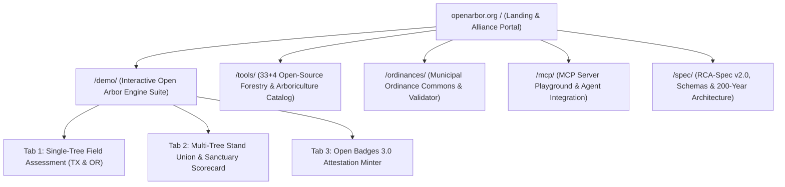

# Open Arbor (`openarbor.org`) Website, Live Tool Suite Demo, and Google Cloud Run Deployment Plan

**Document ID:** `OA-PLAN-2026-15`
**Date:** 2026-10-29
**Status:** Architecture and Implementation Plan (Ready for Implementation Team Handoff)
**Canonical Repository:** `/home/george/Myceliate_Master/UNDERSTORY/arboracle-ecosystem/openarbor` (`https://github.com/Arboracle-Ecosystem/openarbor.git`)
**Target Domain:** `https://openarbor.org` (Primary: Google Cloud Run; Mirror: GitHub Pages)

---

## 1. Recovery Receipt and Current Asset Inventory

### 1.1 Recovered GitHub Pages Application (Built by Hermes on 2026-10-28)

The static browser application built by Hermes is committed, verified, and live on GitHub Pages:

* **Live GitHub Pages URL:** `https://arboracle-ecosystem.github.io/openarbor/`
* **Published Branch and Commit:** `origin/gh-pages` at commit `f89c1e9bab1edd0e10f2c69c69c698be70a635f7` (`2026-10-28 20:49:40 -0500`)
* **Source Branch and Commit:** `master` (`origin/master`) at commit `f9bad001a5e3cd33ff18be435f9e95615ad084e8` (`feat(web): add mobile-first OpenArbor v2.0 static field tool and CLI parity proof`)

### 1.2 Local Filesystem Inventory

All source, bundle, and deployment artifacts reside in `/home/george/Myceliate_Master/UNDERSTORY/arboracle-ecosystem/openarbor/`:

| Path | Lines / Size | Current Role |
| :--- | :--- | :--- |
| `web/index.html` | 513 lines | Mobile-first single-page field tool shell with 3-step assessment wizard and 3 output panels |
| `web/app.js` | 1,225 lines | Browser controller importing `rootZone.js`, `ordinanceEngine.js`, `ecosystemBenefits.js`, and `rcaEngine.js` |
| `web/presets.js` | 614 lines | 3 Central Texas presets (`Case 1: Austin Live Oak`, `Case 2: Georgetown Pecan`, `Case 3: Liberty Hill Post Oak`) |
| `web/styles.css` | 651 lines | Sunlight-legible field stylesheet (48px touch targets, dark forest banner `#0C1A0E`, card layout) |
| `web/crypto-shim.js` | 117 lines | Pure-JS synchronous `sha256` and `randomUUID` shim aliasing `node:crypto` for browser bundling |
| `web/build.mjs` | 41 lines | `esbuild` bundler script producing `out/openarbor-bundle.js`, `out/index.html`, `out/styles.css`, and `out/.nojekyll` |
| `out/openarbor-bundle.js` | 219,024 bytes | Self-contained ESM browser bundle (zero external runtime dependencies) |
| `scripts/verify-web-cli-parity.mjs` | 145 lines | Automated parity harness verifying 21/21 metrics and SHA-256 hashes between CLI and browser bundle |
| `deploy/DEPLOY.md` | 79 lines | Build, parity verification, and `gh-pages` deployment instructions |
| `deploy/VERIFICATION.md` | 123 lines | Bit-for-bit CLI vs. browser parity proof across all 3 Central Texas benchmark cases |

### 1.3 Related Ecosystem Assets to Unify on `openarbor.org`

Beyond the `web/` field calculator, three additional local assets belong in the unified `openarbor.org` public portal:

1. **Open Arbor Core and 100x Substrate (`/home/george/Myceliate_Master/UNDERSTORY/arboracle-ecosystem/openarbor/`):**
   * `src/core/rootZone.js` (ANSI A300, ISA BMP, AS 4970-2009 SRZ, BS 5837:2012, 1-ft spatial grid union de-duplication)
   * `src/core/ordinanceEngine.js` (Data-driven municipal protection, mitigation, and Texas Oak Wilt season rules)
   * `src/core/ecosystemBenefits.js` (Nowak/McPherson allometrics, John White FCIN12 age estimation, OGC CRS84 GeoJSON export)
   * `src/core/rcaEngine.js` (`RCA-Spec v2.0` compiler, Mattheck $t/R$ shell biomechanics, Holobiont vs. CTLA valuation, Scientific Counter-Notice generator, Sanctuary Scorecard parcel rollup, Open Badges 3.0 `RCA-Verified` attestation minter, 5-year practice economics)
   * `server/mcp/openarbor-mcp.mjs` (6-tool Model Context Protocol stdio server over JSON-RPC 2.0)
   * `data/ordinances/central_texas_ordinances.json` (5 Texas cities) and `data/ordinances/rogue_valley_oregon_ordinances.json` (3 Oregon cities)
2. **Forest OS 33-Tool Open-Source Forestry Workbench (`/home/george/Myceliate_Master/ARBORETUM/Active/Forest_OS/`):**
   * `04_Configuration/forestry-tools.json` (Reconciled catalog of 33 open-source forestry tools and 4 supporting applications across 7 domains: `point-clouds`, `growth-and-fire`, `rings-and-biomass`, `canopy-imagery`, `field`, `canopy-photography`, and `audio`)
   * `04_Configuration/desktop/forest_workbench.html` (1,884-line interactive dark-forest workbench UI)
   * `01_Docs/FORESTRY_WORKBENCH.md` (Packaging tiers and 5-rung evidence grade ladder)
3. **Open Arbor Alliance Four-Pillar Manifest (`/home/george/Myceliate_Master/UNDERSTORY/arboracle-ecosystem/open-arbor/README.md`):**
   * Defines the four public pillars: **Open Arbor** (practitioner tools and `RCA-Spec`), **Open Arboretum** (living tree collections and phenology commons), **Open Forest** (watershed, stand-level LiDAR, and FVS modeling), and **Open Sanctuary** (200-year ecological stewardship and Sanctuary Scorecard).

---

## 2. Gap Analysis Between Current `web/` App and `openarbor.org`

Inspecting `web/index.html`, `web/app.js`, and `web/presets.js` against the full Open Arbor repository reveals six specific gaps for the implementation team to close:

1. **Single-Region UI Lock in `web/`:** `web/app.js` loads both `central_texas_ordinances.json` and `rogue_valley_oregon_ordinances.json` into `ALL_MUNICIPALITIES`, yet `web/index.html` hardcodes "Central Texas" in the jurisdiction label and `web/presets.js` only offers 3 Texas presets. The Rogue Valley, Oregon benchmark (`examples/ashland_oregon_white_oak_rca_v2.json`, a 105 cm DBH *Quercus garryana* in Ashland, OR) is not exposed in the preset bar.
2. **Unwired `rcaEngine.js` Exports in Browser UI:** `web/app.js` imports `computeSanctuaryScorecardRollup` (line 75) and `mintOpenBadgeAttestation` (line 81), and `src/core/rootZone.js` exports `unionRootZoneArea`, yet none of these three functions have interactive controls or output tabs in `web/index.html`.
3. **No Municipal Ordinance Commons Explorer or Schema Validator Tab:** Visitors cannot browse the 8 encoded cities (`tx-austin`, `tx-georgetown`, `tx-liberty-hill`, `tx-cedar-park`, `tx-round-rock`, `or-ashland`, `or-medford`, `or-grants-pass`), inspect statutory citations and `UNVERIFIED` markers, or validate a new municipal JSON draft against `schemas/municipal-ordinance.schema.json` in the browser.
4. **No Interactive MCP Server Playground:** `server/mcp/openarbor-mcp.mjs` exposes 6 deterministic tools (`calculate_root_zone`, `evaluate_ordinance`, `calculate_ecosystem_benefits`, `rca_biomechanics`, `rca_lint`, `lookup_ordinance`), yet the web app has no view showing AI agent integration, live JSON-RPC 2.0 request/response payloads, or copyable `claude_desktop_config.json` and Hermes config blocks.
5. **No Unified 33-Tool Forestry Workbench Catalog:** The 33 open-source forestry tools cataloged in `Forest_OS/04_Configuration/forestry-tools.json` (3DFin, CloudCompare, Forest3D, FVS, TreeRingCracker, CrownSegmenter, GroundData, hemispheR, BirdNET, and 24 others) are currently isolated in the local `Forest_OS` desktop file rather than browseable alongside the Open Arbor core engines on `openarbor.org`.
6. **Public Brand Mark Formatting and Cloud Run Packaging:** Per `docs/13_RCA_PRACTICE_SPECIFICATION_v1.md` Section 1.2, all public-facing prose and titles must use the spaced two-word mark **Open Arbor** (retaining unspaced `openarbor` only for package names, CLI commands, and repository paths). In addition, the repository lacks a `Dockerfile`, `nginx.conf`, and `cloudbuild.yaml` to deploy `openarbor.org` on Google Cloud Run (`GCR`).

---

## 3. Target Information Architecture and Route Map for `openarbor.org`

The `openarbor.org` site will compile into the `out/` static directory so the identical build artifact serves both **Google Cloud Run (`openarbor.org`)** via `nginx:1.27-alpine` on port `8080` and the **GitHub Pages mirror (`https://arboracle-ecosystem.github.io/openarbor/`)**. All internal asset links will use relative paths so sub-path hosting on GitHub Pages and root-domain hosting on `openarbor.org` both work without modification.



### 3.1 Route `/` (`out/index.html`): Open Arbor Landing and Alliance Portal

* **Hero Section:**
  * Title: **Open Arbor: The Open-Standards Operating Engine for Arboriculture and Urban Forestry**
  * Subtitle: Deterministic root-zone physics, data-driven municipal code compliance, holobiont valuation, and `RCA-Spec v2.0` evidentiary reporting. Zero vendor lock-in. 200-year data sovereignty.
  * Primary CTAs: **Launch Live Engine Demo (`/demo/`)**, **Explore the 37-Tool Catalog (`/tools/`)**, and **`npx openarbor-mcp` / `npm install openarbor` Quick Start**.
* **The Four Pillars of the Open Arbor Alliance:**
  * Interactive cards for **Open Arbor** (practitioner engines and `RCA-Spec v2.0`), **Open Arboretum** (living collections and phenology commons), **Open Forest** (33-tool stand, LiDAR, and fire modeling suite), and **Open Sanctuary** (5-dimension ecological scorecard and 200-year Heartwood records).
* **Live Parity Proof Strip:**
  * Displays the verified benchmark badge (`4/4 Benchmark Cases Bit-for-Bit Identical Between Node.js CLI and Browser Bundle`), linking directly to `/demo/` and the SHA-256 verification report.
* **Architecture Overview:**
  * Explains the three distribution surfaces: ESM Library (`openarbor`), CLI (`openarbor-rca`), and Model Context Protocol Server (`openarbor-mcp`).

### 3.2 Route `/demo/` (`out/demo/index.html`): Interactive Field and Lab Engine Suite

Upgrades Hermes's current `web/` application into a 3-mode interactive workspace running 100% locally in the browser via `openarbor-bundle.js`:

* **Mode 1: Single-Tree Field Assessment (`RCA-Spec v2.0` + Municipal Ordinance + Ecosystem Benefits)**
  * **Bioregional Preset Bar (4 One-Tap Presets):**
    1. `Austin, TX: 30 in Heritage Live Oak` (*Quercus virginiana*, benchmark `case-1-austin-live-oak.json`)
    2. `Georgetown, TX: 28.4 in Multi-Stem Heritage Pecan` (*Carya illinoinensis*, benchmark `case-2-georgetown-pecan.json`)
    3. `Liberty Hill, TX: 20 in Protected Post Oak` (*Quercus stellata*, benchmark `case-3-liberty-hill-post-oak.json`)
    4. `Ashland, OR: 105 cm (41.3 in) Heritage Oregon White Oak` (`examples/ashland_oregon_white_oak_rca_v2.json`)
  * **Bioregion Filter & 8-City Jurisdiction Selector:** Groups jurisdictions by region (`Central Texas` and `Rogue Valley, Oregon`) and displays statutory citations plus an explicit warning badge whenever a city record contains `UNVERIFIED` fields (`tx-round-rock`, `or-medford`, `or-grants-pass`).
  * **Outputs A, B, and C:** Retains all existing outputs (Municipal Verdict, SVG Root Protection Map with CRZ/TPZ/SRZ rings, Nowak/McPherson Allometrics, Holobiont vs. CTLA Valuation, 5-Year Practice Economics, OGC CRS84 GeoJSON, Markdown Evidentiary Report, Scientific Counter-Notice, and `RCA_v2` JSON) with one-tap download and clipboard copy.
* **Mode 2: Multi-Tree Stand Union and Sanctuary Scorecard Rollup**
  * **Interactive Stand Builder:** Allows adding 2 to 20 trees on a parcel with `(x, y)` foot coordinates (or loading a pre-built 4-tree oak mott preset) and calls `unionRootZoneArea(trees)` from `src/core/rootZone.js`.
  * **Spatial De-Duplication Proof:** Displays gross summed CRZ/TPZ area vs. de-duplicated 1-ft grid union area (`overlap_reduction_sq_ft` and percentage saved), paired with a multi-tree SVG root-zone union canvas.
  * **Parcel Sanctuary Scorecard Rollup:** Calls `computeSanctuaryScorecardRollup(assessments)` from `src/core/rcaEngine.js` to render the 5 parcel-level ecological dimensions (`Soil Health Index`, `Canopy Coverage`, `Water Dynamics`, `Biodiversity Baseline`, `Restoration Potential Score`) and composite tier (`Regenerative Sanctuary`, `Functional Canopy`, `Transitional Stand`, or `Degraded Site`).
* **Mode 3: Open Badges 3.0 (`RCA-Verified`) Attestation Minter**
  * **Live Credential Generator:** Calls `mintOpenBadgeAttestation(report, options)` in the browser using `crypto-shim.js` to produce a W3C Verifiable Credential / Open Badges 3.0 JSON-LD document binding the practitioner credential, municipality, tree identifier, and `report_sha256` digest.
  * **Tamper-Detection Verifier:** Lets the user edit a single character in the assessment payload to watch the SHA-256 hash mismatch trigger in real time.

### 3.3 Route `/tools/` (`out/tools/index.html`): The 37-Tool Open-Source Forestry and Arboriculture Catalog

Integrates the 4 Open Arbor core ESM engines (`rootZone`, `ordinanceEngine`, `ecosystemBenefits`, `rcaEngine`) with the 33 open-source forestry tools and 4 supporting applications from `Forest_OS/04_Configuration/forestry-tools.json`:

* **Interactive Filter Bar:**
  * Filter by **7 Domains**:
    1. `Point Clouds & 3D Structure` (`3DFin`, `CloudCompare`, `Forest3D`, `SegmentAnyTree`, `Treeiso`, `3DTree-seg`, `FuelMap`, `Steps`, `treeX`, `VoxR`)
    2. `Growth, Yield & Fire Simulation` (`FVS`, `pyfvs`, `BurnP3+`, `FARSITE`, `FlamMap`, `Landis-II`)
    3. `Tree Rings & Allometric Biomass` (`TreeRingCracker`, `MtreeRing`, `globallometree`, `allodb`)
    4. `Canopy Imagery & Crown Segmentation` (`CrownSegmenter`, `DeepForest`, `detectree2`, `ForestSegNet`)
    5. `Field Inventory & Operations` (`GroundData`, `OpenForis Arena`, `QField`, `Forest Inventory Analysis`)
    6. `Hemispherical Canopy Photography` (`hemispheR`, `caiman`, `GLA`, `CanEye`)
    7. `Bioacoustics & Sanctuary Monitoring` (`BirdNET-Analyzer`, `AudioMoth`, `Arbimon`)
  * Filter by **Packaging Tier**: `Core Browser/Node ESM`, `Tier 1 (uv Python CLI)`, `Tier 2 (Native Desktop GUI)`, `Tier 3 (Container / Sidecar)`.
  * Filter by **Evidence Grade Badge**: `Cataloged`, `Recipe available`, `Installed`, `Smoke-tested`, `Workflow-qualified`.
* **Tool Detail Modal / Drawer:**
  * Shows upstream repository link, license, citation, primary inputs/outputs (`.las`, `.laz`, `.geojson`, `.csv`, `.tre`), and how the tool connects to the Open Arbor `RCA_v2` data pipeline.

### 3.4 Route `/ordinances/` (`out/ordinances/index.html`): Municipal Ordinance Commons and Live Validator

* **8-City Interactive Matrix:**
  * Displays all 8 currently encoded municipalities across Central Texas (`tx-austin`, `tx-georgetown`, `tx-liberty-hill`, `tx-cedar-park`, `tx-round-rock`) and Rogue Valley, Oregon (`or-ashland`, `or-medford`, `or-grants-pass`).
  * Shows ordinance code section, regulated DBH thresholds, heritage DBH thresholds, mitigation replacement ratios, fee-in-lieu rates, Oak Wilt seasonal window, and verification status (`Verified Primary Statute` vs. `Threshold-and-Fee Stub with UNVERIFIED Markers`).
* **In-Browser Schema Validator:**
  * Embeds `schemas/municipal-ordinance.schema.json` and the `validateAgainstSchema` logic from `scripts/validate-ordinance.mjs` (including the `Object.hasOwn` prototype-pollution guard from commit `86211ef`).
  * Contributors can paste or edit a municipal ordinance JSON record in the browser, run instant validation, and copy a ready-to-submit Pull Request payload following `data/ordinances/CONTRIBUTING_DATA.md`.

### 3.5 Route `/mcp/` (`out/mcp/index.html`): MCP Server Playground and AI Agent Integration

* **Interactive 6-Tool Simulator:**
  * Lets visitors select any of the 6 MCP tools (`calculate_root_zone`, `evaluate_ordinance`, `calculate_ecosystem_benefits`, `rca_biomechanics`, `rca_lint`, `lookup_ordinance`), adjust input parameters, and inspect the exact JSON-RPC 2.0 `tools/call` request and deterministic response payload executed via the in-browser Open Arbor engine bundle.
* **Copy-Paste Configuration Snippets:**
  * Provides one-click copy blocks for `claude_desktop_config.json`, Cursor, Windsurf, and Hermes (`npx -y openarbor` or `node server/mcp/openarbor-mcp.mjs`).

### 3.6 Route `/spec/` (`out/spec/index.html`): `RCA-Spec v2.0` and Schema Reference

* Renders the normative sections of `docs/13_RCA_PRACTICE_SPECIFICATION_v1.md` and `docs/14_OPENARBOR_PLATFORM_100X.md` with anchor links, formula reference tables, and direct downloads for:
  * `/schemas/rca-assessment.schema.json`
  * `/schemas/municipal-ordinance.schema.json`

---

## 4. Brand Hygiene, Visual Design System, and Parity Guarantees

### 4.1 Naming and Editorial Standards

1. **Spaced Public Mark:** Every HTML `<title>`, navigation bar, hero heading, and prose paragraph on `openarbor.org` must use the two-word spaced mark **Open Arbor** and **Open Arbor Alliance** (`docs/13_RCA_PRACTICE_SPECIFICATION_v1.md` Section 1.2). Unspaced `openarbor` is restricted to `npm` package names (`npm install openarbor`), CLI binaries (`openarbor-rca`, `openarbor-mcp`), and GitHub repository URLs.
2. **House Style Gate (`gate.py`):** Every HTML text block and Markdown file must pass `/usr/bin/python3 /home/george/.hermes/skills/writing/match-my-writing-style/scripts/gate.py` with zero em dashes, zero en dashes, zero exclamation points, zero spaced hyphens used as punctuation, and zero AI filler vocabulary.
3. **Honest Evidence Labeling:** Unverified municipal fields in `tx-round-rock`, `or-medford`, and `or-grants-pass` must render with visible `UNVERIFIED` badges in both `/demo/` and `/ordinances/`. Tools in `/tools/` must display their exact evidence grade from `forestry-tools.json`.

### 4.2 Design Tokens and Field Accessibility

The site will share a single CSS token sheet (`web/styles.css`) supporting both **Sunlight Field Mode** (high-contrast light surface for outdoor tablet/phone use under canopy) and **Canopy Dark Mode** (matching the Forest OS workbench aesthetic):

| Token | Value | Purpose |
| :--- | :--- | :--- |
| `--oa-forest-deep` | `#0C1A0E` | Top navigation banner, footer, and Canopy Dark primary background |
| `--oa-forest-canopy` | `#1E3A2B` | Primary brand header, active tab surface, and primary CTA buttons |
| `--oa-soil-bark` | `#5D4A38` | Structural biomechanics accents and SRZ ring stroke |
| `--oa-fern-green` | `#7EA172` | Verified badges, CRZ ring stroke, and positive ecological metrics |
| `--oa-heartwood-gold` | `#D4B86A` | Heritage status badges, TPZ ring highlight, and Open Badges seal |
| `--oa-field-paper` | `#F6F5F0` | Sunlight-legible warm paper background for `/demo/` field forms |
| `--oa-font-display` | `'Fraunces', Georgia, serif` | Section headings and report titles |
| `--oa-font-sans` | `'Inter', system-ui, sans-serif` | Form labels, controls, and body copy (minimum `16px`, `48px` touch targets) |
| `--oa-font-mono` | `'JetBrains Mono', monospace` | SHA-256 digests, statutory citations, JSON-RPC payloads, and formulas |

### 4.3 CLI vs. Browser Parity Guarantee (4-Case Gate)

`scripts/verify-web-cli-parity.mjs` (`npm run verify:parity`) will be expanded from 3 cases to **4 cases** by adding `examples/ashland_oregon_white_oak_rca_v2.json` (`or-ashland`). A build cannot be deployed to Cloud Run or GitHub Pages unless all 4 benchmark cases produce bit-for-bit identical numerical outputs and `report_sha256` digests between `bin/openarbor-rca.mjs` and `out/openarbor-bundle.js`.

---

## 5. Google Cloud Run (`GCR`) and GitHub Pages Dual Deployment Architecture

Following the proven static container pattern in `/home/george/Myceliate_Master/ARBORETUM/Active/Soilgrower.com/`, `openarbor.org` will run on **Google Cloud Run** as an immutable `nginx:1.27-alpine` container serving the pre-built `out/` directory on port `8080`. Because all computation happens client-side inside `out/openarbor-bundle.js`, the container has zero runtime attack surface, sub-50ms response times, and scales to zero when idle.

### 5.1 Repository Deployment Files to Add

1. **`Dockerfile` (Root of `openarbor` repository):**
   * Multi-stage build:
     * **Stage 1 (`node:20-alpine`):** Copies repository source, runs `npm ci`, runs `npm test`, `npm run test:mcp`, `npm run build:web`, and `npm run verify:parity` so an image cannot build if any test or parity check fails.
     * **Stage 2 (`nginx:1.27-alpine`):** Copies `deploy/nginx.conf` to `/etc/nginx/conf.d/default.conf` and copies `out/` to `/usr/share/nginx/html/`. Exposes port `8080`.
2. **`deploy/nginx.conf`:**
   * Listens on `8080`.
   * Enables `gzip` for `text/html`, `text/css`, `application/javascript`, `application/json`, and `application/geo+json`.
   * Sets `absolute_redirect off;` and `port_in_redirect off;` (preventing port `8080` redirect leaks behind the Cloud Run load balancer, matching `Soilgrower.com/nginx.conf`).
   * Maps clean URLs (`/demo`, `/tools`, `/ordinances`, `/mcp`, `/spec`) via `try_files $uri $uri/ $uri/index.html =404;`.
   * Serves `/schemas/*.schema.json` with `Access-Control-Allow-Origin: *` and `Content-Type: application/schema+json` so external JSON validators and IDEs can fetch schemas directly from `https://openarbor.org/schemas/rca-assessment.schema.json`.
   * Adds security headers (`X-Content-Type-Options: nosniff`, `X-Frame-Options: SAMEORIGIN`, `Referrer-Policy: strict-origin-when-cross-origin`).
3. **`cloudbuild.yaml`:**
   * Builds `us-central1-docker.pkg.dev/$PROJECT_ID/cloud-run-source-deploy/openarbor:$COMMIT_SHA`.
   * Pushes image to Artifact Registry.
   * Deploys to Cloud Run service `openarbor` in `us-central1` (`--platform managed --allow-unauthenticated --port 8080 --memory 256Mi --cpu 1 --max-instances 5`).

### 5.2 Custom Domain Cutover Procedure (`openarbor.org`)

Once the Cloud Run service `openarbor` is deployed and verified on its `.run.app` URL, George (or the implementation team with George's confirmation) maps `openarbor.org`:

1. Map root domain and `www` subdomain in Cloud Run:
   ```bash
   gcloud beta run domain-mappings create --service openarbor --domain openarbor.org --region us-central1
   gcloud beta run domain-mappings create --service openarbor --domain www.openarbor.org --region us-central1
   ```
2. Configure the DNS records at the `openarbor.org` registrar using the Google Cloud Run anycast records returned by `gcloud beta run domain-mappings describe`:
   * Four `A` records for `@` (`216.239.32.21`, `216.239.34.21`, `216.239.36.21`, `216.239.38.21`)
   * Four `AAAA` records for `@` (`2001:4860:4802:32::15`, `2001:4860:4802:34::15`, `2001:4860:4802:36::15`, `2001:4860:4802:38::15`)
   * One `CNAME` record for `www` pointing to `ghs.googlehosted.com.`
3. Managed TLS certificate provisioning completes automatically once DNS propagates.

---

## 6. Phased Work Breakdown for the Implementation Team

The implementation team should execute this build in five sequential work packages (`WP-1` through `WP-5`), committing after each verified gate:

### WP-1: Data and Bundle Pipeline Expansion (`web/build.mjs` and `web/data/`)

* **Tasks:**
  1. Copy `Forest_OS/04_Configuration/forestry-tools.json` into `data/catalog/forestry-tools.json` inside the `openarbor` repository so the build is self-contained and reproducible inside Docker.
  2. Update `web/build.mjs` to bundle the shared browser core (`out/openarbor-bundle.js`), copy `schemas/*.schema.json` into `out/schemas/`, copy `data/ordinances/*.json` into `out/data/ordinances/`, and generate the multi-route HTML directories (`out/index.html`, `out/demo/index.html`, `out/tools/index.html`, `out/ordinances/index.html`, `out/mcp/index.html`, `out/spec/index.html`).
  3. Expand `web/presets.js` with `Case 4: Ashland, OR 105 cm Heritage Oregon White Oak` (`examples/ashland_oregon_white_oak_rca_v2.json`) and a multi-tree stand preset for the Sanctuary Scorecard rollup.
  4. Expand `scripts/verify-web-cli-parity.mjs` to verify all 4 presets (3 Texas + 1 Oregon).
* **Acceptance Gate:** `npm run build:web && npm run verify:parity` passes 4/4 cases (28/28 metrics bit-for-bit identical).

### WP-2: `/demo/` Interactive Engine Suite Upgrade (`web/demo/`)

* **Tasks:**
  1. Move the current single-tree assessment UI to `/demo/` while keeping a clean redirect or launch button from `/`.
  2. Update the jurisdiction selector in `/demo/` to group all 8 municipalities by bioregion (`Central Texas` and `Rogue Valley, Oregon`) and display `UNVERIFIED` warnings where present.
  3. Add **Mode 2: Multi-Tree Stand Union & Sanctuary Scorecard Rollup** calling `unionRootZoneArea` and `computeSanctuaryScorecardRollup`, complete with an interactive multi-tree SVG root protection map.
  4. Add **Mode 3: Open Badges 3.0 (`RCA-Verified`) Attestation Minter** calling `mintOpenBadgeAttestation` with live SHA-256 tamper verification.
  5. Standardize all headings and labels to spaced **Open Arbor**.
* **Acceptance Gate:** All 3 modes execute with zero console errors, 100% offline/client-side execution, and `npm run verify:parity` passes 4/4.

### WP-3: `/tools/`, `/ordinances/`, `/mcp/`, and `/spec/` Views

* **Tasks:**
  1. Build `/tools/` rendering all 33 Forest OS open-source forestry tools + 4 supporting apps + 4 Open Arbor core engines (41 total entries) with domain filters, tier filters, and evidence grade badges.
  2. Build `/ordinances/` displaying the 8-city comparison table, statutory citations, and the in-browser JSON Schema validator powered by `schemas/municipal-ordinance.schema.json`.
  3. Build `/mcp/` providing the 6-tool interactive MCP request/response playground and copyable client configuration snippets.
  4. Build `/spec/` rendering `RCA-Spec v2.0` and Platform 100x documentation with downloadable schema links.
* **Acceptance Gate:** Every route loads with zero external JS CDN dependencies, passes mobile viewport checks at `375px` width, and passes `gate.py`.

### WP-4: `/` Landing Portal (`openarbor.org` Root)

* **Tasks:**
  1. Build the `openarbor.org` root landing page (`out/index.html`) presenting the Open Arbor mission, the Four Pillars of the Open Arbor Alliance, the 4/4 CLI-to-Browser Parity Proof badge, quick-start `npm` / `mcp` commands, and deep links into `/demo/`, `/tools/`, `/ordinances/`, `/mcp/`, and `/spec/`.
* **Acceptance Gate:** Full navigation flow across all 6 routes works with relative links (compatible with both `/` on `openarbor.org` and `/openarbor/` on GitHub Pages).

### WP-5: Google Cloud Run Containerization and Verification

* **Tasks:**
  1. Author `Dockerfile`, `deploy/nginx.conf`, `.dockerignore`, and `cloudbuild.yaml` modeled on `/home/george/Myceliate_Master/ARBORETUM/Active/Soilgrower.com/`.
  2. Update `deploy/DEPLOY.md` with both the Google Cloud Run (`gcloud builds submit` / `cloudbuild.yaml` + `openarbor.org` domain mapping) workflow and the GitHub Pages (`gh-pages` subtree mirror) workflow.
  3. Run the complete verification suite:
     * `npm test` (9/9 core & RCA tests)
     * `npm run test:mcp` (8/8 MCP server & security tests)
     * `npm run validate:ordinances` (8/8 TX & OR municipalities + negative prototype-pollution tests)
     * `npm run build:web && npm run verify:parity` (4/4 CLI vs. browser parity cases)
     * `/usr/bin/python3 /home/george/.hermes/skills/writing/match-my-writing-style/scripts/gate.py` across all new HTML/Markdown deliverables.
* **Acceptance Gate:** All 5 verification suites pass with zero errors; container builds cleanly and serves all 6 routes on local port `8080` before asking George for confirmation to push or deploy to Cloud Run.
